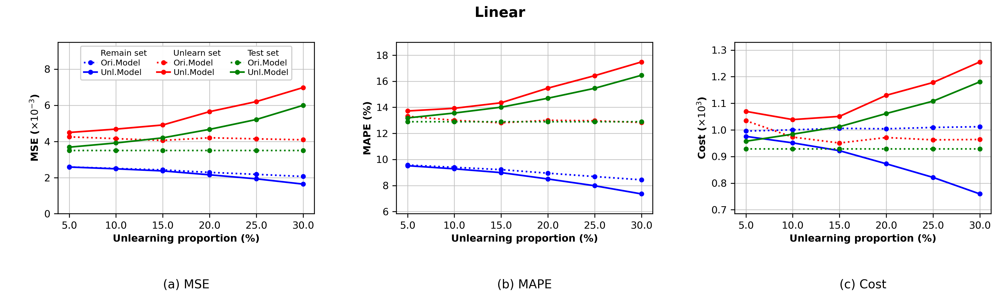
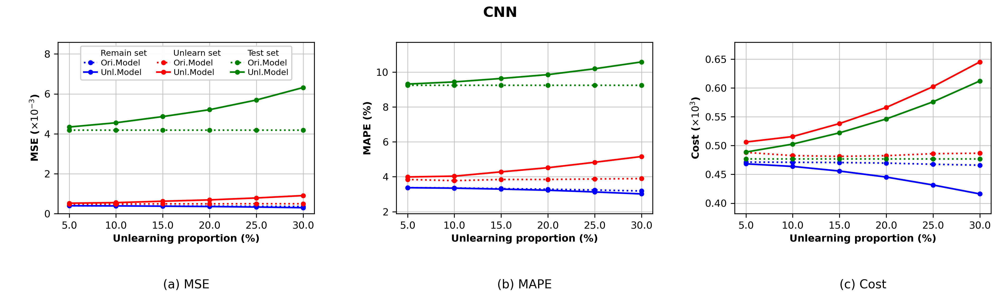
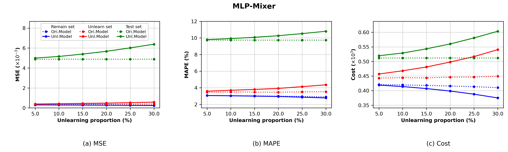

# Linear、CNN、MLP-Mixer 三联图复现报告

已使用完整官方 TX-123BT 年度数据完成三个模型、六个遗忘比例的 18 组基线实验，生成每个模型的 MSE / MAPE / Cost 三联图及独立单图。数值来自修复后的代码和当前实际训练检查点，版式参考用户提供的论文截图和原仓库 `analysis.ipynb`。

本次补跑 15 组实验，全部退出 0；另三组 20% 结果复用此前已完成的完整数据实验，原件保留，复制文件的 SHA-256 和原件逐字节一致。所有 486 个指标均有限且非负。未修改训练损失、cost 定义、优化目标或约束。代码与图表保存在独立分支 `fix/cost-evaluation`，未合并 master、未推送远程。

## 图表与数值文件

| 模型 | 三联图 PNG | 矢量 PDF | 独立 MSE / MAPE / Cost |
| --- | --- | --- | --- |
| Linear | [PNG](figs/linear/unlearning_metrics.png) | [PDF](figs/linear/unlearning_metrics.pdf) | [MSE](figs/linear/mse.png)、[MAPE](figs/linear/mape.png)、[Cost](figs/linear/cost.png) |
| CNN | [PNG](figs/cnn/unlearning_metrics.png) | [PDF](figs/cnn/unlearning_metrics.pdf) | [MSE](figs/cnn/mse.png)、[MAPE](figs/cnn/mape.png)、[Cost](figs/cnn/cost.png) |
| MLP-Mixer | [PNG](figs/mlp/unlearning_metrics.png) | [PDF](figs/mlp/unlearning_metrics.pdf) | [MSE](figs/mlp/mse.png)、[MAPE](figs/mlp/mape.png)、[Cost](figs/mlp/cost.png) |

独立单图也各有同名 PDF。共 12 个 PNG、12 个 PDF；三联图 PNG 为 3780 × 1140 像素，300 dpi，PDF 为矢量图。MLP 对应原仓库的 MLP-Mixer：`model=mlpmixer`、`model.type=nn_mixer`，输出目录使用 `figs/mlp`。

- [完整原始数值 CSV](figs/unlearning_metrics.csv)：54 行，三个集合 × 六个比例 × 三个模型；包括原模型、遗忘模型、重训练模型的三个指标，保留未缩放数值。
- [数值与运行溯源 JSON](figs/unlearning_metrics.json)：486 个标量，预处理数据、影响分数、核心检查点、结果文件和绘图脚本的 SHA-256，精确运行命令、退出码、复用来源及软件版本。可直接用于重绘。
- 原始结果、Hydra 配置及 15 份评估日志：`outputs/paper-proportions`。
- 批量运行日志：`/workspace/.cloud-setup/task-aware/paper-proportions.log`。







## 图例、单位与实验设置

横轴为 5%、10%、15%、20%、25%、30% 遗忘比例。蓝色为保留集，红色为遗忘集，绿色为测试集；点线为 `Ori.Model`，实线为 `Unl.Model`。图中遗忘模型对应原 `eval_unlearn.py` 的影响函数基线。

沿用 notebook 的缩放：MSE 乘 1000，纵轴单位为 10^-3；MAPE 原值已经是百分数；cost 除以 1000，纵轴单位为 10^3。绘图范围覆盖全部实际点，没有按论文固定上下界裁剪结果。没有插值补点、追描论文数值或跳过 cost。

采用 case14、`data_prop=1`、`train_prop=0.8`、`random_split=false`、`random_seed=42`、`unlearn_mode=helpful`。官方数据、预处理和环境验证见 [cost 复现报告](COST_REPRODUCTION_REPORT.md)。

2019 年共 8760 小时，训练集 7008、测试集 1752。CNN 与 MLP-Mixer 的核心集 2102、敏感训练集 4906；复用实际完成 100 epochs 的两个核心检查点，遗忘仍作用于重新解析拟合的最后仿射层。线性默认按 MSE influence 筛选候选集，NN 默认按 cost influence 筛选，均保留原设置。遗忘比例在线性中相对于 7008 条训练样本，在 NN 中相对于 4906 条敏感训练样本。

| 遗忘比例 | Linear 删除 / 保留 | CNN、MLP-Mixer 删除 / 保留 |
| ---: | ---: | ---: |
| 5% | 350 / 6658 | 245 / 4661 |
| 10% | 700 / 6308 | 490 / 4416 |
| 15% | 1051 / 5957 | 735 / 4171 |
| 20% | 1401 / 5607 | 981 / 3925 |
| 25% | 1752 / 5256 | 1226 / 3680 |
| 30% | 2102 / 4906 | 1471 / 3435 |

## 实际测试集 cost

以下保留原始 cost 单位，等于原项目定义的平均 `cost1 + cost2`，含两阶段削减和储存费用。原模型测试集 cost 在六个比例下一致：Linear 为 928.603650、CNN 为 476.944457、MLP-Mixer 为 511.728601。

| 遗忘比例 | Linear 遗忘后 | CNN 遗忘后 | MLP-Mixer 遗忘后 |
| ---: | ---: | ---: | ---: |
| 5% | 957.440177 | 488.763898 | 519.716452 |
| 10% | 984.007746 | 502.632707 | 528.983093 |
| 15% | 1012.208554 | 522.144732 | 543.321494 |
| 20% | 1061.601844 | 546.221348 | 560.110506 |
| 25% | 1108.116653 | 575.992420 | 580.673914 |
| 30% | 1180.611377 | 612.196711 | 603.476615 |

重训练对照的完整数值也已导出。18 组中的遗忘与重训练测试集 cost 最大差约 0.00108，保留原 CG 容差 1e-5 下的数值近似。新增 15 组的 CG 均报告 `info=0`。

## 复现命令

从仓库根目录执行；使用已有 `.venv`、真实预处理数据、两个核心检查点，以及 `outputs/real-full-double`、`outputs/real-conv`、`outputs/real-mixer` 下的完整 influence 文件。

```bash
export OMP_NUM_THREADS=1 OPENBLAS_NUM_THREADS=1 MKL_NUM_THREADS=1
export XDG_CACHE_HOME=/workspace/.cache
export MPLCONFIGDIR=/workspace/.cloud-setup/task-aware/matplotlib

# 本次实际运行：补跑 15 组，明确复用已核验的三组 20% 结果
.venv/bin/python scripts/reproduce_unlearning_figures.py --reuse-20-percent
.venv/bin/python scripts/plot_unlearning_proportions.py

# 已实际验证：不依赖原始 .npy，直接从导出的 JSON 重绘
.venv/bin/python scripts/plot_unlearning_proportions.py \
  --metrics-json figs/unlearning_metrics.json --output-dir /tmp/tamu-figures-redraw

# 本次重新执行的数值回归检查
.venv/bin/python -m pytest tests -q
```

不传 `--reuse-20-percent` 时，批量脚本会运行全部 18 组。每组均调用原 `eval_unlearn.py`，显式设置完整数据、固定划分/种子和正确 influence 路径；原始 Hydra 命令完整保存在 JSON 中。`--jobs 1` 可将并发限制为一个模型。

## 验证、修改与限制

26 项自动化 cost 回归测试全部通过，0 failed、0 skipped。所有 18 个结果文件通过 27 项指标检查；原模型在各比例的测试集 MSE、MAPE、cost 一致。三套三联图已逐张查看。12 个 PNG 能正常解码，12 个 PDF 有有效文件结构，PDF 元数据和文本检查通过。

已执行 JSON 重绘，并逐字节比较：全部 12 个 PNG、CSV、JSON 与首次导出一致；CSV 每个指标均与 JSON 对应原始数值一致。缺失实际结果时绘图脚本明确失败，没有创建替代图表。

新增 `scripts/reproduce_unlearning_figures.py`、`scripts/plot_unlearning_proportions.py`、本报告和 `figs` 中的图表/数值；更新 README 和此前 cost 报告的实验完成范围。本次未改动 cost 修复所涉及的数学源码或依赖版本。

当前 case14 三模型、六个比例的基线绘图流程没有未解决的必需环境阻断。GUROBI 的非生产许可证期限和规模限制、强制 ECOS 在部分输入上的不准确状态限制仍见此前 cost 报告；自动模式保持同一优化问题。本次没有验证完整 PUMU/TAMU 的跨比例曲线、case9、论文截图逐点一致性或新云任务恢复。大型原始数据和检查点仍保留在本地 ignored 路径，便携数值 JSON 与图表保存在分支中。
