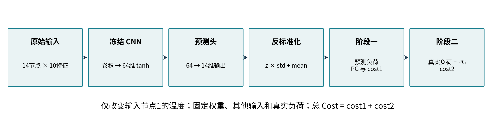
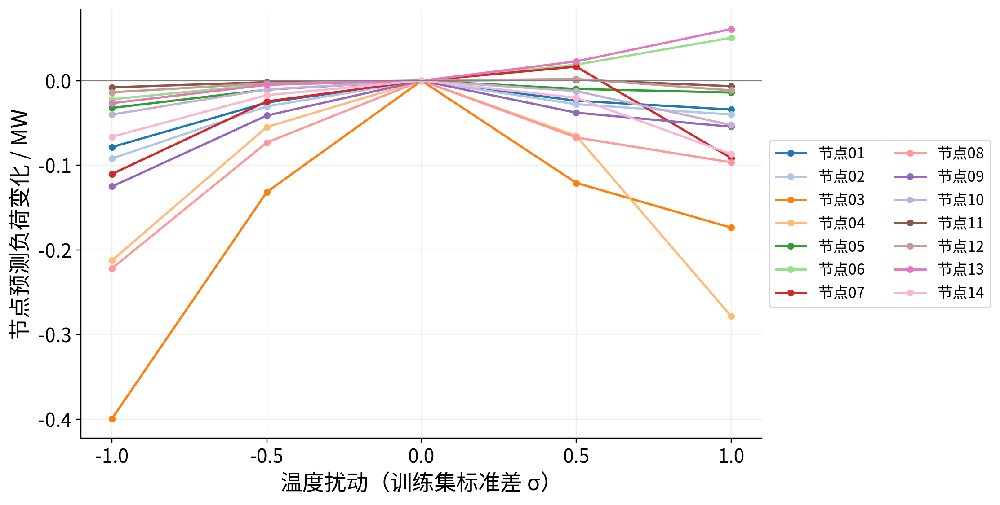
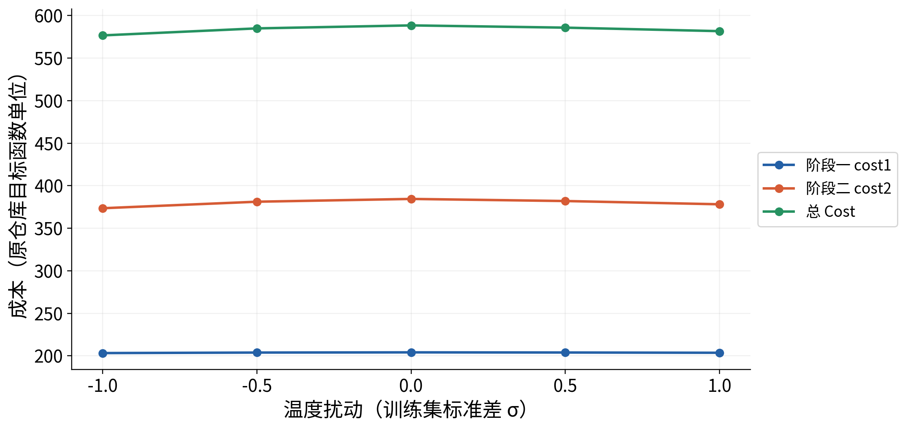
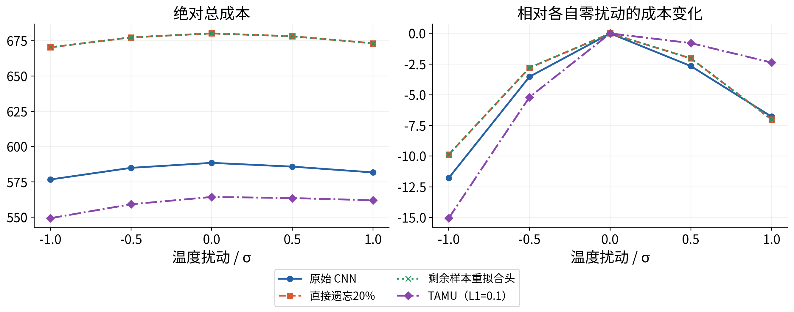

# 实验报告一：CNN 单节点温度扰动的预测与成本影响

单样本、五档扰动与20%遗忘前后对照

## 实验报告一｜单节点温度扰动

CNN 单输入特征扰动—负荷预测—电网运行成本

实验类型：固定模型的数值干预与两阶段运行成本评估。整理日期：2026-10-17。本报告汇编既有实测记录，没有重新训练模型或重新生成实验结果。

| 记录项 | 说明 |
| --- | --- |
| 结果版本 | analysis/cnn-temperature-response；提交 b5fd9f1 |
| 数据与系统 | 官方 TX-123BT 2019 合成测试系统数据；case14 |
| 固定条件 | seed=42，helpful，删除20%敏感样本；TAMU 平均L1=0.1 |
| 参考样本 | test index 0，源 Day 1 / Hour 1；不推断数据时区 |
| 实验规模 | 4模型 × 5档 = 20场景；280个逐节点预测；48次QP |
| 文档定位 | 本报告只讨论单样本；多日期验证见实验报告二 |


### 摘要

以已有CNN为基础，仅改变输入电网节点1的温度，幅度为训练集标准差的−1、−0.5、0、+0.5、+1倍。其他输入、模型权重及该样本真实负荷不变。实验贯通了输入编码、CNN前向传播、14节点负荷预测、阶段一调度和阶段二再调度的完整路径。

在原始CNN上，+1σ使总预测负荷变化−0.827542 MW，总Cost变化−6.778363；最大输出变化为节点4的−0.278248 MW。直接遗忘与剩余样本重拟合预测头的响应近乎重叠。TAMU在+1σ方向的Cost响应幅度较小，在−1σ方向反而更大，因此不能认定它全面降低敏感性。


### 本轮可支持的结论

- 一个温度输入会通过CNN的隐藏表示影响多个输出节点，并进一步改变两阶段运行成本。
- 绝对经济性与相对自身基准的响应幅度必须分别报告。
- 单点干预不代表真实天气事件，也不构成温度对实际负荷的因果证据。

## 1  数据、输入结构与标准化

原始CNN输入为(batch,1,14,10)，按预处理bus文件编号的数值顺序排列。140个原始编码值进入卷积网络，64维是学习到的tanh隐藏表示，不是64种物理特征。Load列是预测目标，不属于输入。

| 节点内零基索引 | 输入特征 | 模型所见表示 |
| --- | --- | --- |
| 0 | 星期正弦 | 周期编码 |
| 1 | 星期余弦 | 周期编码 |
| 2 | 小时正弦 | 周期编码 |
| 3 | 小时余弦 | 周期编码 |
| 4 | 温度 / 原单位K | 节点全年z-score |
| 5 | 短波辐射 / W·m⁻² | 节点全年z-score |
| 6 | 长波辐射 / W·m⁻² | 节点全年z-score |
| 7 | 纬向风速 / m·s⁻¹ | 节点全年z-score |
| 8 | 经向风速 / m·s⁻¹ | 节点全年z-score |
| 9 | 风速 / m·s⁻¹ | 节点全年z-score |

| 关键核验项 | 实际值 |
| --- | --- |
| 本次温度位置 | input[0,0,0,4]；140维展开零基索引4 |
| 节点对应 | 电网节点1 → bus_2.csv → 原TX零基索引2 / 标签3 |
| 训练/测试划分 | 训练7008行：全年行1752..8759；测试1752行：全年行0..1751 |
| 训练σ（ddof=0） | 0.935414141938 编码单位；7.936348491 K |
| 原全年统计（ddof=1） | 均值291.742801955 K；标准差8.484315268 K |
| 参考温度 | 277.344451904 K；float32编码-1.697055101395 |

训练σ仅由原训练段计算；原模型使用的全年归一化保持不变。选中节点8760小时原温度已与365个官方工作簿及预处理CSV逐小时核对。原项目先全年归一化再划分数据的限制仍存在。


## 2  方法：从输入到运行成本



CNN核心为两层卷积与ReLU，展平为280维，经线性层和tanh得到64维特征；再由仿射预测头输出14维标准化负荷。目标反标准化后以p.u.进入运行优化，MW仅用于结果展示。

```text
x_temperature(k) = x_temperature(0) + k * sigma_train
k in {-1, -0.5, 0, +0.5, +1}
forecast_pu = output_z * target_std + target_mean
forecast_MW = forecast_pu * 100
```


### 保留原始两阶段目标函数

阶段一：C1 = PGᵀ diag(q) PG + cᵀ PG + λ ΣLS1。阶段二：C2 = λ ΣLS2 + κ ΣLS2² + ρ ΣGS + η ΣGS²。总Cost=C1+C2。参数λ=3500、κ=1250、ρ=700、η=250。Cost沿用仓库目标函数单位，不解释为实际市场电价或美元/小时。

阶段一使用预测负荷；阶段二固定该样本真实负荷，并使用阶段一的PG。发电上下限、线路双向限额、功率平衡、LS/GS非负与参考角约束全部沿用原实现，未新增LS≤负荷或GS≤PG等约束。负预测沿用原逻辑截为0。

| 模型 | 本轮使用方式 |
| --- | --- |
| 原始 CNN | 敏感集拟合的原始预测头 |
| 直接遗忘20% | 20% helpful直接遗忘后的预测头 |
| 剩余样本重拟合头 | 剩余3925条敏感样本上重新拟合的预测头 |
| TAMU（L1=0.1） | 按Cost分数、平均L1=0.1重加权恢复的预测头 |

四模型共享同一个冻结CNN核心。“重新训练CNN”在这里仅指原项目协议下910个仿射参数的重新拟合，不是从头训练整个卷积网络。


## 3  原始CNN的负荷预测响应



| 扰动/σ | 总预测变化/MW | MSE/p.u.² | MAPE/% |
| --- | --- | --- | --- |
| -1 | -1.448131 | 0.006174719 | 9.388702 |
| -0.5 | -0.433243 | 0.006306180 | 9.345251 |
| +0 | +0.000000 | 0.006372556 | 9.347309 |
| +0.5 | -0.323389 | 0.006311210 | 9.304290 |
| +1 | -0.827542 | 0.006291866 | 9.384601 |

MSE和MAPE均对同一条样本的14个输出节点计算；它们不是全测试集平均指标。所有扰动保持真实负荷不变，仅评价预测器对编码温度变化的响应。

+1σ时，全部14个输出节点变化超过1e−6 MW，最大绝对变化出现在节点4，为−0.278248 MW。负荷总量的变化为−0.827542 MW。曲线在正、负扰动方向呈非对称响应，不宜以单一线性斜率概括。


## 4  两阶段成本与费用分解



| 扰动/σ | cost1 | cost2 | 总Cost |
| --- | --- | --- | --- |
| -1 | 203.198978 | 373.495723 | 576.694702 |
| -0.5 | 203.791202 | 381.151346 | 584.942548 |
| +0 | 204.044292 | 384.429257 | 588.473549 |
| +0.5 | 203.856545 | 381.956236 | 585.812781 |
| +1 | 203.562631 | 378.132555 | 581.695186 |

+1σ相对零扰动：cost1变化−0.481661，cost2变化−6.296702，总Cost变化−6.778363。主要变化来自阶段二GS过量发电处理费用；LS1和LS2的变化接近数值求解误差。该费用解释仅针对本参考样本。

| 原目标费用项 | +1σ相对零扰动变化 |
| --- | --- |
| 发电二次费用 | -0.340034 |
| 发电一次费用 | -0.141627 |
| 阶段一削减费用 | 约0（<1e−6） |
| 阶段二削减一次费用 | 约0（<1e−6） |
| 阶段二削减二次费用 | 约0（<1e−6） |
| GS一次费用 | -5.792791 |
| GS二次费用 | -0.503911 |


## 5  遗忘前后四种模型的响应



| 模型 | 零扰动Cost | +1σ Δ预测/MW | +1σ ΔCost | −1σ ΔCost |
| --- | --- | --- | --- | --- |
| 原始 CNN | 588.473549 | -0.827542 | -6.778363 | -11.778847 |
| 直接遗忘20% | 680.181358 | -0.844525 | -7.007316 | -9.869084 |
| 剩余样本重拟合头 | 680.180885 | -0.844474 | -7.006892 | -9.868670 |
| TAMU（L1=0.1） | 564.325866 | -0.290330 | -2.371888 | -15.057260 |

直接遗忘与重拟合头的五档总Cost最大差异为0.000472933，二者曲线近乎重叠。TAMU的零扰动绝对成本较低，+1σ时成本响应幅度也较小；但−1σ的响应幅度更大。这两种事实不矛盾：绝对成本与响应幅度衡量不同问题。

本实验没有为每档温度扰动重新优化TAMU权重。TAMU针对原测试平均Cost的一阶分数进行重加权，不提供逐场景成本或输入敏感性都下降的保证。


## 6  恢复核验、求解状态与复现

| 验收项 | 记录结果 |
| --- | --- |
| 模型恢复 | 前三种预测头及CNN核心与上一轮保存参数逐位相同 |
| TAMU恢复 | 全测试MSE=0.004006459731、MAPE=9.124598238%、平均Cost=470.887519328，与历史L1=0.1记录一致 |
| 加权CG | info=0；独立加权正规方程相对残差9.2462e−6 < 1e−5 |
| 零扰动 | 预测逐位恢复，Cost差为0 |
| 正式规模 | 20组模型场景；另有4次独立基准Cost，合计48个QP |
| 求解质量 | 全部optimal；最大约束残差1.69e-08 |
| 回归测试 | 该轮49项通过，0失败、0跳过；后来扩展为累计57项 |
| 重放 | 280个预测逐位相同；成本表和求解轨迹逐字节相同 |

3925变量的TAMU重加权LP受GUROBI内置许可证规模限制，按原有自动回退机制由ECOS求解同一LP；没有替换目标或约束。本轮小型运行QP使用GUROBI。调试中修正了新增核验脚本的权重/偏置展平顺序，并统一单样本前向，避免批量矩阵运算舍入差异被当作扰动效应。失败输出未用于最终结果。


### 复算入口（仓库根目录，输出目录须为空）

```text
.venv/bin/python experiments/input_sensitivity.py \
  --replay-from research/cnn_temperature_response \
  --output-dir /tmp/temperature-report-replay
```

```text
.venv/bin/python experiments/validate_temperature_response.py \
  --replay-dir /tmp/temperature-report-replay
```

数值记录来自既有实验validation.json与测试日志，本次编制报告没有重新运行上述实验。复算仍需原项目固定版本依赖及兼容求解器。


## 7  结论、局限与源码索引


### 结论

已完成指定温度坐标到14节点预测、两阶段决策及完整Cost的可追踪实验；直接遗忘与重拟合头响应接近，TAMU表现出方向相关的响应变化。该结果为下一轮节点成本诊断和多日期验证提供了固定模型、真实输入及可重放基准。


### 必须保留的解释边界

- 只有一个样本、一个输入节点、温度一个特征和seed42，不支持全年或跨系统结论。
- 输入编码的人工加法扰动保持真实负荷不变，不是实际发生的天气事件，也不证明气温对实际负荷的因果关系。
- 训练σ只用训练段，但原全年天气与目标归一化先于训练/测试划分；helpful与TAMU还使用测试性能分数。新增σ控制没有消除这些原协议局限。
- 成本是项目目标函数数值；没有使用真实市场电价，也没有在本实验中接入ERCOT数据。
| 源码/产物 | 用途 |
| --- | --- |
| clean_data.py / utils/dataset.py | 天气行映射、特征顺序、数据排列、标准化与划分 |
| utils/net.py: NN_CONV.forward | 14×10输入 → 64维隐藏表示 |
| func_operation.py / utils/funcs.py | 预测头恢复、预测反标准化和评价 |
| utils/optimization.py | 原两阶段调度、求解状态、变量与约束 |
| experiments/input_sensitivity.py | 独立扰动与完整结果保存 |
| research/cnn_temperature_response/ | 结果CSV、280个预测、费用轨迹、快照、验证记录 |

数据与模型来源：task_aware_machine_unlearning 原项目；Xu与Teng，Task-Aware Machine Unlearning and Its Application in Load Forecasting，IEEE TPWRS，DOI:10.1109/TPWRS.2024.3376828。TX-123BT数据的原始引用及官方归档信息见仓库COST_REPRODUCTION_REPORT.md与readme.md。


## 附录A  全部20组指标与数据索引

| 模型 | σ | MSE/p.u.² | MAPE/% | cost1 | cost2 | 总Cost |
| --- | --- | --- | --- | --- | --- | --- |
| 原始 | -1 | 0.00617472 | 9.3887 | 203.1990 | 373.4957 | 576.6947 |
| 原始 | -0.5 | 0.00630618 | 9.3453 | 203.7912 | 381.1513 | 584.9425 |
| 原始 | +0 | 0.00637256 | 9.3473 | 204.0443 | 384.4293 | 588.4735 |
| 原始 | +0.5 | 0.00631121 | 9.3043 | 203.8565 | 381.9562 | 585.8128 |
| 原始 | +1 | 0.00629187 | 9.3846 | 203.5626 | 378.1326 | 581.6952 |
| 直接 | -1 | 0.00792577 | 9.4882 | 209.9818 | 460.3305 | 670.3123 |
| 直接 | -0.5 | 0.00805634 | 9.5282 | 210.4996 | 466.8787 | 677.3783 |
| 直接 | +0 | 0.00812147 | 9.5557 | 210.7042 | 469.4772 | 680.1814 |
| 直接 | +0.5 | 0.00807102 | 9.5477 | 210.5564 | 467.5925 | 678.1490 |
| 直接 | +1 | 0.00803400 | 9.5223 | 210.1915 | 462.9826 | 673.1740 |
| 重拟合 | -1 | 0.00792579 | 9.4882 | 209.9818 | 460.3304 | 670.3122 |
| 重拟合 | -0.5 | 0.00805635 | 9.5282 | 210.4996 | 466.8784 | 677.3780 |
| 重拟合 | +0 | 0.00812148 | 9.5557 | 210.7042 | 469.4767 | 680.1809 |
| 重拟合 | +0.5 | 0.00807103 | 9.5476 | 210.5564 | 467.5922 | 678.1486 |
| 重拟合 | +1 | 0.00803401 | 9.5223 | 210.1914 | 462.9825 | 673.1740 |
| TAMU | -1 | 0.00548276 | 8.8619 | 201.2660 | 348.0026 | 549.2686 |
| TAMU | -0.5 | 0.00563926 | 8.8249 | 201.9684 | 357.1618 | 559.1302 |
| TAMU | +0 | 0.00573794 | 8.8436 | 202.3373 | 361.9886 | 564.3259 |
| TAMU | +0.5 | 0.00571380 | 8.8046 | 202.2837 | 361.2516 | 563.5353 |
| TAMU | +1 | 0.00574757 | 8.9112 | 202.1704 | 359.7836 | 561.9540 |

本附录显示值为便于阅读而四舍五入；未四舍五入的完整结果在随报告附带的evidence/experiment1_results.csv。14节点逐值结果在experiment1_predictions_14_buses.csv；完整求解费用及变量在原研究目录cost_traces.json。

本报告全部数值表由已提交CSV/JSON自动读取，source_manifest.json记录来源文件校验值；未填充缺失实验或虚构实验结果。
