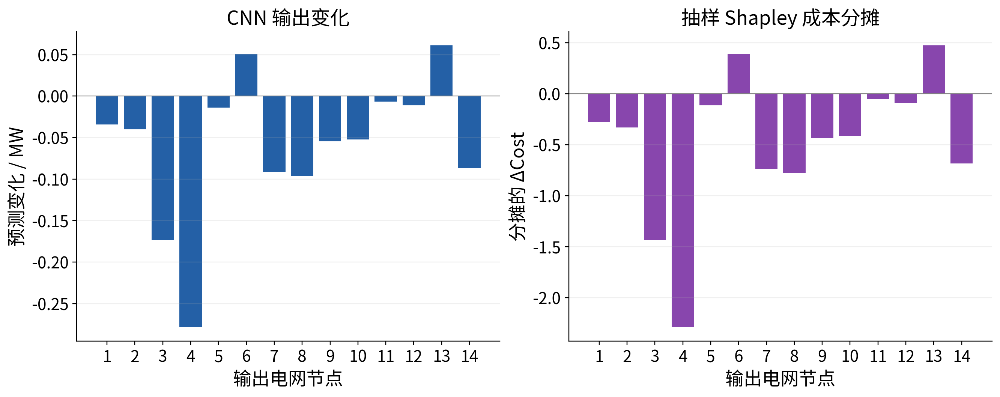
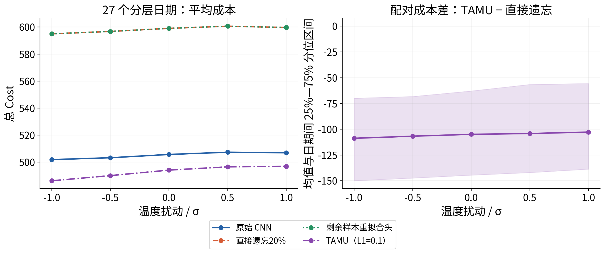
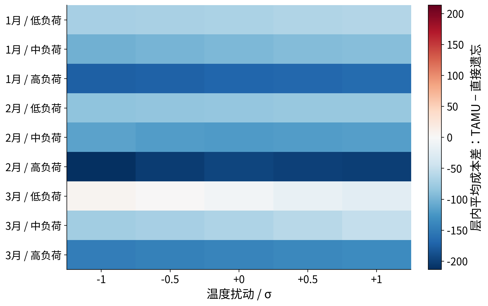
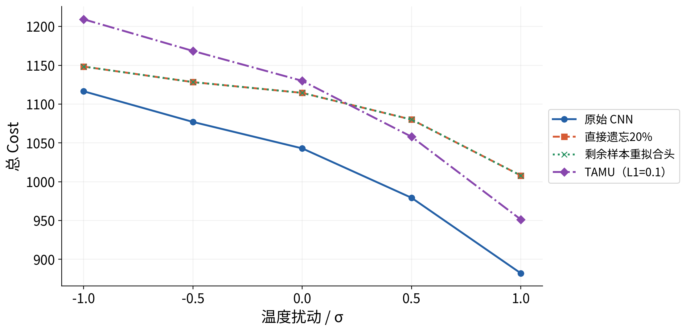

# 实验报告二：CNN 输出节点成本诊断与多日期验证

输出节点反事实、抽样Shapley与分层四模型经济性对照

## 实验报告二｜节点成本诊断与多日期验证

从单点影响路径扩展到输出节点诊断和多日期证据

整理日期：2026-10-17。本报告基于既有冻结CNN与四种预测头的实际评估记录，不重新训练模型、不改变Cost目标或数学约束。

| 记录项 | 说明 |
| --- | --- |
| 结果版本 | analysis/cnn-cost-attribution；提交 b527981 |
| 承接实验 | 复用实验一完全相同的四种冻结模型、训练σ和五档扰动 |
| 日期与负荷 | 27个预先分层的新日期 + 原参考点，合计28个不同日期 |
| 正式规模 | 560个模型场景、7840个预测值、8680次Cost评估、17360个QP |
| 节点诊断 | 隔离变化、从完整输出复位单节点；参考点128条抽样Shapley顺序 |
| 测试范围 | 2019-01-01至03-14，仅seed42、输入节点1温度 |


### 摘要

实验验证了最大预测变化输出节点与最大Cost影响节点是否相同，并比较TAMU在不同日期、不同真实负荷水平下的经济性。原始CNN的112组非零扰动对照中，预测峰值与隔离/复位成本峰值均一致；参考点的抽样Shapley检查也一致。隔离影响之和与联合Cost变化最大相差3.246397，说明不能将逐节点隔离影响直接当作严格加性贡献。

27个新增日期的108个非零扰动场景中，TAMU有106个比直接遗忘更便宜；五档分层平均Cost均较原始/直接遗忘低。但在3月12日的−1σ反例中，TAMU反而比直接遗忘贵60.929210，平均优势不构成逐场景保证。

正式实验全部QP返回optimal，最大约束残差7.38e−8；当时累计57项测试通过，完整复算一致。多日期结果仍只覆盖现有前73天测试期，不能推出全年、夏季、其他种子或ERCOT上的普遍结论。


## 1  研究问题与分层实验设计

问题一：预测变化最大的输出节点是否也是Cost影响幅度最大的节点？问题二：在相同温度扰动和真实负荷下，直接遗忘、重拟合头与TAMU的绝对经济性和响应是否改变？问题三：单点发现能否在预先选定的其他日期中观察到？

| 固定项 | 设置 |
| --- | --- |
| 模型与温度 | 实验一四种冻结预测头；input[0,0,0,4]；σ=0.935414141938编码单位 |
| 扰动 | −1、−0.5、0、+0.5、+1训练σ；仅改变一个输入坐标 |
| 控制 | 每个样本内部固定真实负荷、其他139输入、权重和系统约束 |
| 月份分层 | 1月、2月、3月；3月仅现有测试期的前14天 |
| 月内负荷分层 | 按真实总负荷的1/3、2/3分位分为低/中/高 |
| 每层取样 | 最接近层内10%、50%、90%负荷分位的小时，并约束日期不重复 |
| 样本数 | 3个月 × 3负荷层 × 3日期 = 27；另保留参考样本0，共28日期 |
| 汇总分母 | 分层平均与胜出率只用27个新日期，参考点不额外加权 |

选样只使用日期和真实总负荷，不查看任何模型预测或Cost。选择清单在推理前冻结；1752个测试时刻的真实总负荷选样池一并保存，能够独立重算选择规则。低/中/高仅是各月内部的相对水平。

数据仍来自官方TX-123BT合成测试系统，真实负荷指数据中的ground truth，而非额外接入的现实电网观测。输入、输出缩放、两阶段费用与约束均继承实验一。


## 2  输出节点成本诊断方法

记零扰动预测为f0、完整温度扰动后的预测为f1，C(f)表示在固定真实负荷下，按原两阶段优化求得的总Cost。全部14个坐标是预测输出节点，不是14个温度输入实验。

| 方法 | 定义与解释 |
| --- | --- |
| 隔离变化 | 仅令节点j采用f1[j]，其他输出保持f0；计算C(仅j变化)−C(f0) |
| 复位诊断 | 以完整f1为背景，仅将j复位为f0[j]；计算C(f1)−C(仅j复位) |
| 抽样Shapley | 按不同顺序逐一加入输出变化，平均每个节点对C的边际贡献 |

隔离与复位诊断对28个样本、4个非零扰动、14个输出节点执行，生成1568行诊断记录，每行包含两种影响。零扰动的Cost已在主实验实算，但没有变化的节点无需重复做同值诊断。


### 参考样本的抽样Shapley

仅在原始CNN参考样本0上，对四个非零温度水平进行Shapley分摊。使用64个独立随机排列及其逆序，共128条路径，seed42。相同输出子集的成本缓存复用，但每个新增子集都实际求解原两阶段QP。

```text
贡献_j(π) = C(π中j之前的集合 ∪ {j}) − C(π中j之前的集合)
Shapley_j = 64个逆序对边际均值的平均
MC标准误 = 对均值的样本标准差 / sqrt(64)
```

每条路径的边际值望远镜求和等于C(f1)−C(f0)。守恒仅验证分摊路径一致性，不意味着精确枚举了全部2^14个子集。MC标准误只反映顺序抽样误差，不包含求解误差、日期样本不确定性或模型训练不确定性。

混合输出向量未必对应任何可实现的真实CNN输入。这些方法是模型输出的反事实成本诊断，不能直接解释为物理控制因果，也不能把隔离影响之和当成严格的总成本分解。


## 3  节点诊断的实际结果



| 扰动/σ | 预测峰值节点 | 隔离Cost峰值 | 复位Cost峰值 | Shapley峰值 |
| --- | --- | --- | --- | --- |
| -1 | 3 | 3 | 3 | 3 |
| -0.5 | 3 | 3 | 3 | 3 |
| +0.5 | 3 | 3 | 3 | 3 |
| +1 | 4 | 4 | 4 | 4 |

在本参考样本中，−1σ、−0.5σ、+0.5σ的峰值为节点3，+1σ的峰值为节点4。+1σ下节点4预测变化−0.278248 MW，抽样Shapley分配ΔCost约−2.289145。这里按绝对幅度排名，符号仍保留。

跨28个日期的112组非零扰动，预测峰值与隔离/复位峰值均一致（不一致0次）。两种诊断的前两名绝对差均大于1e−4诊断阈值，但该阈值不是目标值误差的严格上界。不能据本批一致，推出“预测变化最大必然等于成本影响最大”。

隔离影响之和与联合ΔCost的最大差为3.246397。参考点Shapley总分配与联合ΔCost最大误差3.55e−15；其MC标准误约1e−9，小于求解误差量级时不应当作有效小数位或总体置信区间。


## 4  多日期四模型经济性比较



| σ | 原始均Cost | 直接遗忘 | 重拟合头 | TAMU | 低于直接 | 低于原始 |
| --- | --- | --- | --- | --- | --- | --- |
| -1 | 501.870 | 594.992 | 594.994 | 486.210 | 26/27 | 22/27 |
| -0.5 | 503.251 | 596.762 | 596.764 | 490.031 | 26/27 | 22/27 |
| +0 | 505.687 | 599.037 | 599.039 | 494.109 | 26/27 | 21/27 |
| +0.5 | 507.337 | 600.657 | 600.659 | 496.516 | 27/27 | 20/27 |
| +1 | 506.936 | 599.684 | 599.686 | 496.912 | 27/27 | 21/27 |

胜出以配对差值<−1e−4判定。所有模型使用同一批输入、同一真实负荷、相同Cost定义。均值在五档上均显示TAMU较原始和直接遗忘更便宜；108个非零场景中，TAMU相对直接遗忘胜出106个，相对原始胜出85个。

阴影为所选日期间的25%—75%分位区间，不是总体置信区间。27个日期不是随机总体抽样，同一模型下不同日期也可能相关；这些结果是当前固定模型的描述性对照。


## 5  月份与真实负荷分层结果



该图对1/2/3月的低、中、高负荷层分别汇总，避免只展示总体平均值。3月低负荷层的优势较弱，不能以其他层的较大改善掩盖这一差异。这里的低/中/高仅按对应月份内的真实总负荷划分，不代表全年绝对负荷等级。

日期清单和负荷阈值保存在selection.json与parent_provenance.json；选样池保存在cohort_inputs.npz。编制报告时没有增删日期，没有根据本轮Cost表现替换样本。

参考样本0不计入分层平均，防止在1月额外加权。绘图和均值均从paired_model_costs.csv与cohort_summary.csv读取，可与原始逐场景results.csv核对。


## 6  必须保留的反例



| 模型 | cost1 | cost2 | 总Cost |
| --- | --- | --- | --- |
| 原始 CNN | 156.357328 | 960.194340 | 1116.551668 |
| 直接遗忘20% | 155.863587 | 992.506741 | 1148.370328 |
| 剩余样本重拟合头 | 155.863511 | 992.512642 | 1148.376153 |
| TAMU（L1=0.1） | 155.001331 | 1054.298207 | 1209.299538 |

在同一真实总负荷478.328583 MW下，−1σ时TAMU总Cost为1209.299538，直接遗忘为1148.370328，前者更贵60.929210。该日期−0.5σ和零扰动也存在TAMU高于直接遗忘的情况；正向扰动后两者关系发生变化。

这一反例说明：整体平均Cost改善不等于每个日期、每个方向都更经济。TAMU使用原测试平均Cost分数恢复权重，没有对本次温度干预场景重新优化，也没有逐场景经济性约束。


## 7  工程验收与可复现性

| 验收项 | 实际记录 |
| --- | --- |
| 固定模型 | 四种快照与实验一字节相同；干预前后模型哈希不变 |
| 样本控制 | 28个不同日期；每次固定对应真实负荷；零扰动预测逐位一致、Cost差0 |
| 正式评估 | 560个模型场景、7840个预测；8680次Cost评估，即17360个QP |
| 节点/子集 | 1568行节点诊断；8232条子集成本记录（含复用主场景端点） |
| 求解状态 | 全部optimal，实际使用GUROBI |
| 约束与费用 | 最大约束残差7.38e−8；七项费用分解最大误差4.55e−13 |
| 累计回归测试 | 57项通过，0失败、0跳过；已包含实验一的49项，不能相加为106项 |
| 独立重放 | 7840个预测逐位一致；全部成本CSV与求解轨迹逐字节一致 |
| 下载包 | 在无Git元数据、无年度数据的解压目录完成57项测试及完整重放 |


### 复算入口

```text
.venv/bin/python experiments/cost_attribution.py \
  --replay-from research/cnn_cost_attribution \
  --output-dir /tmp/cost-path-report-replay
```

```text
.venv/bin/python experiments/validate_cost_attribution.py \
  --replay-dir /tmp/cost-path-report-replay
```

本次报告制作只读取以上已保存记录，未重新执行实验。逐字节复算一致是原固定环境与相同求解器的验证；换平台或兼容求解器可能出现数值差异。


## 8  结论、局限与后续工作


### 本轮结论

- 已建立输入温度→多个输出预测→两阶段Cost的可追踪路径，并区分隔离、复位与Shapley诊断含义。
- 本批112组原始CNN对照的峰值节点一致，但逐节点隔离影响不是可直接相加的总成本贡献。
- 所选27个日期中TAMU平均经济性较好，但存在明确较贵反例；不能将平均优势升级为逐场景或因果保证。

### 局限

测试期只覆盖2019年前73天，没有夏季/全年验证；只有seed42、一个输入节点和温度一个特征。分层样本不是随机总体样本，模型训练和日期间不确定性未被本轮MC标准误刻画。混合输出向量也未必是CNN可实现输入。

原全年归一化先于划分，helpful/TAMU使用测试性能信息的协议限制仍然存在。本实验中的ground truth属于官方合成测试数据，不代表已经接入ERCOT现实观测。


### 建议下一步（尚未执行）

- 在相同固定模型上扩展其他物理输入特征，先明确各自训练尺度和编码合法性，避免任意破坏sin/cos关系。
- 用多个种子与预先确定的场景评估稳定性；把平均Cost、最差Cost和输入敏感性分别报告。
- 如需夏季/全年独立测试，应重新设计时间划分和归一化评估，不能把原训练段直接称为独立测试。
- ERCOT正式Cost实验需先确定节点映射和负荷缩放方案；本轮没有开展该项工作。
| 源码/数据目录 | 说明 |
| --- | --- |
| experiments/cost_attribution.py | 冻结推理、反事实、抽样路径及实际Cost保存 |
| experiments/validate_cost_attribution.py | 样本池重算、全部真实负荷/预测向量、子集费用、重放验收 |
| research/cnn_cost_attribution/ | 原始结果、完整8680次Cost轨迹及模型/输入快照 |
| 本报告evidence/与source_manifest.json | 用于文档表格的原数据副本与来源SHA256 |


## 附录A  参考点+1σ的逐节点分摊

| 输出节点 | Δ预测/MW | Shapley cost1 | Shapley cost2 | Shapley总计 |
| --- | --- | --- | --- | --- |
| 1 | -0.034101 | -0.015455 | -0.261549 | -0.277005 |
| 2 | -0.040013 | -0.024502 | -0.306736 | -0.331238 |
| 3 | -0.173673 | -0.103445 | -1.329494 | -1.432939 |
| 4 | -0.278248 | -0.161712 | -2.127433 | -2.289145 |
| 5 | -0.014011 | -0.007961 | -0.107666 | -0.115627 |
| 6 | +0.050643 | +0.030603 | +0.360423 | +0.391026 |
| 7 | -0.091339 | -0.053658 | -0.685235 | -0.738892 |
| 8 | -0.096471 | -0.056673 | -0.723740 | -0.780413 |
| 9 | -0.054381 | -0.032126 | -0.403863 | -0.435989 |
| 10 | -0.052397 | -0.031080 | -0.386247 | -0.417327 |
| 11 | -0.006526 | -0.003907 | -0.047290 | -0.051196 |
| 12 | -0.011382 | -0.006866 | -0.081286 | -0.088152 |
| 13 | +0.061029 | +0.036763 | +0.436999 | +0.473763 |
| 14 | -0.086671 | -0.051643 | -0.633586 | -0.685228 |

表中Shapley是128条顺序的抽样估计，只适用于原始CNN参考点+1σ，不是对全部28日期的精确Shapley枚举。MC误差单独保存在reference_shapley.csv，不能当作求解精度或总体置信区间。


### 汇总分母说明

| 统计 | 分母 |
| --- | --- |
| 原始CNN节点峰值比较 | 28个日期 × 4个非零温度水平 = 112组 |
| TAMU非零经济性比较 | 27个新日期 × 4个非零水平 = 108场景；106场景低于直接遗忘 |
| 四模型主场景 | 28个日期 × 4模型 × 5温度水平 = 560组 |
| 分层平均成本 | 每个温度水平27个新日期；原参考点不计入 |
| 回归测试 | 实验二时累计57项；不与实验一49项相加 |
