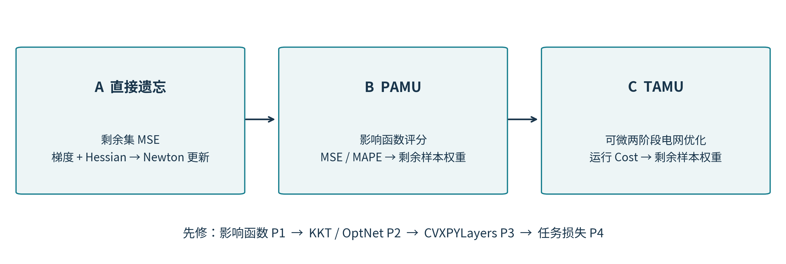
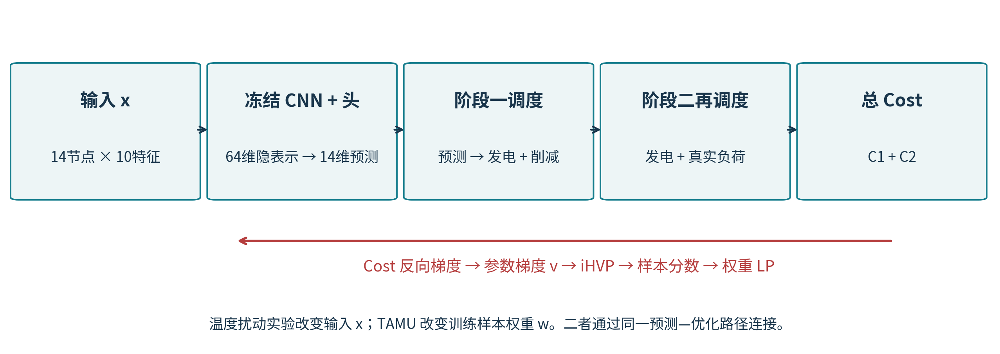

# 阅读范围与来源边界

**目标论文**：Wangkun Xu、Fei Teng，*Task-Aware Machine Unlearning and Its Application in Load Forecasting*，IEEE Transactions on Power Systems，2024。DOI：[10.1109/TPWRS.2024.3376828](https://doi.org/10.1109/TPWRS.2024.3376828)。用户指定入口：[arXiv 2308.14412](https://arxiv.org/html/2308.14412#S6)；[摘要页](https://arxiv.org/abs/2308.14412)；[PDF](https://arxiv.org/pdf/2308.14412)。

**必须先说明的核验限制**：本次环境访问 arXiv、IEEE、PMLR 等论文站点时，网络代理返回 403。已实际读取作者原仓库的论文摘要、算法实现，影响函数、OptNet、CVXPYLayers、task-based learning、certified removal 配套仓库，以及作者的可微凸优化讲义；**没有取得目标论文及铺垫论文的完整正文**。因此，本讲义是“作者代码核对 + 标准数学知识的独立推导”，不是已经逐页核对原文的正式精读定稿。以下 G 编号、算法 A/B/C、图及例子均为本讲义自编，不能当作原论文的公式、算法、定理编号。

本讲义可以帮助理解已核验代码所实现的方法；目标论文各版本的完整假设、证明细节和引用关系，仍需在取得 PDF 后逐项对照。文末书单是**理解方法的推荐先修文献**，并不声称它们全部出现在目标论文参考文献中。链接已经写入同一 Word，可以点击；被代理拦截的论文正文链接未完成在线有效性核验。

本材料不重新训练模型、不生成新的论文实验结果、不修改 Cost 数学模型。标注“教学例子”的数值来自随附脚本的独立计算；标注“项目既有实验”的数值来自已保存实验 CSV。二者分开解释。

## 先抓住三个问题

1. **直接遗忘**：删去一部分训练样本后，如何不从头拟合而得到接近剩余数据重训的参数？
2. **性能感知遗忘 PAMU**：删除样本会损伤 MSE/MAPE，能否通过调整剩余样本的重要性补偿？
3. **任务感知遗忘 TAMU**：预测误差不等于电网经济损失，能否用真正的调度成本指导这种补偿？

其中第一个问题需要“影响函数 / Newton 法”；第二个增加“外层性能梯度与样本权重”；第三个再增加“可微调度优化与链式求导”。论文方法的思想递进可由这三层理解。



# 先修论文与阅读路线

## 最短阅读顺序

先读 P1 的影响函数定义与参数扰动推导，再结合本讲义 G1—G8 手算一次删除；补 K1 的 KKT 与 Newton 知识；读 P2 的 QP 隐式求导和 P3 的可微凸优化层；最后读 P4 的任务损失思想，返回 TAMU 的样本评分和权重 LP。P5 帮助理解“参数更新接近重训”和“隐私认证”之间的区别。

| 层次 | 文献 | 解决的理解障碍 | 在本讲义的位置 |
|---|---|---|---|
| 核心 | P1 Koh & Liang，2017 | 为什么改变一个样本权重会产生 $-H^{-1}g_i$？ | 影响函数、评分正负号 |
| 核心 | P2 Amos & Kolter，2017，OptNet | 优化器为什么可以作为神经网络的一层？ | KKT 导数、伴随方程 |
| 核心 | P3 Agrawal 等，2019，CVXPYLayers | CVXPY 问题如何成为可微层？DPP 是什么？ | Cost 反向传播、实现 |
| 核心 | P4 Donti、Amos、Kolter，2017 | 为什么低 MSE 不保证低运行成本？ | TAMU 外层目标 |
| 边界 | P5 Guo 等，2020 | 什么才是有认证的数据删除？Newton 更新有哪些条件？ | 遗忘保证的边界 |
| 数学 | K1 Boyd & Vandenberghe，2004 | 凸性、对偶、KKT、Newton 法 | 全文推导基础 |

## 铺垫论文链接及具体读法

**P1．Understanding Black-box Predictions via Influence Functions**。Pang Wei Koh、Percy Liang，ICML 2017。论文：[PMLR 页面](https://proceedings.mlr.press/v70/koh17a.html)；[arXiv 1703.04730](https://arxiv.org/abs/1703.04730)。[作者代码](https://github.com/kohpangwei/influence-release)。已读取作者代码 README，标题、作者、会议与方法介绍可核对；正文未取得。

重点学习：经验风险极小点的驻点条件；单样本 upweight 的导数；测试损失的影响分数；如何避免显式构造逆 Hessian。读完应能够解释“增权”和“删除”为何符号相反。TAMU 继承的是这种局部敏感性工具，不是直接套用黑箱重要性排序。

**P2．OptNet: Differentiable Optimization as a Layer in Neural Networks**。Brandon Amos、J. Zico Kolter，ICML 2017。论文：[PMLR 页面](https://proceedings.mlr.press/v70/amos17a.html)；[arXiv 1703.00443](https://arxiv.org/abs/1703.00443)。[作者代码](https://github.com/locuslab/optnet)。已读取作者代码 README，书目信息及 QP 层思想可核对；正文未取得。

重点学习：带参数 QP 的原始—对偶变量；对 KKT 方程全微分；反向传播时求解转置线性系统。读完应能够解释“求解最优点”和“求最优点对输入的导数”是两次不同操作。

**P3．Differentiable Convex Optimization Layers**。Akshay Agrawal、Brandon Amos、Shane Barratt、Stephen Boyd、Steven Diamond、J. Zico Kolter，NeurIPS 2019。论文：[arXiv 1910.12430](https://arxiv.org/abs/1910.12430)；[作者 PDF](https://web.stanford.edu/~boyd/papers/pdf/diff_cvxpy.pdf)。[配套库](https://github.com/cvxgrp/cvxpylayers)。已读取库 README 和 BibTeX，题名与作者可核对；正文未取得。

重点学习：参数化凸问题、锥规划表示、规范化与恢复映射、DPP 的作用。项目使用 CVXPYLayers，不应把“Gurobi 可以解出一个数值最优解”当作“该数值求解调用自动具有 PyTorch 梯度”。

**P4．Task-based End-to-end Model Learning in Stochastic Optimization**。Priya L. Donti、Brandon Amos、J. Zico Kolter，NeurIPS 2017。论文：[arXiv 1703.04529](https://arxiv.org/abs/1703.04529)。[作者代码](https://github.com/locuslab/e2e-model-learning)。已读取作者 README，确认研究目的、书目信息和电网调度应用说明；正文未取得。

重点学习：预测误差与下游任务损失的区别；把预测送进决策模型，再按决策结果评价模型。TAMU 将这种任务损失思想用于删除数据之后的剩余样本重加权，而当前仓库的基础训练损失仍为 MSE。

**P5．Certified Data Removal from Machine Learning Models**。Chuan Guo、Tom Goldstein、Awni Hannun、Laurens van der Maaten，ICML 2020。论文：[arXiv 1911.03030](https://arxiv.org/abs/1911.03030)。[作者代码](https://github.com/facebookresearch/certified-removal)。已读取作者 README，确认 Newton 更新、梯度残差与认证删除的关系；正文未取得。

重点学习：删除后模型与重训模型的比较对象；梯度残差控制；噪声与认证保证所需额外条件。不能把本项目里“预测头参数差很小”直接升级为满足认证删除定义。

**K1．Convex Optimization**。Stephen Boyd、Lieven Vandenberghe，2004。这是教材，不是论文。免费入口：[教材主页](https://web.stanford.edu/~boyd/cvxbook/)；[PDF](https://web.stanford.edu/~boyd/cvxbook/bv_cvxbook.pdf)。建议阅读第 5 章的对偶与 KKT，第 9—10 章的 Newton / 等式约束最小化。链接未在当前代理环境下成功打开。

**K2．Fast Exact Multiplication by the Hessian**。Barak A. Pearlmutter，Neural Computation，1994。论文：[DOI 10.1162/neco.1994.6.1.147](https://doi.org/10.1162/neco.1994.6.1.147)。用于理解 Hessian-vector product；可在掌握主要推导后补读，不必先实现完整 Hessian。正文未取得。

## 扩展阅读：有明确用途再读

| 编号 | 文献及链接 | 适用问题 |
|---|---|---|
| E1 | Giordano 等，*A Swiss Army Infinitesimal Jackknife*，AISTATS 2019：[arXiv 1806.00550](https://arxiv.org/abs/1806.00550) | 理解用局部权重扰动近似重拟合，以及近似误差为何需要假设 |
| E2 | Bourtoule 等，*Machine Unlearning*，IEEE S&P 2021：[arXiv 1912.03817](https://arxiv.org/abs/1912.03817) | 对照 SISA 这类预先设计训练过程的遗忘方法 |
| E3 | Elmachtoub、Grigas，*Smart “Predict, then Optimize”*，Management Science 2022：[arXiv 1710.08005](https://arxiv.org/abs/1710.08005) | 扩展理解决策导向预测；不是本仓库已实现的损失函数 |
| E4 | *A Synthetic Texas Backbone Power System with Climate-Dependent Spatio-Temporal Correlated Profiles*：[arXiv 2302.13231](https://arxiv.org/abs/2302.13231)；[官方数据页](https://rpglab.github.io/resources/TX-123BT/) | 理解实验数据是合成测试系统的数据，而非 ERCOT 实地观测 |
| E5 | Tolstikhin 等，*MLP-Mixer: An all-MLP Architecture for Vision*，2021：[arXiv 2105.01601](https://arxiv.org/abs/2105.01601) | 仅当需要理解项目另一个特征提取器时阅读 |

E1—E5 以推荐背景材料列出，未在本次环境中取得正文；E4、E5 的链接也出现在原项目 README。它们不是理解 CNN + TAMU 主线的必读前置条件。

# 符号、形状与被遗忘的对象

| 符号 | 含义 | 当前 CNN 实验中的对应 |
|---|---|---|
| $D$、$U$、$R$ | 原拟合集、删除集、剩余集，$D=U\cup R$ | CNN 的敏感集，而非全部 core + sensitive 数据 |
| $n,k,m$ | 上述集合大小，$n=k+m$ | 4906、981、3925 |
| $x$ | 一条原始编码输入 | $1\times14\times10$，140 个输入值 |
| $h_\phi(x)$ | 冻结特征提取器 | CNN 输出的 64 维 tanh 隐表示 |
| $f_\theta$ | 可更新预测器 | $W h_\phi(x)+b$，输出 14 维 |
| $\theta$ | 被拟合/遗忘的参数向量 | $14\times64+14=910$ 个头部参数 |
| $\ell_i(\theta)$ | 第 $i$ 个训练样本的 MSE | 对该样本 14 个节点误差求平均 |
| $L_S$、$H_S$ | 集合 $S$ 的平均训练损失及 Hessian | 不是 Cost 的 Hessian |
| $J$ | 外层评估损失 | MSE、MAPE 或两阶段 Cost 的平均 |
| $w_i$ | 剩余训练样本的完整权重 | 以 1 为基准，当前约束下为 $[0,2]$ |

**三个容易混淆的量**：$\nabla_\theta J$ 是改变参数对外层指标的影响；$\partial J/\partial w_i$ 是改变训练样本重要性的影响；$\partial J/\partial x_j$ 是固定模型时改变输入特征的影响。它们通过链式法则相连，但含义不同。

网络核心在 core 数据上训练，再冻结核心，在 sensitive 数据的隐藏特征上拟合仿射头。因而本文所讲“一步精确删除”指满足条件的二次预测头，不是整个非凸 CNN 的任意层都可以一步精确遗忘。若删除对象也参与过核心训练，仅更新预测头不足以移除它对核心的影响。

# 从经验风险到影响函数

## G1：模型为什么停在某个参数上

将训练目标写成

$$L_D(\theta)=\frac1n\sum_{i\in D}\ell_i(\theta),\qquad
\theta_0=\operatorname*{argmin}_{\theta}L_D(\theta).$$

在可微且取得内点极小解的情形，$\nabla_\theta L_D(\theta_0)=0$。定义 $H_D=\nabla_\theta^2L_D(\theta_0)$。它描述参数变化时，训练梯度改变的速度。严格正定是后面求逆/CG 的一种充分条件；原项目对冻结仿射头的 MSE 有二次结构，但是否满秩仍应检查。

## G2：把一个样本稍微增权

采用 P1 常用的“额外添加 $\epsilon\ell_i$”约定：

$$L_{\epsilon,i}(\theta)=L_D(\theta)+\epsilon\ell_i(\theta),\qquad
\nabla_\theta L_{\epsilon,i}(\theta_{\epsilon,i})=0.$$

对 $\epsilon$ 全微分，在 $\epsilon=0$ 处记 $g_i=\nabla_\theta\ell_i(\theta_0)$，得到

$$H_D\left.\frac{d\theta_{\epsilon,i}}{d\epsilon}\right|_0+g_i=0,
\qquad \left.\frac{d\theta_{\epsilon,i}}{d\epsilon}\right|_0=-H_D^{-1}g_i.$$

这一步使用的是隐函数定理：权重改变后，新的参数必须继续满足“训练梯度为零”，所以参数要沿抵消新增梯度的方向移动。负号来自把 $g_i$ 移到方程右边。

## G3：把参数影响转成指标影响

令 $v=\nabla_\theta J(\theta_0)$。若 $J$ 不直接依赖样本权重，则

$$\left.\frac{dJ(\theta_{\epsilon,i})}{d\epsilon}\right|_0
=-v^TH_D^{-1}g_i.$$

$g_i$ 指出该训练样本试图推动的方向，$H_D^{-1}$ 用训练损失的曲率校正方向，$v$ 衡量该方向会让外层指标上升还是下降。相似的预测误差并不保证相似的影响分数。

## G4：删除为什么翻转符号，为什么有 $1/n$

删除单样本，可先从全数据平均目标中减去 $\ell_i/n$。无正则化时，剩余目标整体乘以正数不会改变最优点，因此采用 $\epsilon=-1/n$ 可得局部近似

$$\Delta\theta_i\approx\frac1nH_D^{-1}g_i,\qquad
\Delta J_i\approx\frac1n v^TH_D^{-1}g_i.$$

这里从“无穷小增权导数”代入一个有限删除量，通常只是近似。删除比例较大时误差可能增加；若目标含固定强度的正则项，还必须明确删除后正则化如何归一化，不能直接照搬这个整体缩放论证。当前头部训练的正则项为零。

如果改用“完整权重 $w_i$，目标为 $\sum_i w_i\ell_i/n$”的约定，则 $\partial\theta/\partial w_i=-H_D^{-1}g_i/n$。两种公式一致，差别只是扰动参数的定义。

# 算法 A：直接遗忘与剩余集 Newton 更新

## G5：对剩余目标做一次 Newton

直接求剩余集重训解 $\theta_R=\arg\min L_R(\theta)$ 可能昂贵。在旧参数处计算

$$g_R=\nabla L_R(\theta_0),\qquad H_R=\nabla^2L_R(\theta_0),\qquad
\theta_{\mathrm{del}}=\theta_0-H_R^{-1}g_R.$$

这是当前 `eval_unlearn.py` 所实现的关键更新。`stest` 只是“计算梯度 + 求逆 Hessian 向量积”的封装。这里的 `train_loader` 和 `test_loader` 都传入剩余数据，名字中出现 `test` 不表示此处真的使用了留出测试集。

## G6：为什么冻结仿射头可以精确到数值误差

把每条隐藏特征增广为 $\tilde h_i=[h_i;1]$，把所有输出参数适当展平，得到线性设计矩阵 $X$ 和目标向量 $Y$。MSE 的正数归一化系数不影响最小点。用等价的半平方误差写法：

$$L_R(\theta)=\frac1{2m}\|X_R\theta-Y_R\|^2,\quad
H_R=\frac1mX_R^TX_R,\quad
g_R=H_R\theta_0-\frac1mX_R^TY_R.$$

当 $X_R^TX_R$ 可逆时，代入 G5：

$$\theta_{\mathrm{del}}
=\theta_0-H_R^{-1}\left(H_R\theta_0-\frac1mX_R^TY_R\right)
=(X_R^TX_R)^{-1}X_R^TY_R=\theta_R.$$

**精确性来自“二次目标的梯度是仿射函数”**。它甚至不要求 Newton 的起点刚好是全数据最优点；但要求用正确的剩余集 Hessian，线性系统求解足够准确。秩亏、阻尼、数值精度、CG 截断都会影响结果。

## G7：同一个删除更新的另一种写法

若原始参数满足 $\sum_{i\in D}g_i=0$，则

$$m g_R=\sum_{i\in R}g_i=-\sum_{i\in U}g_i=-k g_U,$$

从而

$$\theta_{\mathrm{del}}=\theta_0+\frac{k}{m}H_R^{-1}g_U.$$

这解释了为什么某些删除代码使用“加号”，另一些使用“减号”：它们分别使用删除集梯度和剩余集梯度。必须同时核对 Hessian 的数据集合、梯度的平均方式及 $k/m$ 系数。

## G8：旧 Hessian 与剩余 Hessian 不是一回事

$$H_D=\frac{m}{n}H_R+\frac{k}{n}H_U.$$

即使目标是二次函数，拿 $H_D$ 代替 $H_R$ 也一般失去一次更新等于剩余集重训的性质。P1 的局部删除近似与项目的剩余 Hessian Newton 更新有共同思想，但不是可以不加区分地互换的公式。

**算法 A 的实现顺序**：固定核心并准备剩余特征；在 $\theta_0$ 计算 $g_R$；求解 $H_R\Delta=g_R$；令 $\theta=\theta_0-\Delta$；检查残差并与剩余集拟合解比较。无需显式计算整个逆矩阵。

# 手算一个删除例子

**教学例子，不是 TX-123BT 实验。** 单参数模型 $f_\theta(x)=\theta x$，数据 $(1,1),(2,2),(3,0)$，损失为半平方误差。删除第三条，保留前两条。

全数据解为 $\theta_0=(1+4)/(1+4+9)=5/14$。剩余集直接拟合得到 $\theta_R=1$。在 $\theta_0$ 处有

$$H_R=\frac{1^2+2^2}{2}=\frac52,\qquad
g_R=\frac{(\theta_0-1)+2(2\theta_0-2)}2=-\frac{45}{28}.$$

因此 $\theta_0-g_R/H_R=1$。若错误地把同一步中的 $H_R$ 换成 $H_D=14/3$，结果是 $275/392\approx0.701531$，不等于 1。

若采用 G4 的“单样本无穷小删除近似”，它的结果约为 0.586735；这和“直接替换 Hessian”的 0.701531 又不同，因为 G4 使用的是单样本删除扰动量，G5 使用的是归一化后的剩余梯度。比较公式时不能只看正负号。

随附 `verify_derivations.py` 会独立计算这三种结果，并对正确 Newton 更新与直接拟合的一致性进行断言。

# 算法 B：性能感知遗忘 PAMU

## G9：给剩余样本完整权重

令删除集不进入最终拟合，剩余目标为

$$L_R(\theta;w)=\frac1m\sum_{i\in R}w_i\ell_i(\theta),\qquad
\theta(w)=\arg\min_\theta L_R(\theta;w).$$

理想目标是，在有限权重调整预算内最小化 $J(\theta(w))$。如果 $J$ 是评估集 MSE/MAPE，就是性能感知方法；如果 $J$ 是运行成本，就进入 TAMU。权重用于训练样本，不是神经网络连接权重，也不是改变电网负荷场景的概率。

## G10：理想权重导数

在 $w=\mathbf1$ 时，真正的内层解是 $\theta_R$。若 Hessian 在该点可逆，隐式求导给出

$$\left.\frac{\partial\theta(w)}{\partial w_i}\right|_{\mathbf1}
=-\frac1m H_R(\theta_R)^{-1}g_i(\theta_R),$$

$$s_i^{\mathrm{ideal}}=
\left.\frac{\partial J(\theta(w))}{\partial w_i}\right|_{\mathbf1}
=-\frac1m\nabla J(\theta_R)^TH_R(\theta_R)^{-1}g_i(\theta_R).$$

这是一条严格的局部导数公式，有明确锚点 $\theta_R$；它说明有利/不利的训练样本会因外层评价标准改变而改变。

## G11：当前代码实际算的分数

`eval_unchange.py` 为减少计算、复用原模型，在 **$\theta_0$** 而非 $\theta_R$ 计算各样本梯度与外层梯度，并用剩余集 Hessian：

$$v_0=\nabla J(\theta_0),\qquad M=-H_R(\theta_0)^{-1}v_0,\qquad
s_i^{\mathrm{code}}=\frac1n g_i(\theta_0)^TM.$$

因此不能声称 G11 是 G10 在代码中逐项精确实现：锚点及归一化不同。$1/n$ 相对 $1/m$ 是共同正比例因子，单独用于当前线性目标时不会改变权重 LP 的最优解集合；但若把分数和直接数值 $\Delta J$ 比较，必须恢复正确比例。锚点变化本身则是额外的局部近似。

二次目标下 $H_R$ 不随 $\theta$ 变化，但 $g_i$ 和 $\nabla J$ 仍会变，不能因为 Hessian 恒定就忽略锚点区别。

## G12：由局部近似得到权重问题

在选定锚点附近，写成

$$J(\theta(w))\approx\text{常数}+\sum_{i\in R}s_i(w_i-1).$$

省略与 $w$ 无关的项，得到代码实际求解的代理目标

$$\min_w\sum_{i\in R}s_iw_i\quad\text{s.t.}\quad
\|w-\mathbf1\|_1\le cm,\quad\|w-\mathbf1\|_\infty\le1.$$

当 $s_i>0$ 时，局部代理倾向降低该样本的权重；当 $s_i<0$ 时，倾向提高权重。这里 $s_i$ 表示**增权**影响，不能把它直接称为删除影响。

约束意味着 $0\le w_i\le2$，平均绝对权重偏离不超过 $c$。`L1=0.1` 是平均偏离预算；它不是“删去 10% 数据”，也不是参数 L1 正则化。当前 $m=3925$，总偏离预算是 392.5。

# 为什么权重优化是 LP，而不是重新求一个非凸网络

令 $t_i\ge0$，将绝对值约束等价写成

$$-t_i\le w_i-1\le t_i,\qquad\sum_i t_i\le cm,\qquad0\le w_i\le2.$$

目标线性，约束全为线性，故是线性规划。ECOS 的等价锥表示与 GUROBI 的线性表示可以求解同一个问题；更换兼容求解器不需要改变目标或增加数学约束。

当前 LP **没有** $\sum_iw_i=m$ 的守恒约束。自行增加这一约束会改变问题。由于训练项全为 MSE 且没有正则化，所有权重整体乘同一个正数不会改变拟合极小点，但会影响代码的权重预算与线性代理值，不能以此随意重新归一化最优权重。

**教学例子**：三个样本的分数为 $(2,-1,0.5)$，预算 $cm=1$。原权重 $(1,1,1)$ 的代理目标为 1.5；可行权重 $(0,1,1)$ 的代理目标为 $-0.5$，是这个例子的最优解。预算优先花在将第一个高正分数样本减权，而不是把所有剩余样本同样缩小。

权重 LP 只保证“该固定局部线性代理最优”，并不保证最终真实 Cost 全局最小，更不保证所有新样本都降低 Cost。$w=\mathbf1$ 总是可行，故最优代理不差于不重加权的代理；这个结论不能自动搬到未经线性化的真实评估指标上。

## G13：得到权重后如何产生新参数

固定最优权重 $w^*$，代码重新构造加权 MSE 的 Hessian 与梯度：

$$H_{R,w}=\nabla^2 L_R(\theta_0;w^*),\quad
g_{R,w}=\nabla L_R(\theta_0;w^*),\quad
\theta_{\mathrm{PAMU}}=\theta_0-H_{R,w}^{-1}g_{R,w}.$$

若加权设计矩阵保持满秩，MSE 仍为二次函数，G13 等于该**加权剩余集**的精确拟合解。它一般不等于无权重剩余集重训解 $\theta_R$。前者的精确性不表示后者的相同，也不表示全部隐私要求自动成立。

有些权重可达到 0；加权系统可能因此秩亏，正权重的个数也不是满秩的充分条件。应核对 Hessian 条件数、线性系统残差和求解状态，不能仅检查最终预测“看上去合理”。

# 算法 C：TAMU 为什么要把电网优化接进来

P4 的关键启发是：预测误差应通过它造成的决策后果来评价。负荷低估可能造成失负荷费用，高估可能造成过量发电处理费用；线路与机组约束还会让相同误差在不同节点产生不同成本。

**教学例子，与原论文模型分开**：一个节点真实负荷为 1，预测分别是 0.9 和 1.1，二者平方误差均为 0.01。为直观说明非对称性，暂用无网络、无线性外其他费用的简化成本

$$C(q)=q+100(1-q)_++10(q-1)_+.$$

则 $C(0.9)=10.9$，$C(1.1)=2.1$。该简例不替换项目两阶段问题，只解释为何“同样 MSE”可以有很不同的经济性。$q<1$ 时导数为 $-99$，$q>1$ 时导数为 11；在 $q=1$ 存在折点。

TAMU 与 PAMU 的主要区别是把外层 $J$ 换成实际两阶段 Cost，使 $v=\nabla_\theta J$ 通过优化层得到。训练 Hessian仍然取自 **MSE**，没有换成 Cost Hessian。



# 项目两阶段电网模型的数学表达

以下完整写出**当前已修复仓库实际使用的数学问题**，不是未核验原文的逐字转录。设预测负荷为 $\hat d$，真实负荷为 $d$，发电为 $p$，削减负荷为 $s$，过量发电处理变量为 $g$，相角为 $\alpha$。所有功率以 p.u. 进入优化，MW 展示需乘 baseMVA。

## G14：阶段一，依据预测做调度

最小化下式 $C_1$，决策变量为 $p,s_1,\alpha_1$：

$$C_1=p^T\operatorname{diag}(a)p+b^Tp+\lambda\mathbf1^Ts_1.$$

分别满足发电限额、线路限额、节点功率平衡和参考角约束：

$$0\le p\le\bar p,\qquad -\bar f\le B_f\alpha_1\le\bar f.$$

$$B_{\mathrm{bus}}\alpha_1=C_gp-C_l(\hat d-s_1).$$

$$s_1\ge0,\qquad\alpha_{1,\mathrm{ref}}=0.$$

$C_g,C_l$ 分别把机组出力和负荷映射到节点。$B_{\mathrm{bus}}$ 是直流节点功率关系矩阵，$B_f$ 将相角转为支路潮流。阶段一输出不仅有 $p^*$，还有 $s_1^*$；Cost 及其梯度必须包含阶段一削减费用。

## G15：阶段二，以相同真实负荷评价偏差

最小化下式 $C_2$，决策变量为 $s_2,g,\alpha_2$：

$$C_2=\lambda\mathbf1^Ts_2+\kappa\|s_2\|^2+\rho\mathbf1^Tg+\eta\|g\|^2.$$

固定阶段一传来的 $p^*$，分别满足：

$$-\bar f\le B_f\alpha_2\le\bar f.$$

$$B_{\mathrm{bus}}\alpha_2=C_g(p^*-g)-C_l(d-s_2).$$

$$s_2\ge0,\quad g\ge0,\qquad\alpha_{2,\mathrm{ref}}=0.$$

总成本为 $C(\hat d,d)=C_1(p^*,s_1^*)+C_2(s_2^*,g^*)$。当前系数是 $\lambda=3500,\kappa=1250,\rho=700,\eta=250$；$a,b$ 来自 case 修改器。沿用仓库目标函数单位，不转换成未经校准的实际市场价格。

当前阶段二通过 $p^*-g$ 允许处理过量发电，模型没有另外给自由增加发电的变量；短缺由 $s_2$ 处理。仓库也没有 $s_1\le\hat d$、$s_2\le d$、$g\le p^*$ 这些上界，不能在“解释原模型”时自行添加它们。它们如需改进应单独研究。

## G16：输入和单位链

$$\hat d=\operatorname{ReLU}(\sigma_y\odot f_\theta(h_\phi(x))+\mu_y).$$

$f_\theta$ 输出标准化目标，反标准化后为 p.u. 负荷，负预测沿用原逻辑截为 0。误把标准化值直接送进调度、或又乘/除一次 baseMVA，都会改变问题。反向传播也必须经过反标准化和非负截断；截断边界会引入不光滑点。

# “三层优化”应该怎样理解

对一个评估样本，固定参数时有以下嵌套关系：外层选择剩余样本权重，内部用预测负荷解阶段一，再用真实负荷和阶段一发电解阶段二。若将权重到参数的映射单独展开，还会看见一个加权训练子问题。层数名称不能代替把每个变量的依赖写清楚。

用 $z_1^*(\hat d)$ 表示阶段一最优变量，$z_2^*(p^*,d)$ 表示阶段二最优变量，记 $P$ 为从 $z_1$ 取出机组发电的选择矩阵。完整依赖是

$$w\longrightarrow\theta(w)\longrightarrow\hat d
\longrightarrow z_1^*(\hat d)\longrightarrow z_2^*(Pz_1^*,d)
\longrightarrow C.$$

外层的经验目标可写为

$$J_C(\theta(w))=\frac1{N_v}\sum_{t=1}^{N_v}
C\bigl(\hat d_\theta(x_t),d_t\bigr).$$

理想问题是直接在权重约束中最小化这个嵌套的真实成本；代码采用局部影响分数和 LP 作为可计算近似，再对所得加权头做真实 Cost 评估。它不是穷举权重，也不是对这个完整嵌套问题给出全局最优保证。

# 从 KKT 推导优化层的梯度

## G17：把一个 QP 的最优点变成隐函数

考虑参数为 $u$ 的一般凸 QP：

$$\min_z\ \frac12z^TQz+q(u)^Tz\quad
\mathrm{s.t.}\ Az=b(u),\ Gz\le h(u).$$

此处为突出推导，先假设 $Q,A,G$ 固定。令 $\nu$ 为等式乘子，$\beta$ 为不等式乘子。最优点满足 KKT：

$$Qz+q+A^T\nu+G^T\beta=0,\quad Az-b=0,$$

$$Gz-h\le0,\quad\beta\ge0,\quad\beta\odot(Gz-h)=0.$$

前两式来自驻点与可行性，最后一式是互补松弛：不活跃约束的乘子为 0，具有正乘子的约束必须紧。

## G18：在活跃集合不变的局部区域求导

令活跃约束索引为 $\mathcal A$。将它们与等式约束一起视作局部等式，对 KKT 全微分：

$$\begin{bmatrix}
Q&A^T&G_{\mathcal A}^T\\
A&0&0\\
G_{\mathcal A}&0&0
\end{bmatrix}
\begin{bmatrix}dz/du\\d\nu/du\\d\beta_{\mathcal A}/du\end{bmatrix}
=\begin{bmatrix}-dq/du\\db/du\\dh_{\mathcal A}/du\end{bmatrix}.$$

左侧为 KKT 线性系统。若该矩阵可逆，就能解出 $dz^*/du$。若 $Q,A,G$ 也依赖 $u$，右侧还必须加入例如 $-(dQ/du)z$、$-(dA^T/du)\nu$ 等项，不能丢掉。

这就是 P2 的核心计算思想：前向求最优点，反向对最优性条件求导。CVXPYLayers 使用更一般的凸问题规范化与锥规划求导机制，概念上与此相通，并不要求用户手写每个 KKT 矩阵。

## G19：为什么反向用伴随方程

将最优性条件简写为 $F(y,u)=0$，$y$ 包含原始—对偶变量。令 $K=F_y$，$B=F_u$。于是

$$\frac{dy}{du}=-K^{-1}B.$$

对标量目标 $C(y,u)$，按列梯度约定有

$$\nabla_u C=C_u-B^TK^{-T}C_y.$$

先求解 $K^Ta=C_y$，再计算 $\nabla_u C=C_u-B^Ta$，无需构造整个 $K^{-1}$ 或完整 Jacobian。注意这是**伴随**向量 $a$，不是发电二次系数表中也曾用过的系数；上下文不同。

# 梯度存在需要什么条件

KKT 驻点条件能写出来，不等于每一点的解映射都可微。一个便于理解的局部充分条件组合是：活跃约束梯度线性无关、严格互补，以及约束切空间上的二阶充分条件，使局部 KKT 系统非奇异、活跃结构稳定。更一般理论有不同表述，不能把此组合冒充目标论文定理的原始假设。

需要区分：

- **目标/约束是凸的**：有利于求全局最优点，但不保证最优点唯一。
- **目标是严格凸的**：有助于唯一性，但仍不保证跨活跃集边界处处可微。
- **局部 KKT 系统非奇异**：允许在该局部通过隐函数定理求导。
- **DPP 合规**：使参数化规范化具有规定结构，适合可微层；不是处处可微的独立充分证明。

当前调度目标并非对全部相角、削减变量都严格凸，不能仅因发电有二次项就断言整个决策向量处处唯一。参考相角消除一类自由度，也不自动消除所有退化。线路约束活跃集切换、多个最优解、非负截断为 0 的边界，都可能造成不光滑或数值导数不稳定。

因此，“代码可以反向传播”“有限差分在某点吻合”“某些条件下理论梯度存在”是不同层次的证据。本文没有取得目标论文原定理，不能替它补写一个未经核对的全局可微性证明。

# 两阶段 Cost 的完整链式法则

## G20：不能只对阶段一最优值求导

设 $A_1=\partial z_1^*/\partial\hat d$，$A_2=\partial z_2^*/\partial p^*$。将成本看成 $C(z_1,z_2)$，固定真实负荷 $d$，有

$$\nabla_{\hat d}C
=A_1^T\left[\nabla_{z_1}C+P^TA_2^T\nabla_{z_2}C\right].$$

其中第一项是阶段一最优变量改变其自身费用，第二项是阶段一发电改变阶段二最优决策及费用。仅使用阶段一最优值的包络导数，不能完整覆盖第二条路径。若模型另外有对 $\hat d$ 的显式费用，还需加入该偏导；当前费用表达没有这一项。

## G21：从预测梯度到参数梯度

令 $F_\theta=\partial\hat d/\partial\theta$，则

$$v_C=\nabla_\theta J_C
=\frac1{N_v}\sum_t F_{\theta,t}^T\nabla_{\hat d_t}C.$$

`SPO` 封装中，标准化预测经过反标准化、ReLU、阶段一层和阶段二层；`MSE_COST.test_loss` 重新组合所有费用项，使自动微分得到 $v_C$。

## G22：从参数梯度到每条训练样本分数

沿用 G11 的代码约定：

$$s_i^C=-\frac1n g_i(\theta_0)^TH_R^{-1}v_C.$$

只需解一次 $H_R a=v_C$，随后对每个训练样本做内积 $s_i^C=-g_i^Ta/n$。不需要针对每个训练样本重新跑一遍完整两阶段反向图。

再将 $s_i^C$ 送入同一个权重 LP，得到 $w^*$，最后通过 G13 拟合加权剩余集预测头。这就是当前可核验 TAMU 计算链。

# 三类方法的伪代码与不同保证

## 算法 A：直接遗忘

```text
输入：冻结的核心、原始预测头 theta0、删除集 U、剩余集 R
g = grad_theta MSE_R(theta0)
H = Hessian_theta MSE_R(theta0)
解 H delta = g
theta_del = theta0 - delta
验证线性系统残差；与剩余集头部重拟合比较
```

## 算法 B：PAMU

```text
输入：算法 A 的数据；外层标准 J = MSE 或 MAPE
在 theta0 计算 v = grad_theta J（评估数据）
在 theta0 计算 H_R（剩余训练数据的 MSE Hessian）
解 H_R a = v
逐样本计算 g_i，s_i = -dot(g_i, a) / n
在 L1 / Linf 预算中最小化 sum_i w_i s_i
用最优权重构造加权剩余 MSE 的梯度与 Hessian
执行加权 Newton 更新；真实评估 MSE / MAPE / Cost
```

## 算法 C：TAMU

```text
输入：算法 B 的数据；真实负荷与固定电网约束
对评估输入预测 14 节点负荷并反标准化 / 截断
阶段一：用预测负荷调度，保存 p* 和阶段一削减
阶段二：用 p* 和真实负荷求再调度
组合完整 C1 + C2，反向传播得到 v = grad_theta mean(Cost)
其余评分、权重 LP、加权 Newton 更新与算法 B 相同
最后用数值优化器重新计算真实 Cost，不能用代理值代替
```

| 方法 | 更新头部的目标 | 外层指导信号 | 条件满足时可以说什么 |
|---|---|---|---|
| 直接遗忘 | 无权重剩余 MSE | 无额外外层优化 | 二次、满秩、精确求解时等于剩余集头部重训 |
| PAMU | 加权剩余 MSE | MSE/MAPE 的局部梯度 | 给定权重时可精确拟合二次头；代理目标最优 |
| TAMU | 加权剩余 MSE | 两阶段 Cost 的局部梯度 | 同上；须另行检查真实 Cost 和泛化 |

# 不显式求逆：iHVP、CG 与阻尼

对于参数维度 $p$，显式 Hessian 存储约为 $O(p^2)$，直接分解一般约为 $O(p^3)$。算法实际上只需要 $H^{-1}v$，所以应解线性系统 $Ha=v$。

Hessian-vector product 可由自动微分计算：先形成 $\nabla L$，再对标量 $(\nabla L)^Tr$ 求梯度，得到 $Hr$。CG 在正定线性算子上迭代，只需要 HVP，不要求存储完整 $H$。每次 HVP 要访问训练数据，运行时间还取决于样本量、批大小和迭代次数。

`CGInfluenceModule.inverse_hvp` 使用 scipy CG；配置 `damp` 表示实际算子为 $H+\gamma I$。$\gamma>0$ 可以改善某些数值性质，但它会改变更新，不能再直接援引 G6 的无阻尼精确等式。当前 CNN 配置 `damp=0`；求解容差、浮点误差仍然存在。

`gnh` 是 Gauss–Newton 类 Hessian 近似开关。当前冻结线性头 + MSE 的普通 Hessian 已是半正定；不应为了“让结果通过”随意切换近似。至少检查 CG 的收敛标志以及 $\|Ha-v\|/\max(1,\|v\|)$，不能只看返回了一个向量。

# 与当前仓库的逐项对应

基准代码版本：`reports/cnn-experiments-group-meeting` 的 `d166da3`，继承已修复 Cost 逻辑。下列链接固定到该提交，避免后续分支变动造成定位不一致。

| 数学步骤 | 实现与阅读入口 |
|---|---|
| 核心训练 / 敏感集特征 | [`return_core_datasets`、`return_dataset_for_nn_affine`](https://github.com/syh-Mason/task_aware_machine_unlearning/blob/d166da3416f2431766251a77a535d873d3c07195/func_operation.py#L375) |
| CNN 的 $h_\phi$、$f_\theta$ | [`NN_CONV.forward`](https://github.com/syh-Mason/task_aware_machine_unlearning/blob/d166da3416f2431766251a77a535d873d3c07195/utils/net.py#L31) |
| G5 剩余集更新 | [`eval_unlearn.py`](https://github.com/syh-Mason/task_aware_machine_unlearning/blob/d166da3416f2431766251a77a535d873d3c07195/eval_unlearn.py#L83) |
| G11 样本评分 | [`eval_unchange.py`，114—158 行](https://github.com/syh-Mason/task_aware_machine_unlearning/blob/d166da3416f2431766251a77a535d873d3c07195/eval_unchange.py#L114) |
| G12 权重 LP | [`eval_unchange.py`，215—220 行](https://github.com/syh-Mason/task_aware_machine_unlearning/blob/d166da3416f2431766251a77a535d873d3c07195/eval_unchange.py#L215) |
| G13 加权 Newton | [`eval_unchange.py`，229—238 行](https://github.com/syh-Mason/task_aware_machine_unlearning/blob/d166da3416f2431766251a77a535d873d3c07195/eval_unchange.py#L229) |
| G14 / G15 目标与约束 | [`Operator.stage_one/stage_two`](https://github.com/syh-Mason/task_aware_machine_unlearning/blob/d166da3416f2431766251a77a535d873d3c07195/utils/optimization.py#L160) |
| G20 / G21 可微图 | [`Stage_One_Layer`、`Stage_Two_Layer`、`SPO`](https://github.com/syh-Mason/task_aware_machine_unlearning/blob/d166da3416f2431766251a77a535d873d3c07195/utils/net.py#L102) |
| 完整 Cost 的可微表达 | [`return_objective` 中 `MSE_COST`](https://github.com/syh-Mason/task_aware_machine_unlearning/blob/d166da3416f2431766251a77a535d873d3c07195/func_operation.py#L187) |
| CG / HVP | [`CGInfluenceModule.inverse_hvp`](https://github.com/syh-Mason/task_aware_machine_unlearning/blob/d166da3416f2431766251a77a535d873d3c07195/torch_influence/modules.py#L183) |
| `stest` 的实际语义 | [`BaseInfluenceModule.stest`](https://github.com/syh-Mason/task_aware_machine_unlearning/blob/d166da3416f2431766251a77a535d873d3c07195/torch_influence/base.py#L202) |

行号是阅读入口，具体函数名为准。标准参数展平顺序是 PyTorch `model.parameters()` 的 weight 后 bias；解析解中按输出分块的参数需要重排对应，不能把“每输出含 bias 的向量”直接当作原生展平顺序。

## 两个评分文件为何看起来符号相反

`gen_index.py` 先算 $M=-H_D^{-1}v$，再用 `scale=-1` 得到保存的删除影响 $+g_i^TH_D^{-1}v/n$。正值表示删除它预计让指标变差，因此称 helpful。`eval_unchange.py` 用 $H_R$ 并保存增权分数 $-g_i^TH_R^{-1}v/n$。

除了符号，它们的 Hessian 数据集合也不同，因此不能不加核对地拿旧 influence 文件当作 TAMU 的剩余样本增权分数。还应核对样本顺序、数据划分、核心模型与外层评价标准。

代码中 `eps_remain` 表示完整权重 $w$，不是数学上默认以 0 为中心的微小增量。`eps_all[unlearn_index]=-1` 是辅助数组里删除扰动的记号；最终加权拟合实际只把剩余样本及其 $w$ 送入 `DatasetWithWeight`，没有用负权重重新训练删除样本。

# 连接到你的“温度—预测—Cost”实验

你目前的实验固定一条测试样本、一个节点的温度，改变输入而不改变模型权重：

$$x_j(\tau)=x_j(0)+\tau\sigma_{j,\mathrm{train}},\qquad
\tau\in\{-1,-0.5,0,0.5,1\}.$$

原始输入形状为 $(N,1,14,10)$，节点内温度是零基索引 4，选中项为 `input[0,0,0,4]`。$\sigma_{j,\mathrm{train}}$ 在该实验中为编码单位约 0.935414，折算原温度差约 7.936348 K。它与模型原有的全年归一化标准差不是同一个统计量。

对固定模型，小扰动局部可以解释为

$$\frac{dC}{d\tau}
=\sigma_{j,\mathrm{train}}\ e_j^T
\left(\frac{\partial\hat d}{\partial x}\right)^T
\nabla_{\hat d}C.$$

右侧的 CNN 输入 Jacobian 决定“哪个输入改变哪些预测”；$\nabla_{\hat d}C$ 则决定“哪些预测变化具有更大经济后果”。**预测变化最大的输出节点，不在数学上必然等于 Cost 影响最大的节点。** 当多个节点同时改变、活跃约束切换时，单节点贡献还可能有交互，不能随意把逐节点独立影响相加。

TAMU 改变的是预测头 $\theta$，从而可能同时改变基准预测、输入到预测的 Jacobian，以及当前调度所在的活跃区域。即使冻结 CNN 核心不变，输入到 Cost 的响应也可以改变。

## 既有实测结果对理论的提醒

下表从已经提交的实验 CSV 读取，不是本次新实验。参考样本为 test 0，扰动为 +1 个训练标准差，真实负荷不变。

| 模型 | 零扰动 Cost | +1σ 总预测变化 / MW | +1σ 相对自身基准 ΔCost |
|---|---:|---:|---:|
| 原始 CNN | 588.473549 | -0.827542 | -6.778363 |
| 20% 直接遗忘 | 680.181358 | -0.844525 | -7.007316 |
| 剩余集重拟合头 | 680.180885 | -0.844474 | -7.006892 |
| TAMU，平均 L1=0.1 | 564.325866 | -0.290330 | -2.371888 |

在后续 27 个分层日期的 108 个非零扰动场景中，TAMU 比直接遗忘 Cost 更低的有 106 个；仍有反例。test 1686 的 −1σ 场景中，TAMU 比直接遗忘高约 60.929210。这与“线性代理不等于所有样本的真实 Cost 保证”一致，不能用总体平均改善掩盖。

参考：[第一次温度实验](https://github.com/syh-Mason/task_aware_machine_unlearning/tree/b5fd9f13296382a787f28cacbcb498dd9fff07bc/research/cnn_temperature_response)；[第二次成本归因与多日期实验](https://github.com/syh-Mason/task_aware_machine_unlearning/tree/b527981a9b5f6c1820a442a44f59ed6a9d446356/research/cnn_cost_attribution)。这些结果不单独构成论文正确性的证明。

# 读懂之后必须能够辨认的边界

**删除不等于模型表现更差。** 被删样本可能 helpful，也可能 harmful；遗忘算法的目标不能仅以“误差是否上升”判断是否成功。

**无权重重训不等于加权剩余集拟合。** TAMU 主动改变保留样本的重要性，其拟合目标已经与无权重重训不同。若声称满足某种遗忘保证，必须明确参考算法、可访问的信息和保证定义。

**删除数据不意味着历史信息从所有产物消失。** 评分在原模型处计算；原模型曾学习删除样本。代码没有提供噪声、分布不可区分性证明或完整成员推断验证，不能据此宣称认证隐私删除。

**测试集参与调权会影响评估独立性。** 原流程用称为 test 的数据计算 helpful 分数和 PAMU/TAMU 的外层梯度。解释原实验应如实报告；后续严谨研究应预留独立最终测试集，不能把参与调权的指标当作完全独立泛化证据。

**当前原数据预处理先全年标准化再划分。** 这保留了原复现协议，但会影响泛化评估解释。本次讲义不改变数据处理过程，也不通过重做实验掩盖这一限制。

**有限差分是局部检查，不是全局定理。** 选择多个扰动步长、检查最优状态、活跃约束和误差尺度；出现折点时，左右导数不同可能是真实现象，不一定是代码错误。

# 建议怎样核验每一条计算链

| 环节 | 具体核验 | 能排除的问题 |
|---|---|---|
| 头部 MSE | 解析解与自动微分梯度/Hessian 对照 | 目标平均方式、输出顺序错误 |
| 直接删除 | 剩余 Hessian Newton 对照剩余集拟合 | 错用全数据 Hessian、缩放或符号 |
| 影响函数 | 小幅单样本增权，再拟合，对照预测导数 | $1/n$ 丢失、增权与删除符号混淆 |
| 数值调度 | 检查 optimal、约束残差、完整费用分解 | 取错变量、漏计费用、不可行解 |
| 可微 Cost | 同一预测输入的有限差分对照反向梯度 | 断梯度、阶段参数次序、尺度错误 |
| 权重 LP | L1/Linf 残差、w=1 基准、目标值 | 误加权重守恒、把 w 当增量 |
| 最终预测头 | 加权正规方程/CG 残差、重复恢复 | 权重错配、秩亏、旧文件污染 |
| 一般性结论 | 独立数据、多个时段/种子、保留反例 | 把单样本偶然结果当普遍规律 |

随附数学脚本只验证这里的教学例子及标准矩阵恒等式，不重新执行已有电网实验，也不宣称覆盖目标论文全部定理。真正论文复核还需要取得原文，核对其严格假设、误差界、约束与证明。

# 给导师讲解时可以使用的一段话

“我们把 CNN 分成冻结特征提取器和可遗忘的线性预测头。删除数据后，用剩余集 MSE 的梯度和 Hessian 做一次 Newton 更新；在二次满秩条件下，它等于剩余数据重拟合预测头。为降低删除对性能的损伤，我们用影响函数估计每条保留样本增权对评估指标的影响，再在 L1/Linf 预算内选择样本权重。TAMU 将评估指标从 MSE/MAPE 换成电网两阶段调度的真实费用，通过可微优化层得到参数梯度。这样得到的是局部代理指导的重加权策略，需要用真实 Cost 重新评价；它不保证每个新样本都更便宜，也不能自动等同认证隐私删除。”

应能独立回答以下问题：为什么是 $H_R$ 而非 $H_D$？为什么增权分数与删除影响符号相反？TAMU 中哪个 Hessian 仍来自 MSE？优化层在哪些条件下可微？为什么 LP 最优不能保证逐样本 Cost 下降？为什么 64 维隐藏表示不等于 64 个物理输入？

# 附录：实际来源、复现与待补核验

## 已实际读取的来源

- 目标论文[作者原仓库](https://github.com/xuwkk/task_aware_machine_unlearning)，包括 README 论文摘要和实现；当前研究仓库固定提交为 `d166da3416f2431766251a77a535d873d3c07195`。
- P1 [作者代码 README](https://github.com/kohpangwei/influence-release/blob/master/README.md)。
- P2 [作者代码 README](https://github.com/locuslab/optnet/blob/master/README.md)。
- P3 [配套库 README](https://github.com/cvxgrp/cvxpylayers/blob/master/README.md)。
- P4 [作者代码 README](https://github.com/locuslab/e2e-model-learning/blob/master/README.md)。
- P5 [作者代码 README](https://github.com/facebookresearch/certified-removal/blob/master/README.md)。
- Wangkun Xu 的[可微凸优化学习笔记](https://github.com/xuwkk/blog/blob/5d1d5cf018c350174670efcd5de3ec25068b0a83/docs/posts/learning/autometic_differentiation/differetiable_convex_layer.html)。该笔记是辅助来源，不替代论文证明。本讲义使用自行整理、维度一致的列梯度推导，而不是照搬笔记中的所有符号。

## 可重复运行

从仓库根目录执行：

```bash
python reports/tamu_algorithm_guide/verify_derivations.py
python reports/build_tamu_algorithm_guide.py
```

数学脚本只需要 NumPy；构建器需要 python-docx、NumPy、Matplotlib、PyMuPDF、Pandoc 和 LibreOffice。它使用文档工具环境，不改变项目 `.venv` 依赖；Word 中的数学公式由 Pandoc 生成原生 Office Math，可在 Word 中编辑。构建器会检查文档压缩结构、原生公式数量、超链接、PDF 的文字边界、教学验证结果及引用的既有实验数值，再生成下载包。

## 取得原文后的补核验清单

1. 固定 arXiv 版本号，比较其与 IEEE 发表版的题名、符号与算法差异。
2. 核对直接遗忘、PAMU、TAMU 的原文命名、公式号、算法号，不用本讲义编号代替。
3. 对照权重变量的完整权重/扰动约定、Hessian 数据集合、平均化因子和展开锚点。
4. 逐条核对成本梯度存在定理的全部假设、结论范围与证明，而非仅凭摘要判断。
5. 核对发表版电网目标、可行域和各项费用与当前仓库的一致性。
6. 将推荐先修书单与原文参考文献分开标记，补充经全文核对的精确章节与页码。

**当前交付的明确范围**：已有算法实现得到核对，相关标准推导与教学算例可检查、可重复；未宣称完成无法读取的论文原文及其证明的逐条核验。
