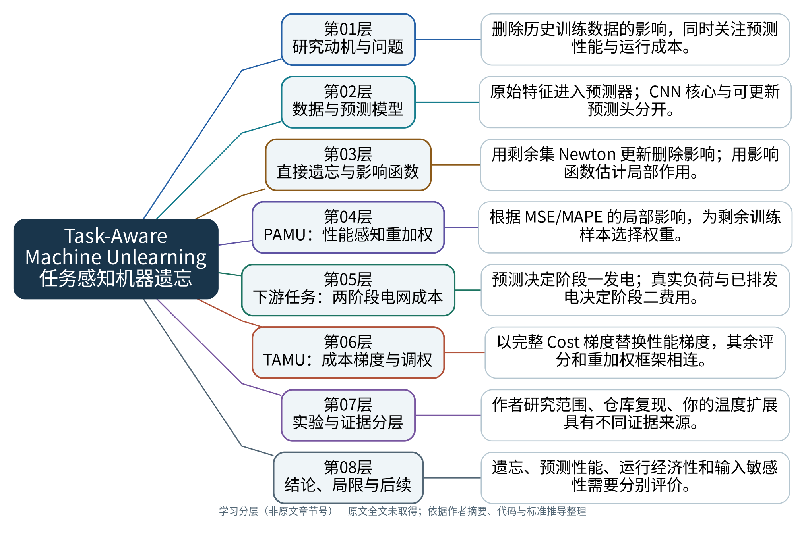
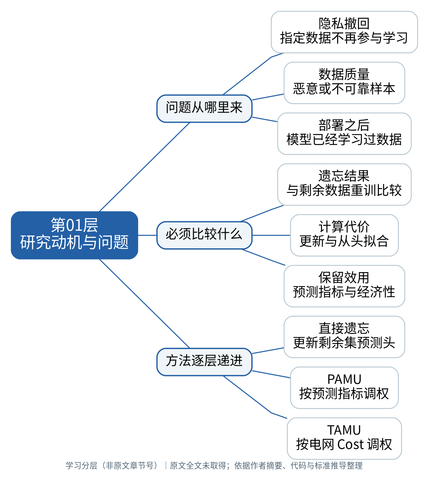
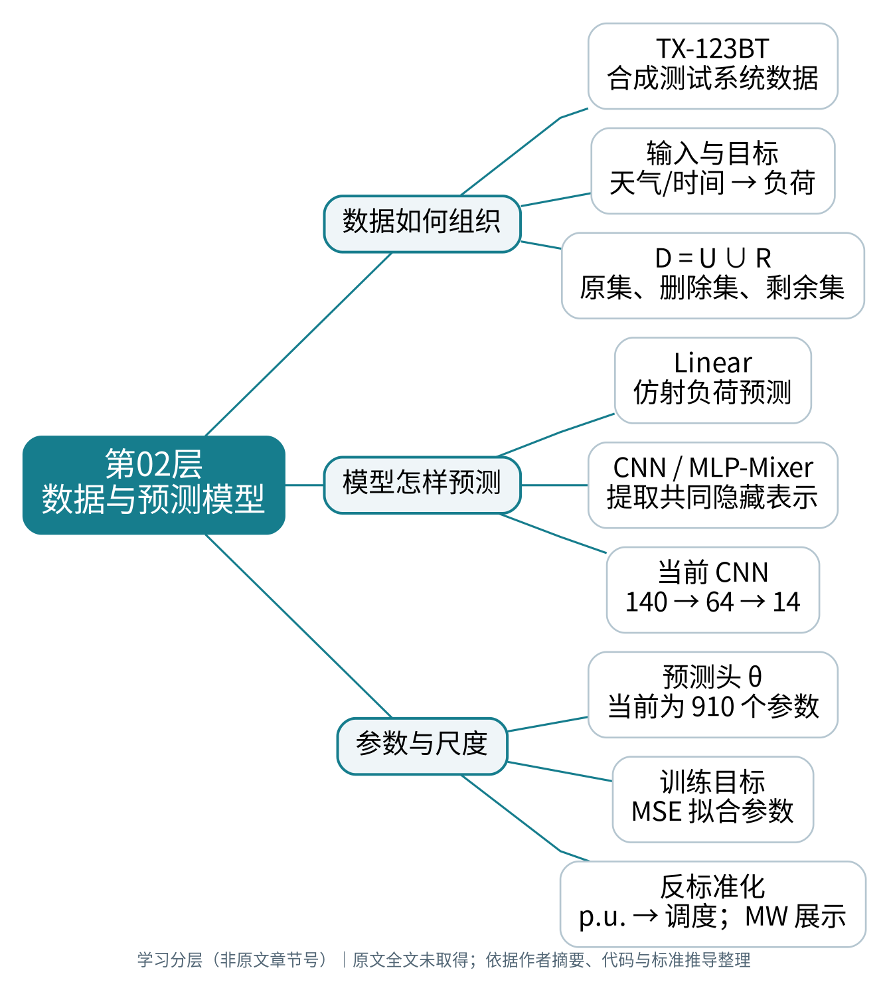
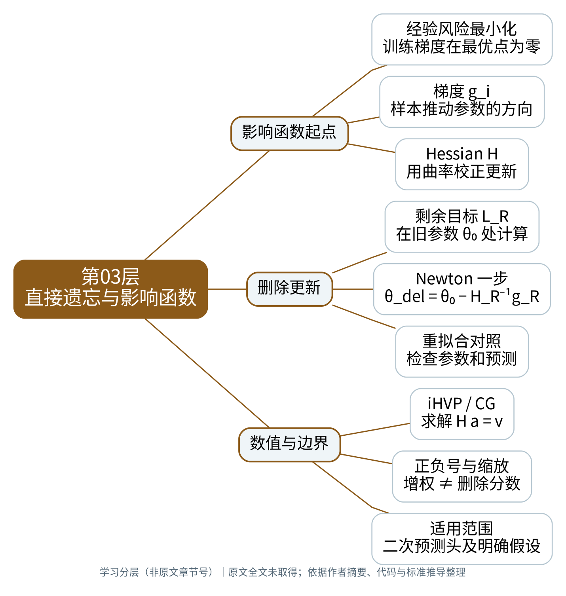
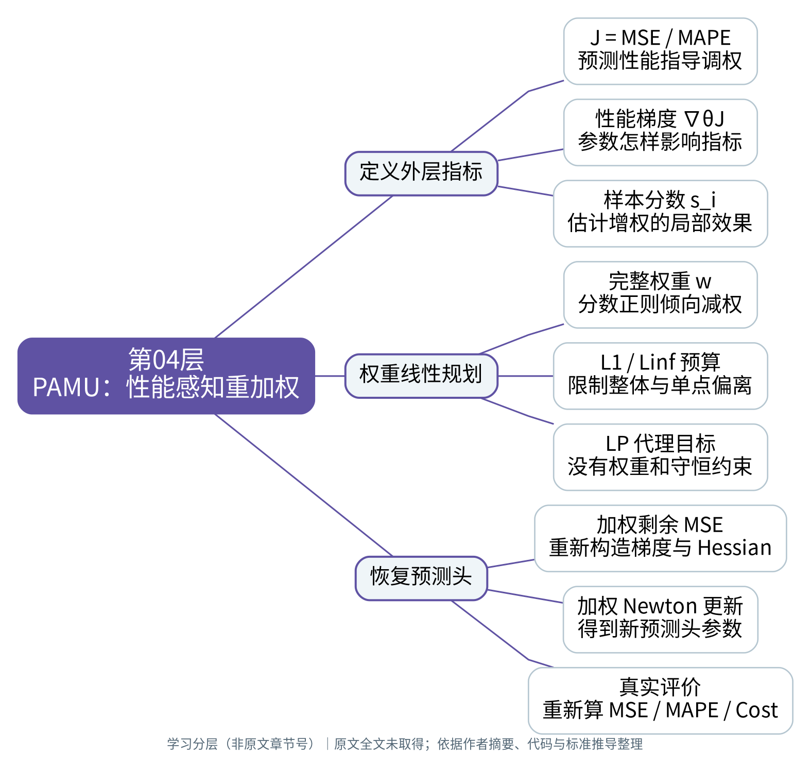
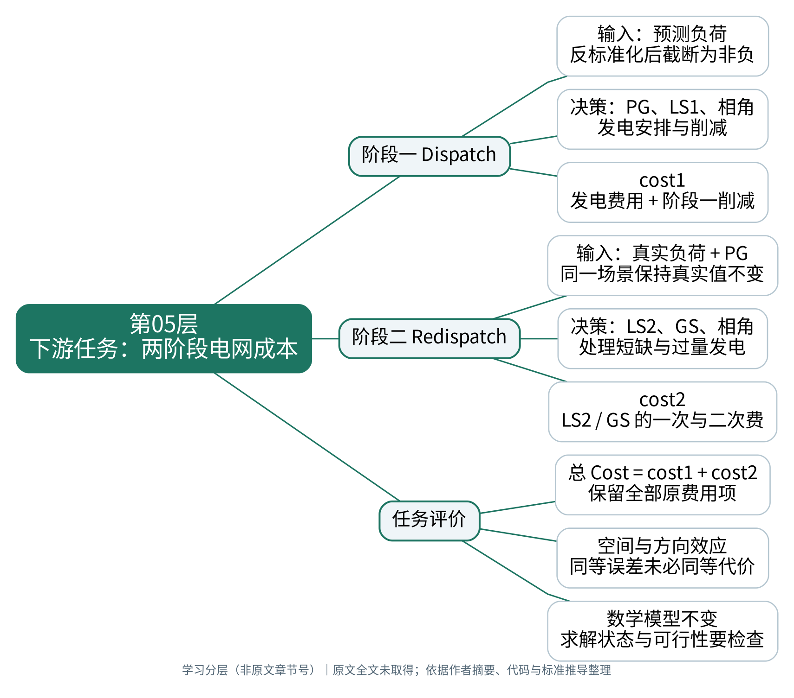
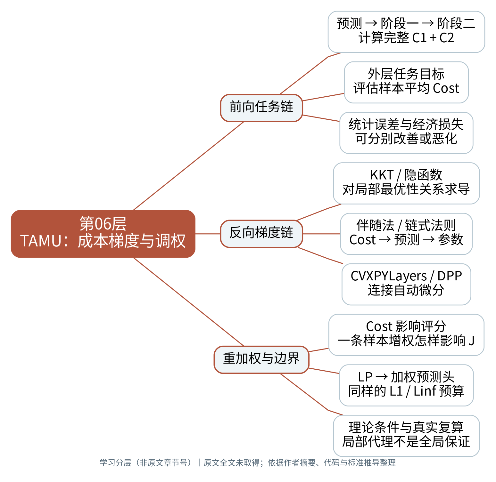
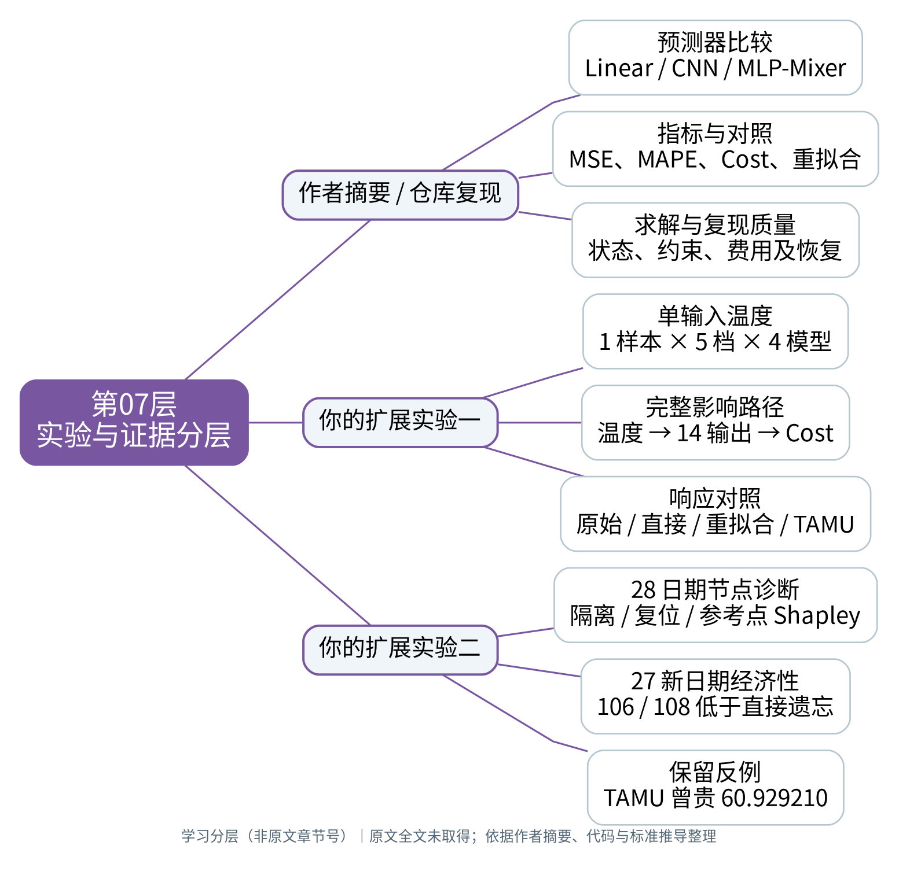
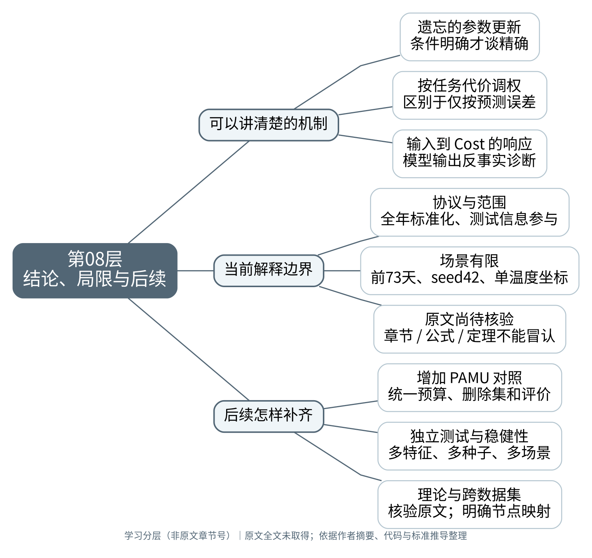

# Task-Aware Machine Unlearning 分层阅读与导图

**学习分层（非原文章节号）｜原文全文未取得；依据作者摘要、代码与标准推导整理。本套图是学习结构，不能冒充已逐章核对的论文目录。**

目标论文：[arXiv 2308.14412](https://arxiv.org/abs/2308.14412)。

阅读顺序：为什么删 → 删什么 → 怎样直接删 → 怎样保预测性能 → 怎样定义任务成本 → 怎样按成本调权 → 怎样验证 → 能下什么结论。

## 第01层：研究动机与问题

先弄清：为什么需要机器遗忘

**来源范围：**作者 README 摘要与代码支持；不是原文章节标题。

训练数据会影响已部署模型的参数。数据被要求撤回、发现恶意样本等情况，会产生删除影响的需求。重新训练可以作为比较基准，但可能有较高计算开销。该项目沿直接遗忘、性能感知、任务感知逐层增加考虑因素。

### 问题从哪里来

- **隐私撤回：指定数据不再参与学习**：删除对象是历史训练样本的影响，不是删除一个温度特征，也不是要求模型无法预测该样本。
- **数据质量：恶意或不可靠样本**：作者摘要列出恶意数据等删除动机；是否有害要依据实际数据和评价标准判断。
- **部署之后：模型已经学习过数据**：从文件中删掉原始记录，并不会自动更新已经训练出来的模型参数。

### 必须比较什么

- **遗忘结果：与剩余数据重训比较**：需要先明确重训算法、删除集合和保证定义，不能只以误差变化判断是否遗忘成功。
- **计算代价：更新与从头拟合**：影响函数和 Newton 更新提供减少某些重新拟合计算的途径；实际速度仍取决于规模与数值求解。
- **保留效用：预测指标与经济性**：删掉有帮助的样本可能损伤预测或运行表现；性能与成本是不同评价维度。

### 方法逐层递进

- **直接遗忘：更新剩余集预测头**：先建立可核对的删除更新，再与剩余数据重新拟合比较。
- **PAMU：按预测指标调权**：在剩余样本重加权时关注 MSE 或 MAPE 的局部影响。
- **TAMU：按电网 Cost 调权**：将下游调度代价引入评分，讨论删除后的经济性。

**读懂标志：**三个问题依次是：怎样删、怎样减轻预测性能损失、怎样控制下游运行代价。

**代码位置：**
- [readme.md](https://github.com/syh-Mason/task_aware_machine_unlearning/blob/960e7505f307cc4ac1cae17de655176cf29d7bd7/readme.md)
- [eval_unlearn.py](https://github.com/syh-Mason/task_aware_machine_unlearning/blob/960e7505f307cc4ac1cae17de655176cf29d7bd7/eval_unlearn.py)
- [eval_unchange.py](https://github.com/syh-Mason/task_aware_machine_unlearning/blob/960e7505f307cc4ac1cae17de655176cf29d7bd7/eval_unchange.py)

**先修来源：**[目标论文](https://arxiv.org/abs/2308.14412)；[作者原仓库](https://github.com/xuwkk/task_aware_machine_unlearning)；[Guo 等：认证删除](https://arxiv.org/abs/1911.03030)

## 第02层：数据与预测模型

明确：输入、参数和删除对象分别是什么

**来源范围：**作者实现与当前 case14/CNN 配置核对；尺寸是当前配置。

原项目包含线性、CNN、MLP-Mixer 预测器。当前 CNN 配置的原始输入是 14 节点乘 10 特征，经冻结核心得到 64 维隐藏表示，再由 910 个仿射头参数输出 14 节点预测。神经网络核心使用 core 数据，预测头使用 sensitive 数据；删除范围应与这一训练协议对应。

### 数据如何组织

- **TX-123BT：合成测试系统数据**：官方数据用于构建负荷预测任务；不能将其称为已接入 ERCOT 的实际观测。
- **输入与目标：天气/时间 → 负荷**：温度等天气变量与周期时间编码为输入，Load 是预测目标。标准化和数据划分的顺序影响评估解释。
- **D = U ∪ R：原集、删除集、剩余集**：对当前神经网络头部流程，D 通常指敏感拟合集；20% 删除比例应说明其分母。

### 模型怎样预测

- **Linear：仿射负荷预测**：线性模型通过特征的仿射组合给出负荷预测。
- **CNN / MLP-Mixer：提取共同隐藏表示**：先在 core 数据上训练特征提取器，再冻结核心，准备敏感样本的隐藏特征。
- **当前 CNN：140 → 64 → 14**：输入形状为 (N,1,14,10)，64 维 tanh 隐表示进入仿射预测头，输出 14 维标准化负荷。

### 参数与尺度

- **预测头 θ：当前为 910 个参数**：14×64 个连接权重和 14 个偏置；所有模型连接参数与训练样本权重 w 是不同对象。
- **训练目标：MSE 拟合参数**：PAMU/TAMU 以其他指标指导样本调权，但最终预测头仍使用加权 MSE 拟合。
- **反标准化：p.u. → 调度；MW 展示**：模型输出先恢复为 p.u. 负荷；MW 展示再乘 baseMVA。64 个隐藏坐标不能直接当成物理天气特征。

**读懂标志：**140 是原始编码输入数，64 是学习到的隐藏维度，14 是预测输出数。

**代码位置：**
- [clean_data.py](https://github.com/syh-Mason/task_aware_machine_unlearning/blob/960e7505f307cc4ac1cae17de655176cf29d7bd7/clean_data.py)
- [utils/dataset.py](https://github.com/syh-Mason/task_aware_machine_unlearning/blob/960e7505f307cc4ac1cae17de655176cf29d7bd7/utils/dataset.py)
- [utils/net.py](https://github.com/syh-Mason/task_aware_machine_unlearning/blob/960e7505f307cc4ac1cae17de655176cf29d7bd7/utils/net.py)
- [func_operation.py](https://github.com/syh-Mason/task_aware_machine_unlearning/blob/960e7505f307cc4ac1cae17de655176cf29d7bd7/func_operation.py)

**先修来源：**[作者原仓库](https://github.com/xuwkk/task_aware_machine_unlearning)

## 第03层：直接遗忘与影响函数

推导：为什么能用梯度与 Hessian 更新

**来源范围：**代码核对与标准数学推导；公式是学习记号，非原文编号。

影响函数从训练最优点的驻点条件出发，描述单样本增权对参数的局部导数。当前直接删除使用旧参数处剩余数据 MSE 的梯度和 Hessian，做一次 Newton 更新。二次满秩且精确求解时，这一步等于剩余集头部重新拟合；这不是整个非凸 CNN 的一般结论。

**关键关系（本讲义记号）：** g_R = ∇L_R(θ₀)，H_R = ∇²L_R(θ₀)；求解 H_R Δ = g_R，θ_del = θ₀ − Δ。

### 影响函数起点

- **经验风险最小化：训练梯度在最优点为零**：对选定训练目标和参数定义驻点条件，再对样本增权量求导。
- **梯度 g_i：样本推动参数的方向**：梯度是该样本损失对参数的局部导数，不是温度对预测输出的 Jacobian。
- **Hessian H：用曲率校正更新**：单样本额外增权的局部参数导数为 −H⁻¹g_i；完整权重约定还含样本数归一化。

### 删除更新

- **剩余目标 L_R：在旧参数 θ₀ 处计算**：计算剩余集平均 MSE 的梯度 g_R 与 Hessian H_R。
- **Newton 一步：θ_del = θ₀ − H_R⁻¹g_R**：实现通常求解线性系统，而非显式构造整个逆矩阵。
- **重拟合对照：检查参数和预测**：二次满秩条件下可与剩余数据精确拟合一致；CG 容差、阻尼、秩亏会影响数值结果。

### 数值与边界

- **iHVP / CG：求解 H a = v**：Hessian-vector product 支持 CG 计算逆 Hessian 向量积，检查收敛状态和残差。
- **正负号与缩放：增权 ≠ 删除分数**：若使用删除集平均梯度，更新可写成加号并带 k/m；评分文件的符号和分母必须核对。
- **适用范围：二次预测头及明确假设**：参数接近重拟合不足以推出认证隐私删除；核心曾使用删除样本时，仅更新头部也不能保证移除核心影响。

**读懂标志：**增权与删除符号相反；直接删除中 H_R 与 H_D 不能随意互换。

**代码位置：**
- [eval_unlearn.py](https://github.com/syh-Mason/task_aware_machine_unlearning/blob/960e7505f307cc4ac1cae17de655176cf29d7bd7/eval_unlearn.py)
- [check.py](https://github.com/syh-Mason/task_aware_machine_unlearning/blob/960e7505f307cc4ac1cae17de655176cf29d7bd7/check.py)
- [torch_influence/base.py](https://github.com/syh-Mason/task_aware_machine_unlearning/blob/960e7505f307cc4ac1cae17de655176cf29d7bd7/torch_influence/base.py)
- [torch_influence/modules.py](https://github.com/syh-Mason/task_aware_machine_unlearning/blob/960e7505f307cc4ac1cae17de655176cf29d7bd7/torch_influence/modules.py)

**先修来源：**[Koh & Liang：影响函数](https://arxiv.org/abs/1703.04730)；[Boyd & Vandenberghe：凸优化教材](https://web.stanford.edu/~boyd/cvxbook/)；[Guo 等：认证删除](https://arxiv.org/abs/1911.03030)

## 第04层：PAMU：性能感知重加权

解决：删完之后怎样补偿预测性能

**来源范围：**eval_unchange.py 的实现流程核对；局部代理不是全局性能保证。

删除一批有帮助的样本可能损伤预测性能。PAMU 对剩余样本分配完整权重 w，以 MSE 或 MAPE 的外层梯度计算局部样本影响，再在权重预算中最小化线性评分。得到权重后，用加权剩余 MSE 重新拟合预测头。

**关键关系（本讲义记号）：** 代码评分 s_i = −g_i(θ₀)ᵀ H_R⁻¹∇J(θ₀)/n；min s_Rᵀw，‖w−1‖₁≤cm，‖w−1‖∞≤1。

### 定义外层指标

- **J = MSE / MAPE：预测性能指导调权**：先选择需要补偿的评价标准；该标准的梯度决定哪些样本增权有利。
- **性能梯度 ∇θJ：参数怎样影响指标**：它与训练样本 MSE 梯度不同；训练 Hessian 仍取自剩余数据 MSE。
- **样本分数 s_i：估计增权的局部效果**：代码在原参数 θ₀ 评分并使用剩余 Hessian；理想剩余最优点的权重导数锚点不同。

### 权重线性规划

- **完整权重 w：分数正则倾向减权**：局部评分为正意味着增权使该外层指标上升；最优方向还受总预算约束。
- **L1 / Linf 预算：限制整体与单点偏离**：当前 Linf≤1 给出 0≤w≤2；平均 L1=0.1 是权重偏离预算，不是删除 10%。
- **LP 代理目标：没有权重和守恒约束**：当前代码没有 Σw=m；增添这一约束会改变问题。目标中与 w 无关的常数可省略；分数共同正比例缩放不改变 LP 最优解集合。

### 恢复预测头

- **加权剩余 MSE：重新构造梯度与 Hessian**：最终更新使用所选 w 对应的 H_R,w 与 g_R,w，而非直接复用未加权 Hessian。
- **加权 Newton 更新：得到新预测头参数**：加权二次系统满秩且求解准确时，更新等于该加权剩余数据的精确拟合。
- **真实评价：重新算 MSE / MAPE / Cost**：线性代理最优不等于真实指标或全部新样本最优；PAMU 也可以评价 Cost。

**读懂标志：**调权看 MSE/MAPE，拟合仍用 MSE；样本权重 w 不等于模型参数 θ。

**代码位置：**
- [eval_unchange.py](https://github.com/syh-Mason/task_aware_machine_unlearning/blob/960e7505f307cc4ac1cae17de655176cf29d7bd7/eval_unchange.py)
- [func_operation.py: return_objective](https://github.com/syh-Mason/task_aware_machine_unlearning/blob/960e7505f307cc4ac1cae17de655176cf29d7bd7/func_operation.py)

**先修来源：**[Koh & Liang：影响函数](https://arxiv.org/abs/1703.04730)；[Boyd & Vandenberghe：凸优化教材](https://web.stanford.edu/~boyd/cvxbook/)

## 第05层：下游任务：两阶段电网成本

明确：预测怎样进入真实运行评价

**来源范围：**当前已修复 Operator 数学问题；没有声称逐式核对论文发表版。

第一阶段用预测负荷安排机组出力，第二阶段固定真实负荷，利用第一阶段发电安排处理偏差。总 Cost 必须包含阶段一发电与削减费用，以及阶段二 LS/GS 的线性和二次费用。所有功率和系数尺度必须与代码一致。

**关键关系（本讲义记号）：** C1 = PGᵀdiag(q)PG + cᵀPG + λΣLS1；C2 = λΣLS2 + κΣLS2² + ρΣGS + ηΣGS²；C = C1 + C2。

### 阶段一 Dispatch

- **输入：预测负荷：反标准化后截断为非负**：先将标准化预测恢复为 p.u.，沿原逻辑将负预测截为 0。
- **决策：PG、LS1、相角：发电安排与削减**：满足发电范围、线路双向限额、功率平衡、LS1 非负与参考角。
- **cost1：发电费用 + 阶段一削减**：阶段一 LS1 费用是总成本及可微表达的一部分，不能遗漏。

### 阶段二 Redispatch

- **输入：真实负荷 + PG：同一场景保持真实值不变**：阶段二使用数据中 ground truth，不以扰动后的温度重新生成真实负荷。
- **决策：LS2、GS、相角：处理短缺与过量发电**：当前平衡式使用 PG−GS；GS 是代码中的过量发电处理量，不是完整物理储能模型。
- **cost2：LS2 / GS 的一次与二次费**：阶段二沿原线路、功率平衡、非负和参考角约束；没有额外自由增发变量。

### 任务评价

- **总 Cost = cost1 + cost2：保留全部原费用项**：当前 λ=3500、κ=1250、ρ=700、η=250；目标函数单位不能未经校准解释为实际货币。
- **空间与方向效应：同等误差未必同等代价**：高估/低估、节点位置、发电与线路约束会使预测误差的经济后果不同。
- **数学模型不变：求解状态与可行性要检查**：兼容求解器必须求同一个问题；不能跳过 Cost，也不能为解释模型擅自加入 LS≤负荷、GS≤PG 上界。

**读懂标志：**同样 MSE 可以造成不同调度费用；人工输入扰动时真实负荷固定。

**代码位置：**
- [utils/optimization.py: Operator](https://github.com/syh-Mason/task_aware_machine_unlearning/blob/960e7505f307cc4ac1cae17de655176cf29d7bd7/utils/optimization.py)
- [utils/net.py: SPO](https://github.com/syh-Mason/task_aware_machine_unlearning/blob/960e7505f307cc4ac1cae17de655176cf29d7bd7/utils/net.py)
- [func_operation.py: MSE_COST](https://github.com/syh-Mason/task_aware_machine_unlearning/blob/960e7505f307cc4ac1cae17de655176cf29d7bd7/func_operation.py)

**先修来源：**[Donti 等：任务导向学习](https://arxiv.org/abs/1703.04529)；[Boyd & Vandenberghe：凸优化教材](https://web.stanford.edu/~boyd/cvxbook/)；[作者原仓库](https://github.com/xuwkk/task_aware_machine_unlearning)

## 第06层：TAMU：成本梯度与调权

把预测—优化—样本权重完整连起来

**来源范围：**代码和标准 KKT/链式法则推导；原论文梯度存在定理全文待核验。

TAMU 将外层 J 换成两阶段平均 Cost。前向得到预测与两阶段决策，反向通过可微优化层得到参数梯度 v_C，再结合剩余 MSE Hessian 和每个样本的训练梯度计算评分。LP 选择样本权重后，以加权 MSE 更新头部并真实评价。

**关键关系（本讲义记号）：** v_C = ∇θ mean(C1+C2)；H_R a = v_C；s_i = −g_iᵀa/n；LP 选 w → 加权 MSE 更新 θ。

### 前向任务链

- **预测 → 阶段一 → 阶段二：计算完整 C1 + C2**：阶段二显式接收阶段一 PG；两层依赖与所有费用都必须进入计算图。
- **外层任务目标：评估样本平均 Cost**：权重到参数的训练映射再连接两阶段决策；将训练子问题展开后依赖层数更多，勿只依赖层数名称。
- **统计误差与经济损失：可分别改善或恶化**：按 Cost 调权不是证明 MSE、MAPE、敏感性同时更好。

### 反向梯度链

- **KKT / 隐函数：对局部最优性关系求导**：在合适正则条件下求解映射可微；活跃集变化、退化和截断边界需要分别处理。
- **伴随法 / 链式法则：Cost → 预测 → 参数**：同时包含阶段一自身费用和阶段一决策影响阶段二费用的路径，仅对第一阶段最优值求导不完整。
- **CVXPYLayers / DPP：连接自动微分**：DPP 是参数化建模结构规则；求解器得到数值最优解不等于该调用自动具有 PyTorch 梯度。

### 重加权与边界

- **Cost 影响评分：一条样本增权怎样影响 J**：与 PAMU 相同框架，主要替换外层梯度；分数锚点、数据集合和归一化仍需核对。
- **LP → 加权预测头：同样的 L1 / Linf 预算**：得到权重后重新构造加权 MSE 系统，检查秩、CG 收敛和残差。
- **理论条件与真实复算：局部代理不是全局保证**：标准充分条件可帮助理解局部导数，但不能冒充未取得原论文的定理；最终 Cost 要重新数值评价。

**读懂标志：**Cost 梯度指导选权；训练 Hessian 来自 MSE；平均目标不保证逐场景经济性。

**代码位置：**
- [utils/net.py: Stage_One_Layer / Stage_Two_Layer / SPO](https://github.com/syh-Mason/task_aware_machine_unlearning/blob/960e7505f307cc4ac1cae17de655176cf29d7bd7/utils/net.py)
- [func_operation.py: MSE_COST](https://github.com/syh-Mason/task_aware_machine_unlearning/blob/960e7505f307cc4ac1cae17de655176cf29d7bd7/func_operation.py)
- [eval_unchange.py](https://github.com/syh-Mason/task_aware_machine_unlearning/blob/960e7505f307cc4ac1cae17de655176cf29d7bd7/eval_unchange.py)

**先修来源：**[Koh & Liang：影响函数](https://arxiv.org/abs/1703.04730)；[OptNet：KKT 与可微优化](https://arxiv.org/abs/1703.00443)；[CVXPYLayers：可微凸优化层](https://arxiv.org/abs/1910.12430)；[Donti 等：任务导向学习](https://arxiv.org/abs/1703.04529)；[Boyd & Vandenberghe：凸优化教材](https://web.stanford.edu/~boyd/cvxbook/)

## 第07层：实验与证据分层

把论文方法复现与你的新增实验分开

**来源范围：**作者 README + 已保存复现记录；温度实验不是原论文实验。

作者摘要确认比较 Linear、CNN、MLP-Mixer，并考虑遗忘、性能与运行成本。当前仓库另有已完成的复现和温度敏感性扩展。导图中所有温度实验数值归于你的新增研究，不能当作原论文实验结论。

### 作者摘要 / 仓库复现

- **预测器比较：Linear / CNN / MLP-Mixer**：作者摘要明确这些模型；发表版全部实验设置、结果和图号仍需原文核对。
- **指标与对照：MSE、MAPE、Cost、重拟合**：仓库实现直接遗忘与 PAMU/TAMU 入口；当前复现保存六档遗忘比例结果。
- **求解与复现质量：状态、约束、费用及恢复**：项目已有成本修复、状态检查和重放记录；工程检查通过不能替代原文理论核验。

### 你的扩展实验一

- **单输入温度：1 样本 × 5 档 × 4 模型**：固定每个模型的参数、其他输入和真实负荷，改变输入节点1温度 ±1、±0.5、0 个训练标准差。
- **完整影响路径：温度 → 14 输出 → Cost**：参考点原始 CNN 的 +1σ 总预测变化 −0.827542 MW，总 Cost 变化 −6.778363。
- **响应对照：原始 / 直接 / 重拟合 / TAMU**：共享冻结 CNN 核心；TAMU 不是逐个温度水平重新调权。绝对成本与敏感性应分开。

### 你的扩展实验二

- **28 日期节点诊断：隔离 / 复位 / 参考点 Shapley**：28×4=112 组原始 CNN 非零扰动对照的峰值节点一致；这是本批观察，不是数学必然。
- **27 新日期经济性：106 / 108 低于直接遗忘**：27 个新日期各一个小时级样本，按月与负荷层预选；参考点不计入该汇总。
- **保留反例：TAMU 曾贵 60.929210**：2019-03-12、test1686、−1σ 场景出现该差异，不能把平均改善说成逐场景保证。

**读懂标志：**实验一打通输入路径；实验二检查节点贡献和多日期稳定性。

**代码位置：**
- [analysis.ipynb](https://github.com/syh-Mason/task_aware_machine_unlearning/blob/960e7505f307cc4ac1cae17de655176cf29d7bd7/analysis.ipynb)
- [scripts/reproduce_unlearning_figures.py](https://github.com/syh-Mason/task_aware_machine_unlearning/blob/960e7505f307cc4ac1cae17de655176cf29d7bd7/scripts/reproduce_unlearning_figures.py)
- [experiments/input_sensitivity.py](https://github.com/syh-Mason/task_aware_machine_unlearning/blob/960e7505f307cc4ac1cae17de655176cf29d7bd7/experiments/input_sensitivity.py)
- [experiments/cost_attribution.py](https://github.com/syh-Mason/task_aware_machine_unlearning/blob/960e7505f307cc4ac1cae17de655176cf29d7bd7/experiments/cost_attribution.py)

**先修来源：**[目标论文](https://arxiv.org/abs/2308.14412)；[作者原仓库](https://github.com/xuwkk/task_aware_machine_unlearning)

## 第08层：结论、局限与后续

明确：能够说明什么，还缺什么证据

**来源范围：**当前算法实现与扩展实验的解释边界；不代写原文结论。

由现有证据可理解影响函数与任务成本如何指导剩余样本重加权，并可追踪输入到 Cost 的数值路径。原论文全文尚未核对，当前扩展也有时间、随机种子、输入坐标和评价协议限制。进一步研究应保留独立测试并补齐 PAMU 等对照。

### 可以讲清楚的机制

- **遗忘的参数更新：条件明确才谈精确**：二次头部的数值重拟合一致性不代表整个 CNN 的任意数据都已认证删除。
- **按任务代价调权：区别于仅按预测误差**：TAMU 的外层指标是 Cost；PAMU 则提供性能指标导向的必要比较。
- **输入到 Cost 的响应：模型输出反事实诊断**：人为温度输入干预和混合输出向量，并不等同真实天气的物理因果作用。

### 当前解释边界

- **协议与范围：全年标准化、测试信息参与**：原协议中先全年标准化再划分，helpful/TAMU 使用测试性能信息；新增扰动控制未消除这些限制。
- **场景有限：前73天、seed42、单温度坐标**：当前扩展不能推出全年、夏季、其他种子或 ERCOT 的普遍结论。
- **原文尚待核验：章节 / 公式 / 定理不能冒认**：本套图的八层是学习顺序；需要取得完整 PDF 才能逐章对应原论文。

### 后续怎样补齐

- **增加 PAMU 对照：统一预算、删除集和评价**：当前四模型温度实验没有 PAMU，因而不能证明 TAMU 优于 PAMU。
- **独立测试与稳健性：多特征、多种子、多场景**：预先确定样本，分别报告平均成本、最差场景及输入响应，不根据结果挑选样本。
- **理论与跨数据集：核验原文；明确节点映射**：原文定理逐条核对、认证定义、ERCOT 节点映射与缩放均需单独证据；当前没有完成真实 ERCOT 成本实验。

**读懂标志：**局部优化代理、精确头部拟合、逐场景经济性、认证遗忘是不同层次的结论。

**代码位置：**
- [research/cnn_temperature_response/README.md](https://github.com/syh-Mason/task_aware_machine_unlearning/blob/960e7505f307cc4ac1cae17de655176cf29d7bd7/research/cnn_temperature_response/README.md)
- [research/cnn_cost_attribution/README.md](https://github.com/syh-Mason/task_aware_machine_unlearning/blob/960e7505f307cc4ac1cae17de655176cf29d7bd7/research/cnn_cost_attribution/README.md)
- [reports/tamu_algorithm_guide/README.md](https://github.com/syh-Mason/task_aware_machine_unlearning/blob/960e7505f307cc4ac1cae17de655176cf29d7bd7/reports/tamu_algorithm_guide/README.md)

**先修来源：**[Guo 等：认证删除](https://arxiv.org/abs/1911.03030)；[目标论文](https://arxiv.org/abs/2308.14412)

## 原论文与扩展实验的边界

第07层中的温度单点、多日期、节点隔离/复位/Shapley 是本项目后续扩展，不是原论文已经报告的实验。原作者摘要确认的模型与研究范围、当前代码实现、标准数学推导和扩展实测结果分别标记。

原论文的准确章节标题、编号、定理假设、证明、图表与发表版差异，需要取得 PDF 后逐项核验。本图没有给未知内容填入虚构编号或数值。
