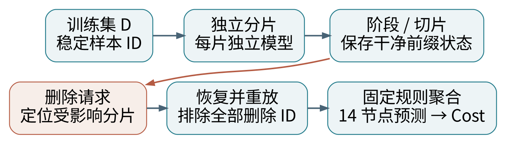

# 报告一｜Exact 遗忘：SISA 分组重训练

**代表论文：Machine Unlearning。** Bourtoule 等，IEEE Symposium on Security and Privacy，2021；预印本发表于 2019 年。方法通常简称 SISA。

[论文入口](https://arxiv.org/abs/1912.03817)　[正式出版 DOI](https://doi.org/10.1109/SP40001.2021.00019)　[作者代码](https://github.com/cleverhans-lab/machine-unlearning)

## 先讲清楚这篇为什么值得读

普通模型把所有训练数据的影响混在同一组参数中。删除一条记录后，完整重训很昂贵。SISA 在最初训练时就划分数据、隔离子模型，并保存中间检查点，使删除请求只触发局部重训。

**一句话：先把训练过程设计成可拆开的结构，将来删除数据时，只重做真正受影响的部分。**

| 本次需求 | 本报告回答 |
|---|---|
| exact unlearning，分组重训练 | 什么条件下局部重训与同流程重训等价 |
| 应用到电网 | 按训练样本分片，输出仍是完整的 14 节点负荷向量 |
| 与已有 CNN 联系 | 冻结核心 + 多个预测头的可行方案与保证范围 |
| 可展示成果 | 分片流程图、推导、代码定位、实验设计与数值校验 |

**证据范围。** 已读取作者 README、sisa.py、sharded.py、aggregation.py 等实现，并固定提交版本。当前 arXiv / IEEE 全文访问返回 403，未取得 SISA 论文全文。因此本文是“作者代码核对 + 独立数学说明”的文献研究报告，不声称逐页精读，也不引用未核实的原论文实验数字或章节编号。

**本轮执行内容。** 编写报告与教学数值校验；没有重新训练电网 CNN，没有生成新的电网 Cost 结果。电网迁移部分均为待实施方案。


# 1｜先用综述建立机器遗忘的概念

建议先读 Nguyen 等的 [A Survey of Machine Unlearning](https://arxiv.org/abs/2209.02299)。作者仓库确认：2022 年预印本，2025 年发表于 ACM TIST，[正式 DOI](https://doi.org/10.1145/3749987)。再参考 Jiang 等的 [Machine Unlearning: A Survey（ACM CSUR）](https://doi.org/10.1145/3603620)。两者用于建立分类与阅读路线；本轮取得的是公开文献索引，未取得综述全文。

引用量用于筛选，不用于证明算法正确。实时引文接口受限；附带说明保留可核对的第三方历史快照，明确平台声明、快照日期和未独立核验状态，不给出当前排名。注意同名综述有多篇，不能把 Xu 等的 arXiv:2306.03558 与 Jiang 等的 CSUR DOI 混为一篇。

令 $D$ 是完整训练集，$D_f$ 是要删除的数据，$D_r=D\setminus D_f$ 是剩余集。$A$ 表示完整训练算法，包含数据处理、初始化、训练和输出规则；$U$ 表示遗忘算法。

$$\operatorname{Law}[U(A(D),D,D_f)]=\operatorname{Law}[A(D_r)].$$

这是本报告采用的 exact 定义：删除后模型的分布，等于同一训练流程从未使用删除数据时的模型分布。若训练完全确定，可直接比较模型或完整状态。随机训练时，参数逐位相同并非分布等价的唯一表达。

| 概念 | 通俗解释 | 常见误解 |
|---|---|---|
| Exact unlearning | 与约定的重训流程等价 | 与任意一个单模型的重训结果相同 |
| Approximate unlearning | 在声明的误差或分布标准下接近重训 | 忘记集准确率下降就算成功 |
| Certified removal | 在假设下给出可证明的统计保证 | 参数差很小就自动得到认证 |
| Retain utility | 保留其余任务的可用性 | 测试 MSE 是唯一标准 |

遗忘的目标是接近“未看过这些数据”的模型。删除后仍能正确预测某个删除样本，可能来自剩余数据中的共同规律，不自动表示删除失败。


# 2｜SISA 的结构：分片、隔离、切片、聚合



**Sharded（分片）：** 把训练样本划为互不重叠的 $S$ 份。每个分片训练一个模型。这里分的是样本，不是把 14 个输出节点分别交给 14 个模型。

**Isolated（隔离）：** 一个分片内的数据只影响该分片自己的训练状态。共享特征提取器如果使用了待删除数据，就会打破这种隔离；共享的全局标准化参数也需要纳入检查。

**Sliced（切片）：** 分片内部按固定顺序划成 $R$ 个切片；在各阶段保存训练状态。作者实现逐步扩大已见前缀，并在阶段内使用该前缀训练，不是每阶段只用一个新切片。

**Aggregated（聚合）：** 汇总各子模型输出。作者代码针对分类做投票或概率聚合；迁移到负荷回归可以预先约定均值，但这是回归适配方案，需要重新验证。

$$\hat y(x)=\frac{1}{S}\sum_{s=1}^{S} f_{\theta_s}(x).$$

删除样本位于分片 2 的切片 3，就回到该分片切片 3 之前的干净状态，跳过删除记录，重放后续训练。其他分片保持原样。


# 3｜为什么局部重训能够是 exact

以下是报告的独立说明；不冒充未读取全文中的定理编号。设分片划分规则固定，删除记录后不把剩余样本重新分片；各分片独立训练，聚合规则固定且不含未清除的删除数据影响。

$$D=\bigsqcup_{s=1}^{S}D_s,\qquad D_{f,s}=D_f\cap D_s.$$

$$\theta_s^-=A_s(D_s\setminus D_{f,s}),\qquad f^-=\operatorname{Agg}(f_{\theta_1^-},\ldots,f_{\theta_S^-}).$$

若某分片没有删除记录，原状态就是该分片在剩余集上的训练结果。若受到影响，就从干净前缀恢复，按与参考重训相同的规则重放。于是每个分片都对应其“从未包含删除记录”的参考训练分布，固定聚合后的分布也相同。

## 删除算法的可执行逻辑

1. 输入稳定样本 ID，列出所有受影响分片。
2. 对每个受影响分片，找到最早包含删除记录的训练阶段。
3. 找到该阶段之前没有使用任何删除记录的检查点；没有则从干净初始化开始。
4. 恢复权重及所需训练状态，重放后续各阶段，所有数据读取都排除累计删除记录。
5. 更新该分片预测；其他分片保持原状态，按同一规则聚合。

**完整状态的重要性。** 使用 Adam 时，动量和二阶矩也是训练记忆；调度器、BatchNorm 统计、随机数状态和数据顺序也可能影响重放。若省略它们，就不能仅凭“读取了同一权重检查点”声称精确恢复。

**比较对象必须一致。** 这里参考的是同一分片、阶段、随机机制下的训练流程；并不保证等于把所有剩余数据放进一个普通 CNN 训练得到的结果。


# 4｜提速来自哪里，20% 删除时会怎样

一次只删除一条记录时，只需重训一个分片；干净检查点还能节省该分片的部分历史训练。但分片越多，每个模型可用样本越少，预测质量、存储和推理开销都可能变化。

若等大小分片、独立均匀抽取 $k$ 次删除位置，受影响分片数的教学近似为：

$$\mathbb{E}[S_{\mathrm{affected}}]=S\left[1-\left(1-\frac{1}{S}\right)^k\right].$$

对有限数据中无放回删除 $k$ 个样本，分片大小为 $n_s$ 时，应使用：

$$\mathbb{E}[S_{\mathrm{affected}}]=\sum_{s=1}^{S}\left[1-\frac{\binom{n-n_s}{k}}{\binom{n}{k}}\right].$$

你的既有设置是在 4906 个敏感样本中删除 981 个。若这些记录散布各片，极可能所有分片都需要重训，而且最早受影响切片可能很靠前。因此不能预先承诺“20% 遗忘就有 $S$ 倍提速”。Helpful 选择不是均匀随机抽样，上式也不是该选择策略的直接保证。

| 要测量的成本 | 为什么必须测量 |
|---|---|
| 初始训练总时间与峰值显存 | 多模型和检查点带来额外开销 |
| 单次与累计删除耗时 | 删除批量与历史请求改变收益 |
| 重放阶段数、受影响分片数 | 解释提速或退化的原因 |
| 存储和推理时延 | 电网在线应用有实际资源限制 |
| 测试 MSE / MAPE / 调度 Cost | 局部训练可能牺牲预测与运行经济性 |

时间比较需包括数据处理、恢复、重训和聚合。至少同时报告“同一 SISA 流程完整重训”和“普通单模型重训”，不要把两种参考混为一列。


# 5｜作者代码定位与迁移前的核验

固定作者提交：`50a3ada6c777f6882a1764d74a4978bfd61ec6f9`。所有链接都固定到这个版本。

| 文件与位置 | 已核对的实际行为 |
|---|---|
| [sisa.py，约 107–192 行](https://github.com/cleverhans-lab/machine-unlearning/blob/50a3ada6c777f6882a1764d74a4978bfd61ec6f9/sisa.py#L107) | 计算切片大小、查找前缀缓存、恢复前一阶段、前缀累积训练 |
| [sharded.py，约 23–58 行](https://github.com/cleverhans-lab/machine-unlearning/blob/50a3ada6c777f6882a1764d74a4978bfd61ec6f9/sharded.py#L23) | 按排除删除 ID 后的前缀计算哈希，读取不含删除记录的 batch |
| [sisa.py，约 216–263 行](https://github.com/cleverhans-lab/machine-unlearning/blob/50a3ada6c777f6882a1764d74a4978bfd61ec6f9/sisa.py#L216) | 恢复及阶段缓存保存 model.state_dict |
| [aggregation.py](https://github.com/cleverhans-lab/machine-unlearning/blob/50a3ada6c777f6882a1764d74a4978bfd61ec6f9/aggregation.py) | 分类输出加权后 argmax；不能原样用于连续负荷回归 |

源码有 Adam 选项，但所见缓存只保存模型 state_dict，没有同时保存 Adam 状态。这是对该实现的检查点完整性观察，不代表论文主张已经被否定。迁移时应选择可一致重放的训练器，或完整持久化训练状态，并独立验证。

分片哈希是缓存索引，不是遗忘证书。它说明缓存使用了哪些样本 ID，不自动证明优化器、预处理、共享参数都不含删除信息。

## 与本项目的直接对应

`utils/net.py` 定义 CNN；`func_operation.py` 负责模型与数据构造；`utils/funcs.py` 有仿射头求解与评估；`utils/optimization.py` 是两阶段 Cost 路径。SISA 应作为独立训练与删除流程新增，不改写既有已验证结果。

本报告没有直接执行作者分类脚本；代码核对和下页的合成数值校验不是原论文实验复现。


# 6｜如何迁移到 14 节点负荷预测

**方案 A：整个 CNN 按样本分片。** 每个子模型都接收 14×10 输入，预测 14 节点负荷。每片独立训练完整 CNN。保证范围清楚，但初始训练、存储、预测误差和推理开销均需实测。

**方案 B：固定公共核心，敏感集预测头分片。** 采用已有 64 维隐藏表示，每个分片训练 64→14 的头；聚合所有头的预测。该方案更接近当前冻结核心的项目结构。如果特征提取器和预处理确实不依赖删除数据，可讨论条件于这些固定组件的精确删除。

| 层或组件 | 建议处理 | 保证边界 |
|---|---|---|
| Conv1 / Conv2 / lin1 / Tanh | 方案 A 逐片训练；方案 B 固定 | 固定核心若见过删除数据，不能忽略 |
| 64→14 预测头 | 每分片独立训练与删除 | 精确性以该训练目标和流程为准 |
| 标准化、节点选择 | 明确是否依赖删除记录 | 数据影响也可能存在于非模型参数中 |
| 两阶段优化 | 保持原目标函数和系统约束 | 遗忘算法只改变预测输入 |

**本项目额外要查的地方。** `clean_data.py` 用全年数据做气象标准化与节点选择；`utils/dataset.py` 用全年负荷最大值、均值和标准差进行缩放。因此即使核心只在 disjoint core 集训练，也不能据此直接声称“完整流程无删除数据影响”。需定义固定预处理条件下的保证，或重新设计仅依赖允许数据的预处理协议。

先聚合预测，再运行两阶段优化：

$$C\left(\frac{1}{S}\sum_s\hat y_s,y\right)\ne\frac{1}{S}\sum_s C(\hat y_s,y)\quad\text{一般不成立相等关系}.$$

真实负荷、线路和机组约束保持不变。不能把各子模型 Cost 的平均值当作集成预测的调度 Cost。


# 7｜待实施的电网对照实验

以下是研究设计，不是已完成结果。沿用 TX-123BT / case14 与既有 20% 删除 ID，先验证小规模，再扩展。新增随机删除和明确的数据污染删除场景，避免结论只依赖 helpful 排序。

| 项目 | 固定规则或对照 |
|---|---|
| 模型 | 普通单 CNN；SISA 完整 CNN；可选冻结核心多头 |
| 分片和切片 | 先试 S=5、R=5；这是起始设计，不是论文推荐最优值 |
| 删除规模 | 1 条、1%、5%、20%；共享同一删除集合 |
| 随机性 | 种子 42 做调试；正式扩展多个种子 |
| 参考重训 | 同一分片流程从干净初始化重训全部剩余数据 |
| 预测评价 | 测试 MSE、MAPE、与参考预测的逐节点差 |
| 下游评价 | cost1、cost2、总 Cost、约束残差、求解状态 |
| 效率 | 初训、恢复、删除、累计删除、存储和推理开销 |

**验收顺序。** 先确认空删除不改变模型；再确认单条删除只触发其所属分片；对受影响片比较恢复重放和干净重训。训练完全确定时检查完整状态与预测；随机训练则说明随机机制，并用多个独立运行评价分布，不能用一次近似相等代替分布证明。

**电网适用场景。** 某批仪表记录被确认错误；某个用户撤回数据授权；某段攻击数据需要删除。这些是不同删除语义，应分别确定删除单位。当前 14 节点合成负荷数据不能直接支撑用户隐私合规结论。

**避免原有评估泄漏。** 已有 helpful 选择用到了评估信息；新算法调参和选择分片规模应使用独立验证集，最终测试集只用于最后报告。


# 8｜本轮实际数值校验：精确性究竟指什么

为了让推导可核对，新增 `experiments/verify_unlearning_reports.py`，使用明确标注的合成数组。SISA 示例是 24 样本、3 个分片、每片 4 个切片的确定性岭回归；检查点用充分统计量保存。这不是作者神经网络实现，也不是 TX-123BT 结果。

| 教学检查 | 实际结果 |
|---|---|
| 从干净前缀恢复并删除索引 3、6（从 0 计） | 只影响 3 个分片中的 1 个 |
| 恢复重放 vs 同流程分片重训 | 参数最大差约 2.44×10⁻¹⁵ |
| 未受影响的两个分片 | 参数逐位相同 |
| 分片均值集成 vs 全数据单模型重训 | 最大预测差约 0.370189 |

第一项支持“隔离正确时可局部重做”；最后一项说明“与同分片流程等价”不意味着“与任意普通模型相同”。浮点小误差只是这个确定性例子的数值误差，不构成一般神经网络 exact 保证。

复算命令（仓库根目录）：

```bash
python experiments/verify_unlearning_reports.py
```

该命令同时执行三份报告的 14 项教学检查，结果保存于 `reports/unlearning_three_methods/numerical_checks.json`。全套 14 项通过，0 项失败；不是新增的电网复现实验通过数。

预期可向导师提出的问题：对于电网记录删除，分片隔离的效率收益能否抵消模型集成带来的预测和调度成本损失？答案需要下一轮实测，不由这组教学数组决定。


# 9｜组会讲法、结论与参考链接

**两分钟讲法。** 我先用综述区分了精确遗忘和近似遗忘。精确遗忘以“同一流程在剩余数据上重训”为参照。SISA 在初始训练时把数据分片并隔离模型，分片内部保存阶段状态；删除时从最早受影响阶段之前恢复，只重训后续部分。

对本项目，可以比较整 CNN 分片与固定核心、多头分片。但已有核心和缩放参数的来源必须审计。20% 删除可能遍及所有分片，不能预先承诺大幅提速。最终仍需把集成后的 14 节点预测送入同一个两阶段优化程序，评价 Cost。

## 本篇结论

SISA 最值得借用的是“提前组织训练依赖，控制删除时需要重做的范围”。它提供结构化重训路线，不能直接安装到一个早已训练好的普通 CNN 上就获得完整 SISA 能力。当前只完成阅读材料、源码核对和数学教学校验，正式电网对照尚未执行。

## 阅读与核对链接

1. [Bourtoule et al., Machine Unlearning，论文入口](https://arxiv.org/abs/1912.03817)
2. [正式发表版本，IEEE S&P 2021](https://doi.org/10.1109/SP40001.2021.00019)
3. [作者代码，固定版本](https://github.com/cleverhans-lab/machine-unlearning/tree/50a3ada6c777f6882a1764d74a4978bfd61ec6f9)
4. [Nguyen 等，A Survey of Machine Unlearning](https://arxiv.org/abs/2209.02299)
5. [该综述作者维护的分类与文献索引](https://github.com/tamlhp/awesome-machine-unlearning)
6. [Jiang 等，Machine Unlearning: A Survey，CSUR](https://doi.org/10.1145/3603620)
7. [Guo 等，Certified Data Removal，作为近似路线对照](https://proceedings.mlr.press/v119/guo20c.html)
8. [Foster 等，SSD，作为参数修改路线对照](https://arxiv.org/abs/2308.07707)

版本、访问状态和文件哈希见同目录 `source_manifest.json`。日期：2026-10-22（北京时间）。
