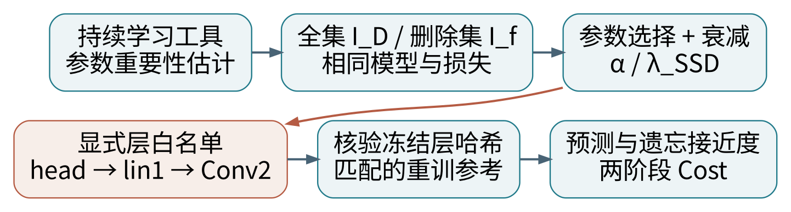

# 报告三｜持续学习启发的近似遗忘：SSD 与模型分层

**代表论文：Fast Machine Unlearning without Retraining through Selective Synaptic Dampening。** Jack Foster、Stefan Schoepf、Alexandra Brintrup，AAAI 2024，38(11)：12043–12051。

[论文入口](https://arxiv.org/abs/2308.07707)　[正式发表 DOI](https://doi.org/10.1609/aaai.v38i11.29092)　[作者代码](https://github.com/if-loops/selective-synaptic-dampening)

**一句话：借用持续学习中“判断哪些参数重要”的思路，找出特别依赖删除数据的参数，再选择性削弱它们。**

## 为什么选它作为第三条路线

你的重点是 approximate unlearning、持续学习和模型分层。SSD 在参数重要性上与持续学习直接衔接；作者 `ssd.py` 明确注明重要性计算改编自 Avalanche 持续学习库。它也适合讨论先改预测头、再改高层模块，而非人工逐个寻找“某个数据对应的唯一权重”。

**术语边界。** 这里选择的是“持续学习启发的近似遗忘”，SSD 本身不是完整的多任务持续学习训练流程；重要性估计来自该方向，并不意味着 EWC 正则项就是 SSD 删除算法。若导师要求严格的流式持续学习任务协议，还需补充任务序列和对应基线。

**证据范围。** 已读取作者 README、核心 `ssd.py`、策略入口并固定提交。arXiv / AAAI 全文访问返回 403，未取得全文；因此本报告的公式与流程以作者代码为依据，持续学习解释和电网迁移属于独立分析，不提供未核实的原论文实验数值。

本轮不重新训练、不修改已有 CNN 权重、不产生新的电网 Cost 结果；完成的是报告和数学教学校验。

# 1｜持续学习的“保留”怎样联系到“遗忘”

持续学习关心模型学新任务时如何保留旧能力。机器遗忘则要求移除指定数据影响，同时保留其余能力。两者都涉及：哪些参数承载哪些信息，修改它们会伤及多少其他任务。

建议铺垫：[Overcoming catastrophic forgetting in neural networks（EWC）](https://arxiv.org/abs/1612.00796)。下式是对 EWC 思路的教学表达，不是 SSD 的目标函数：

$$L_{\mathrm{new}}(\theta)+\frac{\beta}{2}\sum_j F_j(\theta_j-\theta_j^{\mathrm{old}})^2.$$

$F_j$ 描述旧任务对第 $j$ 个参数的敏感程度。重要参数动得越多，代价越大，所以倾向于保留。$\beta$ 控制保留强度。

SSD 借用“参数重要性”这个工具，却用它回答不同的问题：一个参数是否对删除集特别重要，相对于整个训练集又有多突出？如果突出，就考虑衰减该参数。

| 方法 | 重要性在做什么 |
|---|---|
| EWC 的教学理解 | 保护旧任务重要参数，减少灾难性遗忘 |
| SSD | 识别偏向删除集的参数，并进行选择性衰减 |
| 本项目层分析 | 记录激活、输出归因、内部消融；用途不同于删除集重要性 |

一个通道对某次预测贡献大，并不表示它只记住了删除样本。Captum 归因不能直接替代 SSD 的删除集梯度统计。

综述入口：[Nguyen 等](https://arxiv.org/abs/2209.02299)、[Jiang 等 CSUR](https://doi.org/10.1145/3603620)。两篇全文本轮未取得，本文只用公开索引建立阅读路线。

# 2｜SSD 的核心：选择参数，再衰减参数

先用梯度平方估计参数在数据集合 $S$ 上的重要性。理想的逐样本统计可写为：

$$I_S(j)=\frac{1}{|S|}\sum_{i\in S}\left(\frac{\partial\ell_i(\theta)}{\partial\theta_j}\right)^2.$$

原实现使用 batch 平均损失梯度的平方，再对 batch 求平均，区别见下一页。令 $I_D$ 是完整训练集重要性，$I_f$ 是删除集重要性，$\alpha$ 是选择阈值。

$$\mathcal{J}=\{j:I_f(j)>\alpha I_D(j)\}.$$

这些位置对删除集“相对更突出”。作者默认 exponent=1、裁剪上界=1 时，所选参数乘上：

$$s_j=\min\left(1,\lambda_{\mathrm{SSD}}\frac{I_D(j)}{I_f(j)}\right),\qquad j\in\mathcal J.$$

$$\theta_j^-=s_j\theta_j\quad(j\in\mathcal J).$$

$$\theta_j^-=\theta_j\quad(j\notin\mathcal J).$$

$\alpha$ 控制选哪些参数；$\lambda_{\mathrm{SSD}}$ 控制衰减幅度，不是前一报告的 L2 正则系数。代码还提供 exponent 等设置，以上只对应所见默认策略，不混用其他 SSD 变体。

完整集重要性可提前缓存；删除时计算删除集重要性，再做逐坐标乘法。提前缓存本身也有成本，不能将总成本写成“只访问删除集”。

该方法不把参数更新到剩余集最优解，也不自动保证与重训分布接近。它是需要经验验证的近似删除。

# 3｜作者实现的细节会怎样影响结果

固定提交：`cdfdc0e35c1908e032a6e150d882b0fa17833f85`。

| 作者代码位置 | 实际行为 |
|---|---|
| [ssd.py：calc_importance](https://github.com/if-loops/selective-synaptic-dampening/blob/cdfdc0e35c1908e032a6e150d882b0fa17833f85/src/ssd.py#L160) | CrossEntropyLoss；每个 batch 反传后累积 p.grad²，再除以 batch 数 |
| [ssd.py：modify_weight](https://github.com/if-loops/selective-synaptic-dampening/blob/cdfdc0e35c1908e032a6e150d882b0fa17833f85/src/ssd.py#L198) | 按删除 / 全集重要性比较，选择位置并乘衰减系数 |
| [forget_random_strategies.py：ssd_tuning](https://github.com/if-loops/selective-synaptic-dampening/blob/cdfdc0e35c1908e032a6e150d882b0fa17833f85/src/forget_random_strategies.py#L311) | model.eval()；依次统计删除集、全集重要性并修改权重 |

**最容易忽略的统计差异：**

$$\left(\frac{1}{B}\sum_i g_i\right)^2\ne\frac{1}{B}\sum_i g_i^2.$$

两个样本的梯度为 +1、−1 时，左边为 0，右边为 1。batch 划分、样本排列和最后一个 batch 的大小都能影响统计。若迁移时改成逐样本梯度，必须记录为估计器变化，并与原 batch 版本做对照。

**分层限制不能只看参数名字。** 类初始化读取了 min_layer、max_layer 等字段，但所见 modify_weight 循环没有用这些字段过滤层。因此把两个值设置好，并不意味着实际只改指定层。迁移时应显式传入参数名白名单，并检查未开放层的哈希完全不变。

原数据循环解包 `x, _, y`，损失是分类交叉熵。本项目数据格式和 14 维连续目标不同，不能不经适配直接调用。报告没有执行原图像分类基准。

# 4｜用模型分层控制遗忘范围

当前已有模型的可学习模块为 Conv1、Conv2、lin1 和 64→14 预测头；ReLU、Flatten、Tanh 在这里没有独立可训练权重。模型内部激活和贡献已在此前报告中分析，本轮沿用其结构记录。

| 迁移阶段 | 开放的参数 | 能回答什么 |
|---|---|---|
| L0：head-only | 预测头的 910 个参数 | 是否可与已有直接遗忘 / 重拟合 / TAMU 比较 |
| L1：head + lin1 | 再开放高层特征融合 | 高层表示改变是否改善删除与保留折中 |
| L2：再开放 Conv2 | 加入较深卷积通道 | 是否需要修改局部组合特征 |
| L3：全模型 | 所有 20006 个参数 | 全网干预收益能否抵消保留能力损伤 |

这是一组待验证的分层方案，不是 SSD 原论文已经证明的推荐顺序。每层都应单独选择验证集超参数，并与相同训练范围的剩余集重训基线比较。

单个参数会同时影响多个样本和多个节点。分层、通道或参数组更便于控制实验规模，但不能据此宣称某层独占“温度知识”或“删除样本记忆”。

如果开放原来冻结的核心，原有 head-only 重拟合不再是匹配的重训参考。必须先定义新的训练算法，不能沿用旧标签后直接横向排名。

# 5｜从图像分类适配到负荷回归

当前任务输出 14 个连续负荷，不使用分类交叉熵。一个清楚的迁移起点是：在现有标准化输出空间，采用与既有训练相同的 MSE，计算梯度重要性。

$$\ell_i=\frac{1}{14}\sum_{b=1}^{14}(\hat y_{i,b}-y_{i,b})^2.$$

这是本项目适配方案。若用高斯观测模型解释 Fisher，应明确噪声方差与似然；在未推导概率模型前，应称为“梯度平方重要性”，不要直接宣称就是严格 Fisher 信息。

| 选择 | 实际影响与记录要求 |
|---|---|
| 标准化空间 MSE | 各节点尺度按原训练协议处理 |
| MW 空间 MSE | 大负荷节点可能占更大比重；目标已改变 |
| 每样本 vs batch 统计 | 重要性估计不同，必须区分 |
| 完整集 vs 保留集作分母 | 原 SSD 使用完整集；换成保留集是变体 |
| 用 Cost 梯度选参数 | 属于任务感知新变体，应另列实验，不冒充原 SSD |

第一轮建议保持原 MSE 训练约定，只改变参数选择和衰减机制，随后用固定两阶段优化独立评价 Cost。先建立一个可解释、可复算的基线，再讨论 Cost-aware 分层选择。

数值处理也要写清：只有选中且分母为正的位置才计算比例；$I_D=I_f=0$ 的位置不选；$I_D=0,I_f>0$ 时按默认规则可衰减为零。若添加 epsilon 稳定项，其大小与影响必须记录。

乘法衰减不能把原本为零的参数更新成非零，也不一定向剩余集最优解移动。这是它与 Newton 更新的重要区别。

# 6｜电网实验怎样设计才公平

固定 TX-123BT / case14、已有 CNN、删除比例 20% 和相同删除 ID。第一阶段只做 head-only SSD；参数选择使用验证集，不根据最终测试 Cost 调参。

| 对照方法 | 用途 |
|---|---|
| 原始模型、no-op | 基准与空删除一致性 |
| 剩余集直接重拟合头 | head-only 任务的参考重训 |
| 现有直接遗忘 | 与影响函数路线比较 |
| SSD-head | 持续学习启发的参数重要性路线 |
| TAMU | 下游成本导向重加权对照；不自动拥有同一删除保证 |

建议初步网格 $\alpha\in\{1,5,10\}$，$\lambda_{\mathrm{SSD}}\in\{0.1,1\}$。这是待验证的起始设置，不是原文最优超参数；如没有参数被选中，要报告 no-op，不能当作遗忘成功。

需要同时报告：与参考预测的差异；保留集和独立测试 MSE / MAPE；cost1 / cost2 / 总 Cost；求解状态和约束残差；被选参数比例、每层改动比例、未开放层哈希；全集重要性预计算、删除统计与更新总耗时。

如评估成员推断，攻击应区分成员和非成员、按日期或负荷条件匹配并报告与重训的差异。单个攻击接近随机，只能说明该攻击未发现泄漏，不能替代认证。

沿用五档温度扰动检查模型响应，并扩展多个日期、负荷区间和种子。比较成本曲线的同时保留预测误差、保留能力与遗忘接近度，不能把“对温度反应更平”直接解释为更好。

以上均为后续实施计划，本轮未产生 SSD 电网结果。

# 7｜本轮实际教学检查：规则是否按预期工作

合成例子中，五个参数的原值为 `[2, −3, 0.5, 4, 7]`；全集重要性为 `[1, 4, 0, 2, 0]`，删除集重要性为 `[10, 1, 5, 0, 0]`。设 $\alpha=2$、$\lambda_{\mathrm{SSD}}=1$。

| 参数位置 | 是否选中 | 乘数 | 更新后 |
|---|---|---|---|
| 1 | 是 | 0.1 | 0.2 |
| 2 | 否 | 1 | −3 |
| 3 | 是 | 0 | 0 |
| 4 | 否 | 1 | 4 |
| 5 | 否，两个重要性均为零 | 1 | 7 |

显式增加层白名单后，若前两个参数属于冻结核心，则它们保持 `[2,−3]`；这检验的是分层过滤逻辑，不是原代码已有的层限制功能。

另外两个检查：逐样本梯度 `[+1,−1]` 的平均平方为 1，但 batch 平均梯度的平方为 0；EWC 二次教学问题中，重要性为 `[100,1]` 时，对旧参数的保护强度不同，解约为 `[0.990099,0.5]`。

复算：`python experiments/verify_unlearning_reports.py`。这些是对源码默认公式的独立 NumPy 实现与数学校验，不是对原 SSD 程序的端到端执行，不证明其遗忘质量，也不是原论文结果。

全部三篇报告共 14 项教学检查通过，0 项失败；记录见 `numerical_checks.json`。

# 8｜局限、潜在创新与研究边界

**参数重要性不等于独占记忆。** 同一参数可能同时服务删除集与保留集；衰减可能损伤正常负荷预测。对角统计忽略参数间相关性，对参数重标定也敏感。

**输出贡献不等于训练记忆。** 一个隐藏单元对节点 4 贡献大，不等于它主要承载删除数据。已有内部消融图可以帮助定位干预后哪里改变，但不能当成删除证书。

**多次删除会改变重要性。** 在旧参数上计算的完整集缓存可能逐渐失效。连续删除协议需要说明何时重新估计、何时回到重训，不能无限复用首轮统计。

**Cost 改善不保证遗忘更好。** SSD 可能降低保留能力，TAMU 可能改善经济性，但二者均需单独对照重训参考。电网中的约束活跃变化也使参数衰减与成本之间不呈简单线性关系。

## 可以形成的研究问题

“在相同删除集和保留能力约束下，按层限制的梯度重要性遗忘，能否比全参数衰减更接近参考重训，并减少电网运行成本波动？”

一个可能的新方向是把保留集重要性和 Cost 敏感性共同用于层或通道选择。但这是研究设想，必须与原 SSD、随机层选择、只改头和匹配重训进行消融，不能作为已有论文结论。

## 当前最合理的实施顺序

先完成 head-only SSD 与现有四模型的匹配比较；验证统计、参数白名单和独立评估均正确后，再开放 lin1 或 Conv2。若明确目标是用户隐私删除，应先处理核心和预处理对删除记录的依赖范围。

# 9｜组会讲法、结论与阅读链接

**两分钟讲法。** 持续学习为了防止模型忘掉旧任务，会估计哪些参数重要。SSD 借用这个工具，把删除集与完整集的重要性进行比较，找出对删除数据特别敏感的参数，然后乘一个不大于 1 的系数。

对我的 CNN，可以先只开放 64→14 预测头，保留卷积核心，再逐步开放 lin1、Conv2；但每次都要有匹配的剩余集重训参考。原源码并没有自动执行字段中写出的层过滤，因此需要显式参数白名单和哈希核验。

**本篇结论。** 这条路线的价值是低成本的参数选择和分层干预；局限是不能自动保证删除、保持精度或降低 Cost。应把它作为新的经验基线，通过预测、遗忘接近度和两阶段运行成本共同评价。

## 论文与铺垫链接

1. [Foster 等，SSD 论文入口](https://arxiv.org/abs/2308.07707)
2. [AAAI 正式发表页面](https://ojs.aaai.org/index.php/AAAI/article/view/29092)
3. [作者代码，固定版本](https://github.com/if-loops/selective-synaptic-dampening/tree/cdfdc0e35c1908e032a6e150d882b0fa17833f85)
4. [Kirkpatrick 等，EWC：Overcoming catastrophic forgetting](https://arxiv.org/abs/1612.00796)
5. [Avalanche 持续学习库](https://github.com/ContinualAI/avalanche)
6. [Nguyen 等，机器遗忘综述](https://arxiv.org/abs/2209.02299)
7. [Jiang 等，CSUR 综述](https://doi.org/10.1145/3603620)
8. [Shibata 等，Learning with Selective Forgetting，IJCAI 2021](https://www.ijcai.org/proceedings/2021/137)
9. [Guo 等，认证删除，作为保证边界对照](https://proceedings.mlr.press/v119/guo20c.html)

第 8 项是进一步研究持续学习与选择性遗忘结合的阅读入口，本轮未读全文。SSD 全文受限，本文依据作者实现；不声称完成其论文全部实证结论的复核。日期：2026-10-22（北京时间）。
