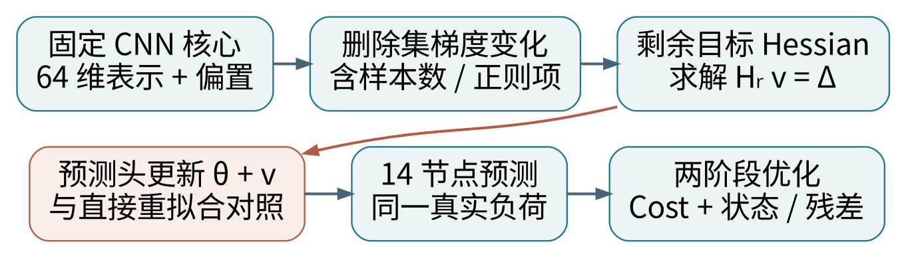

# 报告二｜Approximate 遗忘：影响函数与认证删除

**代表论文：Certified Data Removal from Machine Learning Models。** Chuan Guo、Tom Goldstein、Awni Hannun、Laurens van der Maaten，ICML 2020，PMLR 119：3832–3842。

[正式论文页](https://proceedings.mlr.press/v119/guo20c.html)　[预印本](https://arxiv.org/abs/1911.03030)　[作者代码](https://github.com/facebookresearch/certified-removal)

**一句话：先用梯度和 Hessian 估计删除数据后参数应该怎样移动，再用残差控制与训练时随机扰动处理残留信息。**

它比只读 Koh & Liang 的影响函数论文更直接对应机器遗忘：不只研究“一个训练样本对模型有什么影响”，还明确给出删除机制、认证定义、连续删除预算与重训触发规则。

| 本报告内容 | 你需要掌握的核心 |
|---|---|
| 影响函数 | 为什么加权是负号，删除更新是相反方向 |
| 一步 Newton | 哪个 Hessian、正则化如何随样本数变化 |
| 认证删除 | 小参数误差为什么不等于统计删除保证 |
| 电网迁移 | 冻结 CNN 核心，只处理仿射预测头 |

**阅读证据。** 已从 PMLR 官方出版仓库取得 11 页 PDF，读取全文，并核对作者实现。固定代码提交为 `7693b260cce4416540490d77a8f79f9fb3f52cfb`。论文页、方程与算法引用仅在本篇使用已核实的原文编号；独立推导另外说明。

**范围。** 论文主要认证机制针对强凸的线性模型。本文不会把认证直接推广到非凸 CNN 全参数，也没有为现有 CNN 事后补发隐私证书。本轮只做文献分析与教学数值校验。

# 1｜从综述看这篇论文的位置

先读 [Nguyen 等综述](https://arxiv.org/abs/2209.02299) 建立分类，再参考 [Jiang 等 CSUR 综述](https://doi.org/10.1145/3603620)。本轮取得两篇的文献索引，未取得综述全文；高引用筛选的历史证据与限制见总说明。

机器遗忘的参考对象是 $A(D_r)$，即未使用删除样本时的训练结果。不能把“忘记集损失尽可能大”作为通用目标；一个从未看过该样本的模型也可能正确预测它。

| 路线 | 做什么 | 典型边界 |
|---|---|---|
| SISA | 从干净状态局部重训 | 要有提前隔离的训练流程 |
| 影响函数 / Newton | 根据删除导致的梯度变化修正参数 | 曲率、局部近似、训练收敛都重要 |
| SSD | 选择并衰减偏向删除数据的参数 | 启发式近似，不自动认证 |

本篇属于第二条路线。一般损失下的一步 Newton 更新只是近似；在固定特征、可逆 Hessian 的二次目标下，它可以精确到达剩余集最优解。这解释了“近似遗忘路线”中为什么也会出现某些精确特例。

论文还区分了两种“接近”：参数向量数值接近，和模型输出分布难以区分。一个坐标即使只留下极小非零值，也可能暴露某条记录曾经出现。因此参数误差小，不足以推出隐私删除保证。

本项目过去得到的重拟合预测头、Cost 和温度响应是有用的经验结果，但不能因为直接遗忘和重拟合数值接近，就称整个系统已经通过 Guo 论文的认证定义。

# 2｜影响函数：从样本权重到参数变化

以下用统一记号独立推导。设 $F(\theta)$ 是可微训练目标，在局部最优点 $\theta_0$ 有 $\nabla F(\theta_0)=0$。给第 $i$ 个样本的损失增加权重 $\epsilon$：

$$F_\epsilon(\theta)=F(\theta)+\epsilon\ell_i(\theta).$$

最优性条件为 $\nabla F(\theta_\epsilon)+\epsilon\nabla\ell_i(\theta_\epsilon)=0$。对 $\epsilon$ 求导，在零点代入：

$$H\frac{d\theta_\epsilon}{d\epsilon}\bigg|_0+g_i=0,\quad H=\nabla^2F(\theta_0),\quad g_i=\nabla\ell_i(\theta_0).$$

$$\frac{d\theta_\epsilon}{d\epsilon}\bigg|_0=-H^{-1}g_i.$$

通俗地说，$g_i$ 描述这个样本当前把参数往哪里推；$H^{-1}$ 根据其他数据共同形成的曲率调整移动幅度。它不是独立改一个权重，而是通常联动许多参数。

删除对应减少权重，所以方向与上调权重相反。但删除是有限变化，且平均损失、正则化、样本数都可能改变，不能机械地写成“加上 $H^{-1}g_i$”就结束。

若关心下游标量 $Q(\theta)$，局部影响为：

$$\frac{dQ(\theta_\epsilon)}{d\epsilon}\bigg|_0=-\nabla Q(\theta_0)^\top H^{-1}g_i.$$

取 $Q$ 为 MSE 得到精度导向影响；取 $Q$ 为通过两阶段优化计算的 Cost，得到任务成本导向影响。可微性和求解稳定性仍需检查；这种评分本身不是认证删除机制。

# 3｜删除更新：剩余集 Hessian 与正则化

沿用论文第 3.1 节的求和目标约定：

$$L_D(\theta)=\sum_{i\in D}\ell_i(\theta)+\frac{\lambda n}{2}\|\theta\|_2^2.$$

删除集合 $D_f$ 大小为 $k$，$m=n-k$。若 $\theta_0$ 是完整集精确最优解，则：

$$\nabla L_{D_r}(\theta_0)=-\sum_{i\in D_f}g_i-k\lambda\theta_0.$$

记 $\Delta=\sum_{i\in D_f}g_i+k\lambda\theta_0$，并使用**剩余集目标在旧参数处**的 Hessian：

$$H_r=\nabla^2L_{D_r}(\theta_0),\qquad \theta^-=\theta_0+H_r^{-1}\Delta.$$

这对应论文单条删除式 (3) 和批量删除式 (6)。实现时用线性方程求解 $H_r v=\Delta$，一般比显式构造逆矩阵稳健。如果原训练没有收敛，要保留原梯度残差，不能假装旧梯度恰为零。

## 二次目标为什么是精确特例

采用本报告的 $\ell_i=\tfrac12\|B^T\tilde h_i-y_i\|^2$ 约定；$\tilde h_i$ 是包含偏置常数的固定特征。剩余集矩阵为 $Z_r$：

$$H_r=Z_r^\top Z_r+\lambda mI,\qquad B_r=H_r^{-1}Z_r^\top Y_r.$$

Hessian 不随参数改变，因此一次 Newton 就到达 $B_r$。若不正则化，需检查秩；若偏置不正则化，用对应半正定正则矩阵代替 $I$。不能为获得可逆性悄悄增加正则项并声称目标没变。

一般非二次损失中，一步更新后仍有残差。用完整集 Hessian 代替剩余集 Hessian，也通常不再精确。

# 4｜认证删除：一步更新之外还需要什么

论文第 2 节的 $(\epsilon,\delta)$ 认证删除比较两个随机模型分布。对所有模型事件 $T$，要求两个方向都受控：

$$P(U(A(D),D,D_f)\in T)\le e^\epsilon P(A(D_r)\in T)+\delta.$$

$$P(A(D_r)\in T)\le e^\epsilon P(U(A(D),D,D_f)\in T)+\delta.$$

认证不是“删除样本预测错了”的保证，而是对删除后模型与从未使用这些数据的模型分布之间的约束。

## 原论文的四个关键部件

1. **训练时目标扰动。** 使用 $L_b(\theta)=L_D(\theta)+b^T\theta$，其中 $b$ 按指定分布采样；不是删除后随意加噪声。
2. **Newton 删除。** 用剩余数据的曲率进行参数更新。
3. **残差上界。** 衡量更新后 $\|\nabla L_b(\theta^-;D_r)\|$ 可能有多大，并累计删除造成的误差预算。
4. **预算用尽就重训。** 论文算法 2 在累计上界超过允许阈值时，用算法 1 在剩余集重训。

以论文 logistic 设置为例，在相应特征范数和光滑性假设下，数据依赖上界含有：

$$\|\nabla L_b(\theta^-;D_r)\|_2\le\gamma\|X_r\|_2\|v\|_2\|X_rv\|_2,\quad v=H_r^{-1}\Delta.$$

预算阈值为 $\sigma\epsilon/c$，其中 $c=\sqrt{2\log(1.5/\delta)}$，对应论文算法的噪声参数约定。特征有界、强凸性、训练误差和噪声机制都不能省略。对二次损失，精确求解且特征固定时残差为零，是另一种特例。

当前 CNN 没有按该协议从头训练。不能仅运行一个影响函数更新，就声称获得上述认证。

# 5｜论文实验和作者代码实际上做了什么

原论文第 4 节包括：MNIST 上的线性 logistic；公开预训练特征上的 LSUN、SST 分类；DP 特征提取器上的 SVHN 分类。不是电网实验。

| 原论文表 1 | 删除时间 | 训练时间 |
|---|---|---|
| MNIST：CR 线性模型 | 0.04 s | 15.6 s |
| LSUN：公开特征 + CR 线性模型 | 0.48 s | 124 s |
| SST：公开特征 + CR 线性模型 | 0.07 s | 61.5 s |
| SVHN：DP 特征 + CR 线性模型 | 0.27 s | 1.5 h |

这些数字转述自正式 PDF 第 6 页表 1，未在本环境复现，不能当作电网迁移后的速度保证。不同列还涉及不同的特征提取器训练范围，应保留原表上下文。

| [test_removal.py，固定版本](https://github.com/facebookresearch/certified-removal/blob/7693b260cce4416540490d77a8f79f9fb3f52cfb/test_removal.py) | 核对结果 |
|---|---|
| lr_grad / lr_hessian_inv | 求和损失中使用样本数缩放的 L2 正则化 |
| lr_optimize | 训练时加入 b·w / 样本数；均值形式与求和形式要一致 |
| 删除循环，约 220 行起 | 用剩余数据算 Hessian，w_approx 加上更新，并累计残差上界 |
| 设备、损失、输入 | 原脚本绑定 CUDA 和分类数据；不能原样套入 14 维负荷回归 |

实现核对发现：该脚本记录累计上界，但删除循环没有完整实现论文算法 2 的预算超限重训分支；binary 结尾预测还使用 w 而不是 w_approx。这里只记录源码差异，未修改外部仓库，也不拿该输出作为本轮有效性证据。

# 6｜如何落到已有 CNN 的不同层

既有 CNN 路径：输入 $(N,1,14,10)$ → 两层卷积与 ReLU → 展平 280 维 → lin1 → Tanh 的 64 维表示 → 64→14 仿射头。现有四模型共享冻结核心，只有预测头不同；有效参数共 20006 个，其中头为 910 个。此信息来自已提交的层分析记录，并非本轮重新测量。

**最合适的第一步：** 固定核心，显式构造包含偏置的 65 维特征；每个输出节点的二次回归块只有 65×65。对 14 个输出保持同一损失归一化、参数展开顺序和正则规则；不能因为分块方便改变原目标。

对应位置：`utils/funcs.py` 的 `AnalyticSolverNNAffine` 及 `cal_grad`、`cal_hessian`；`func_operation.py` 构造损失与遗忘模块。注意现有 MSE 对样本和输出维度的归一化细节，以实际代码为准。

**保证范围要写完整。** 如果删除记录只用于敏感头，核心由不含这些记录的数据训练，可讨论固定核心条件下的头部删除。若核心、全年气象标准化、负荷缩放或节点选择见过这些记录，就不能把头部结果升级为完整系统认证。

若开放 lin1 或卷积层，隐藏表示本身随参数改变，二次目标的固定特征条件失效。此时需要非凸近似分析或重训基线；原论文的线性认证不能自动继承。

# 7｜把预测变化追踪到电网运行成本

同一测试输入 $x$，比较原始、一步影响函数更新、剩余集直接重拟合，以及已有 TAMU 预测头。删除集合、核心、目标缩放和评估真实负荷均保持一致。

$$\hat y_\theta(x)\longrightarrow z_1^*(\hat y_\theta)\longrightarrow z_2^*(z_1^*,y)\longrightarrow C_1+C_2.$$

局部平滑区域内，参数变化传递为：

$$\Delta C\approx\nabla_\theta C^\top\Delta\theta,\qquad\Delta\theta\approx H_r^{-1}\Delta.$$

这只是局部近似。线路约束活跃集改变、预测裁剪或最优解不唯一，都可能使导数不稳定；有限变化必须用两阶段求解后的实际 Cost 校验。

| 待实施的检查 | 应记录的证据 |
|---|---|
| 头部固定特征二次目标 | 秩、条件数、残差、参数与预测重拟合误差 |
| 使用完整 H vs 剩余 H | 同一删除集上近似误差差异 |
| 1 条到 20% 删除 | 批量越大，局部近似是否恶化 |
| 分层开放参数 | head-only 与 head+lin1 需各自匹配重训基线 |
| 下游优化 | cost1 / cost2 / 总 Cost、最优状态与约束残差 |
| 隐私结论 | 经验攻击仅作诊断；认证需另行验证全部理论假设 |

论文方法解决“如何删除”；TAMU 进一步用任务损失指导剩余样本重加权，目标有所不同。公平比较时应分开报告遗忘接近程度、保留集效果与下游 Cost，不能只凭经济性更好判定删除更彻底。

本轮没有改动 Cost 目标与约束，没有产生该表中新电网数据。

# 8｜本轮实际数值校验及其含义

所有数字来自新增脚本的合成教学数组，种子 42；不是原论文、CNN 或电网实验结果。运行 `python experiments/verify_unlearning_reports.py` 可复算。

| 教学检查 | 实际结果 |
|---|---|
| 上调单样本权重的有限差分 vs −H⁻¹g | 最大差 1.31×10⁻⁸，符号与尺度一致 |
| 二次目标，删除 4 条，使用剩余 Hessian | 与直接重拟合参数最大差 5.00×10⁻¹⁶ |
| 同一问题改用完整集 Hessian | 参数最大差 0.010439，不能称精确删除 |
| 忽略样本数改变带来的正则变化 | 参数最大差 0.076350 |
| Logistic 一步 Newton | 梯度残差 0.00051948，不为零 |
| Logistic 数据依赖残差上界 | 0.01335626，大于实际残差 |

二次目标例子解释了为什么现有仿射头特别适合精确核验。Logistic 例子说明同样叫一步 Newton，换成非二次损失后仍可能留有残差。

这个教学脚本没有执行目标随机扰动或多次采样认证实验。因此“残差小于上界”不能被写成“通过隐私认证”。全套 14 项数学检查通过，是公式、边界和示例实现的检验。

## 预期研究问题

在同一删除集和分层训练协议下：影响函数近似误差究竟来自 Hessian 选择、训练未收敛、特征改变，还是目标归一化不一致？这些误差是否集中放大在某些节点的调度 Cost 上？

这个问题与已有温度扰动和内部层分析可以衔接，但需要新的对照数据才能回答。

# 9｜组会讲法、结论与阅读链接

**两分钟讲法。** 训练结束时，各样本梯度相互平衡。删除部分样本后平衡被打破；影响函数用 Hessian 把这个梯度变化换算成参数移动。Guo 等在此基础上给出 Newton 删除、残差上界和认证机制。

固定 CNN 核心后，负荷预测头是固定特征的二次回归，适合先与直接重拟合严格对照。一般非二次问题则只是局部近似。认证还需要训练时噪声和预算控制，不能从“结果接近重训”直接推出。

**本篇结论：优先借用曲率修正与残差检查，认证结论按假设单独审查。** 目前正式全文已读、作者代码已核对、教学检查已运行；没有新增电网遗忘结果。

## 论文与铺垫材料

1. [Guo 等，正式论文页与 PDF](https://proceedings.mlr.press/v119/guo20c.html)
2. [本轮实际读取的 PMLR 官方出版仓库 PDF](https://raw.githubusercontent.com/mlresearch/v119/gh-pages/guo20c/guo20c.pdf)
3. [Guo 等，固定作者代码版本](https://github.com/facebookresearch/certified-removal/tree/7693b260cce4416540490d77a8f79f9fb3f52cfb)
4. [Koh & Liang，Understanding Black-box Predictions via Influence Functions](https://arxiv.org/abs/1703.04730)
5. [Nguyen 等，A Survey of Machine Unlearning](https://arxiv.org/abs/2209.02299)
6. [Jiang 等，Machine Unlearning: A Survey，CSUR](https://doi.org/10.1145/3603620)
7. [Boyd & Vandenberghe，Convex Optimization](https://web.stanford.edu/~boyd/cvxbook/)
8. [Donti 等，Task-based End-to-end Model Learning in Stochastic Optimization](https://arxiv.org/abs/1703.04529)
9. [当前 Task-Aware 项目的论文入口](https://arxiv.org/abs/2308.14412)

式 (3)、式 (6)、算法 1–2、表 1 和第 3.3 节均已在 Guo 正式 PDF 中核对。其他参考为学习入口，不声称本轮全部全文已读。日期：2026-10-22（北京时间）。
