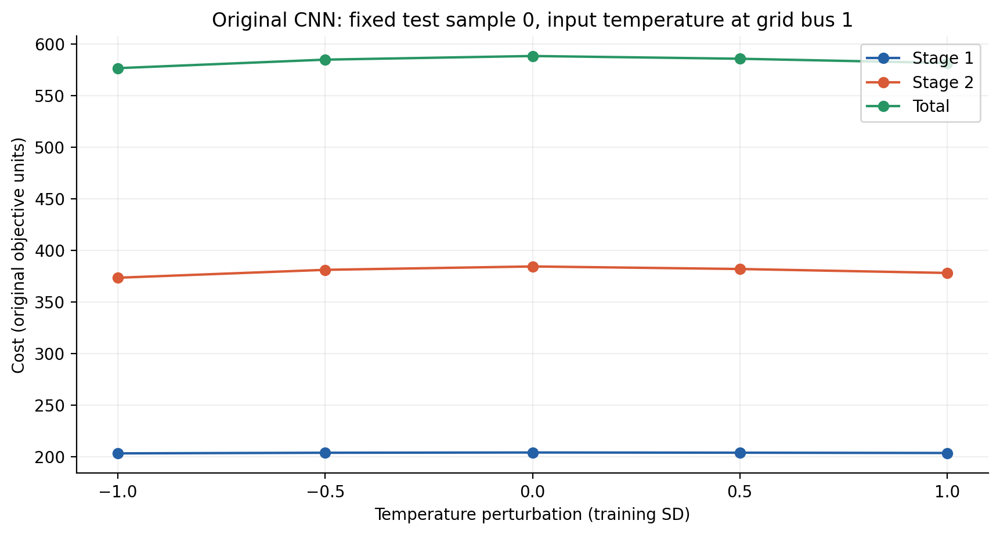
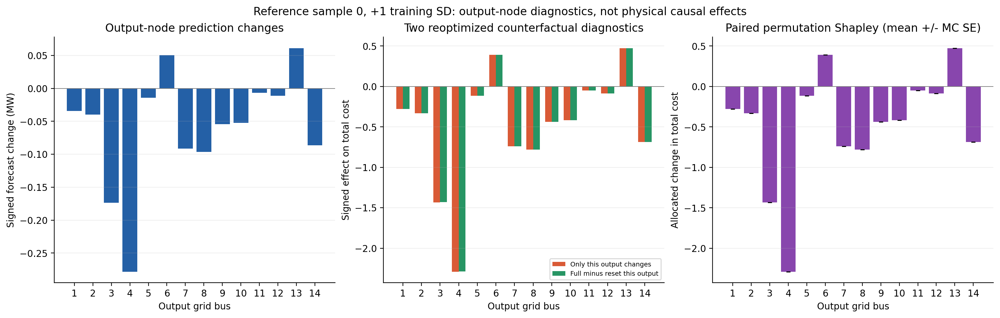
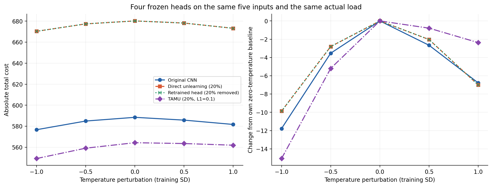
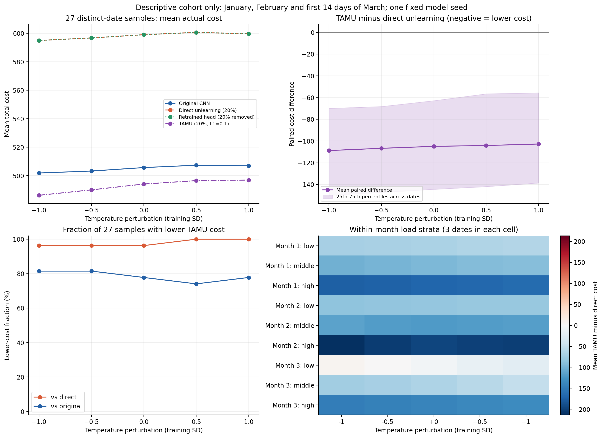

# CNN 温度—负荷预测—运行成本：节点诊断与多日期验证

本轮沿用既有 CNN 核心与原始、20% 直接遗忘、剩余样本重拟合头、20% TAMU（L1=0.1）四种权重，种子42，helpful，case14。**没有训练模型，没有改变原成本目标、罚系数或数学约束。** 结果在独立分支 `analysis/cnn-cost-attribution`。

## 本轮回答什么

1. 保持五档温度扰动不变，实算 cost1/cost2/总 Cost，比较四种模型的经济性。
2. 检查“预测变化最大的输出节点是否也是 Cost 影响最大的输出节点”，使用两种节点反事实和抽样 Shapley，避免把预测变化量直接解释为成本贡献。
3. 在预先按日期和真实负荷选定的样本上复查结果；范围限于当前测试集。

仍扰动输入节点1的温度 `input[0,0,0,4]`，训练段7008行的 σ=0.935414141938 编码单位，等价温差 7.936348491 K。每次仅加 −1/−0.5/0/+0.5/+1σ，其他139个输入、四种权重、每个样本的真实负荷和系统约束均固定。14×10原始输入、64隐藏特征及输出缩放沿用 [上一轮结构与调用链报告](../cnn_temperature_response/README.md)。

## 1. 原始 CNN 的运行成本路径



| 扰动/σ | 总预测变化/MW | cost1 | cost2 | 总 Cost |
| --- | --- | --- | --- | --- |
| -1 | -1.448131 | 203.198978 | 373.495723 | 576.694702 |
| -0.5 | -0.433243 | 203.791202 | 381.151346 | 584.942548 |
| +0 | +0.000000 | 204.044292 | 384.429257 | 588.473549 |
| +0.5 | -0.323389 | 203.856545 | 381.956236 | 585.812781 |
| +1 | -0.827542 | 203.562631 | 378.132555 | 581.695186 |

调用链：`temperature_cases → NN_CONV.forward → 冻结仿射头 → output_z * target_std + target_mean → Operator.solve_one(forecast_pu) → Operator.solve_two(fixed_truth_pu, PG) → cost1+cost2`。预测MW=p.u.×100。费用沿用仓库单位，没有附加市场电价或现实天气因果解释。每次求解的预测、真实负荷、七项费用、PG/LS1/LS2/GS/角度、状态和约束残差均在 [all_cost_traces.jsonl](all_cost_traces.jsonl)。

## 2. 哪个输出节点对 Cost 最重要

固定参考样本0，记零扰动预测为 f0、完整温度扰动后的预测为 f1，成本函数 C 使用同一真实负荷和原两阶段优化。

- **隔离变化：** 仅把节点 j 的预测从 f0[j] 改成 f1[j]，其他输出取 f0，计算 `C(仅j改变)−C(f0)`。
- **复位诊断：** 其他输出取完整 f1，仅将 j 复位到 f0[j]，计算 `C(f1)−C(仅j复位)`。
- **抽样 Shapley：** 用 128 条顺序（64 个独立随机顺序及其逆序对，seed42）逐一加入输出变化，平均各节点对 cost1/cost2/总 Cost 的边际影响。共享子集成本只求解一次并缓存。

这三类是**预测输出向量的反事实诊断**，不代表在14个输入节点分别改变温度，也不证明物理因果。混合输出未必能由某一真实 CNN 输入产生。总负荷预测变化不等于各节点成本贡献；隔离/复位值也不能未经验证相加。



参考样本的最大值均按绝对值排序，符号保存在原表：

| 温度扰动/σ | 最大预测变化节点 | 最大隔离Cost节点 | 最大复位Cost节点 | 最大抽样Shapley节点 |
| --- | --- | --- | --- | --- |
| -1 | 3 | 3 | 3 | 3 |
| -0.5 | 3 | 3 | 3 | 3 |
| +0.5 | 3 | 3 | 3 | 3 |
| +1 | 4 | 4 | 4 | 4 |

在 +1σ 下，抽样 Shapley 最大的是节点 4，分配的 ΔCost=-2.289144787，MC标准误=1.35e-09。本次参考样本中是否一致应按上表如实解释，不能预设一定不同。

所有28个样本的4个非零扰动共 112 次排序比较中，预测峰值与隔离Cost峰值不一致 0 次，与复位Cost峰值不一致 0 次。隔离/复位前两名差≤1e−4的场景分别 0、0 次，此时不应过度解释名次；1e−4是诊断容差，不是严格的目标值误差界。详见 [node_rank_comparison.csv](node_rank_comparison.csv)。

隔离影响求和与联合 ΔCost 的最大差为 3.24639716，不能把隔离值冒充严格的加性成本贡献。抽样 Shapley 每条路径按同一缓存成本望远镜求和，总分配与联合变化最大误差 3.55e-15。这种守恒**不意味着每个节点的 Shapley 已精确枚举**。MC标准误按独立逆序对计算，仅表示随机顺序抽样误差，不包含求解误差或数据样本不确定性；小于数值求解误差的标准误不能作为有效小数位或总体置信区间。

原始逐节点数据：[node_counterfactuals.csv](node_counterfactuals.csv)、[reference_shapley.csv](reference_shapley.csv)、[coalition_costs.csv](coalition_costs.csv)。已保存完整顺序和逐路径边际值，可核验分摊。

## 3. 相同输入下四种模型的经济性



绝对 Cost 回答哪个模型在同一真实负荷下成本较低；相对自身零扰动的 ΔCost 回答模型响应幅度。两者含义不同，响应幅度小不自动等于经济性好。重新训练仍指原项目协议下的910参数预测头重新拟合，核心不动。TAMU权重使用原测试平均Cost分数恢复，未针对本次温度场景重新优化。

## 4. 不同日期与真实负荷水平

在任何本轮推理/Cost之前，按当前测试集的1月、2月、3月分别计算真实总负荷三分位。每个月的低/中/高层内，取最接近10%、50%、90%负荷分位的小时，保留互不重复的日期。形成 **27个分层样本、27个日期**，另保留原参考样本0，总计28个日期。原参考点不计入下表分层平均值，防止额外加权。

选样只用日期与真实负荷，不看原始/TAMU的预测或Cost。选择规则、三分位阈值和哈希在推理前保存；见 [selection.json](selection.json)、[parent_provenance.json](parent_provenance.json)。低/中/高是各月内部相对水平，不能解释为全年的绝对低/高负荷。



| 扰动/σ | 原始平均Cost | 直接遗忘 | 重拟合头 | TAMU | TAMU低于直接遗忘 | TAMU低于原始 |
| --- | --- | --- | --- | --- | --- | --- |
| -1 | 501.869606 | 594.992081 | 594.994115 | 486.210148 | 26/27 | 22/27 |
| -0.5 | 503.250690 | 596.762057 | 596.764059 | 490.030712 | 26/27 | 22/27 |
| +0 | 505.687492 | 599.036910 | 599.038749 | 494.109053 | 26/27 | 21/27 |
| +0.5 | 507.336599 | 600.656945 | 600.658698 | 496.516036 | 27/27 | 20/27 |
| +1 | 506.936312 | 599.684313 | 599.686080 | 496.912228 | 27/27 | 21/27 |

低于以差值<−1e−4判定。全部样本逐一配对比较，没有跨日期混配。图中阴影是所选27个日期的四分位区间，**不是总体置信区间**。逐场景结果/MSE/MAPE见 [results.csv](results.csv)，14节点预测见 [predictions_14_buses.csv](predictions_14_buses.csv)，配对差值见 [paired_model_costs.csv](paired_model_costs.csv)，分层汇总见 [cohort_summary.csv](cohort_summary.csv)。

所选27个日期中，TAMU在五档扰动下的平均Cost均较原始/直接遗忘低，但不逐样本保证。实际反例：test index 1686（2019-03-12、源Hour 7，月内low负荷），-1σ 时 TAMU=1209.299538，直接遗忘=1148.370328，TAMU反而高 60.929210。所有较原始或直接遗忘更贵的场景见 [economic_counterexamples.csv](economic_counterexamples.csv)。

## 5. 验证与复算

- 单参考样本最小真实测试先通过：四模型×五档、节点反事实和8条顺序，共960次QP；正式实验使用128条顺序。
- 正式实验 560 个模型场景、7840 个预测数值，节点隔离/复位表 1568 行，共 17360 次QP。全部状态为 ['optimal']；实际求解器 ['GUROBI']；最大约束残差 7.38e-08，七项费用分解最大误差 4.55e-13。
- 所有模型权重哈希不变、真实负荷逐次检查、零扰动预测逐位一致、零扰动最大Cost差 0。自动化测试与完整重放核验记录见 [validation.json](validation.json)、[test-results.txt](test-results.txt)。
- 原始数学源码、旧实验脚本与历史结果均保留。新增 [cost_attribution.py](../../experiments/cost_attribution.py)、[report_cost_attribution.py](../../experiments/report_cost_attribution.py)、[validate_cost_attribution.py](../../experiments/validate_cost_attribution.py) 及测试；分支未合并 master。

```bash
export OMP_NUM_THREADS=1 OPENBLAS_NUM_THREADS=1 MKL_NUM_THREADS=1
# 已有年度预处理数据及上一轮快照时运行
.venv/bin/python experiments/cost_attribution.py --smoke --output-dir /tmp/cost-path-smoke-new
.venv/bin/python experiments/cost_attribution.py --output-dir /tmp/cost-path-full-new
# 使用本目录保存的真实28条样本、训练σ及冻结权重复算，无需训练或全年原数据
.venv/bin/python experiments/cost_attribution.py --replay-from research/cnn_cost_attribution --output-dir /tmp/cost-path-replay-new
.venv/bin/python experiments/report_cost_attribution.py
.venv/bin/python experiments/validate_cost_attribution.py --replay-dir /tmp/cost-path-replay-new
.venv/bin/python -m pytest -q
```

输出目录必须为空。依赖沿用现有 [requirements.txt](../../requirements.txt)，CPU环境和求解器限制见 [成本修复报告](../../COST_REPRODUCTION_REPORT.md)。

## 结论范围

本轮给出指定温度输入→14个输出预测→两阶段Cost的实际路径，并分开核验绝对经济性、响应幅度和输出节点成本诊断。不同节点与模型的结论以实测表为准，不预设TAMU在所有场景更优，也不预设预测峰值和成本峰值必然不同。

虽然新增多日期样本，**测试期仍只有2019-01-01至03-14**，尚未覆盖夏季/全年；只有seed42和一个输入节点/特征。分层样本不是随机总体抽样；同一个训练模型的观测可能相关。原全年归一化先于划分、helpful/TAMU使用测试性能信息的原协议局限仍存在。未增加ERCOT数据或改变节点映射。

[下载完整结果ZIP](https://github.com/syh-Mason/task_aware_machine_unlearning/blob/analysis/cnn-cost-attribution/exports/cnn_cost_attribution.zip?raw=true)。
