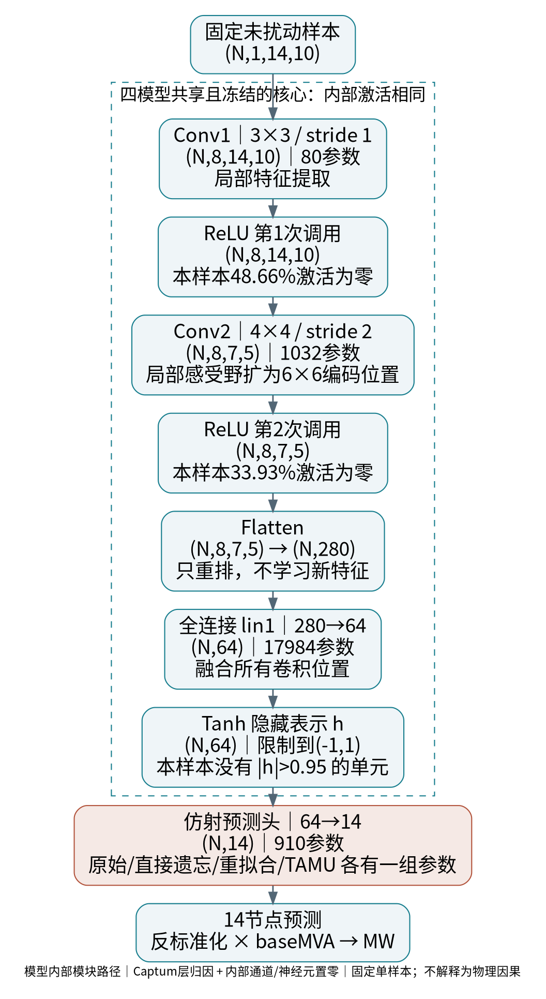
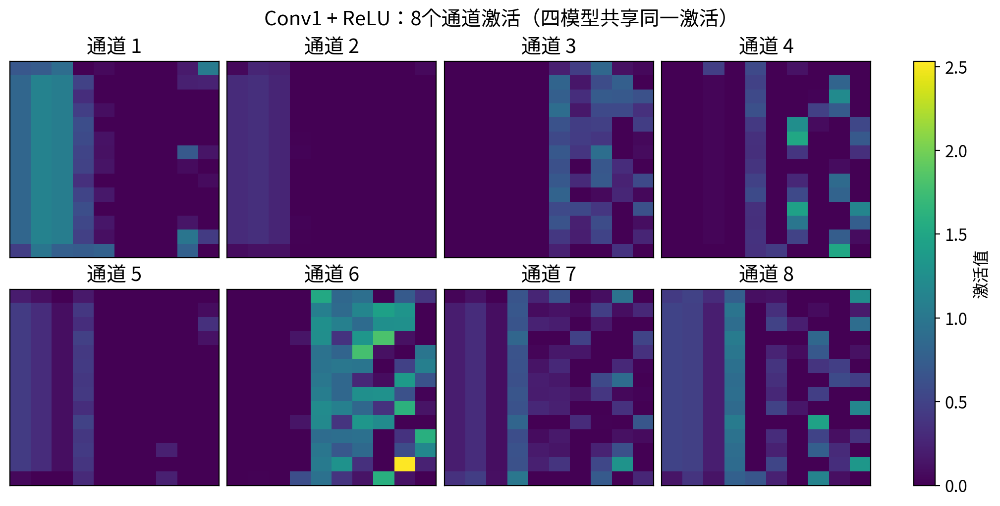
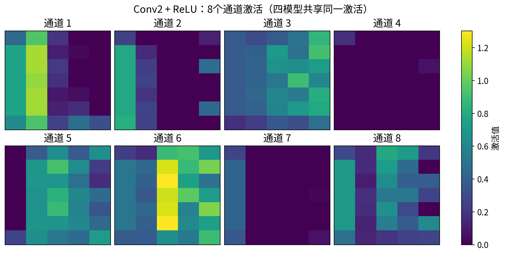
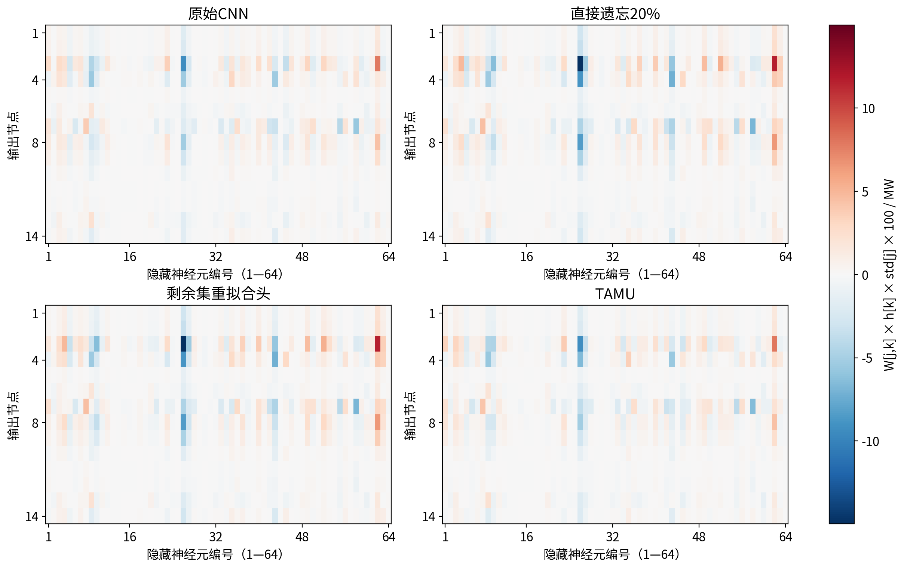
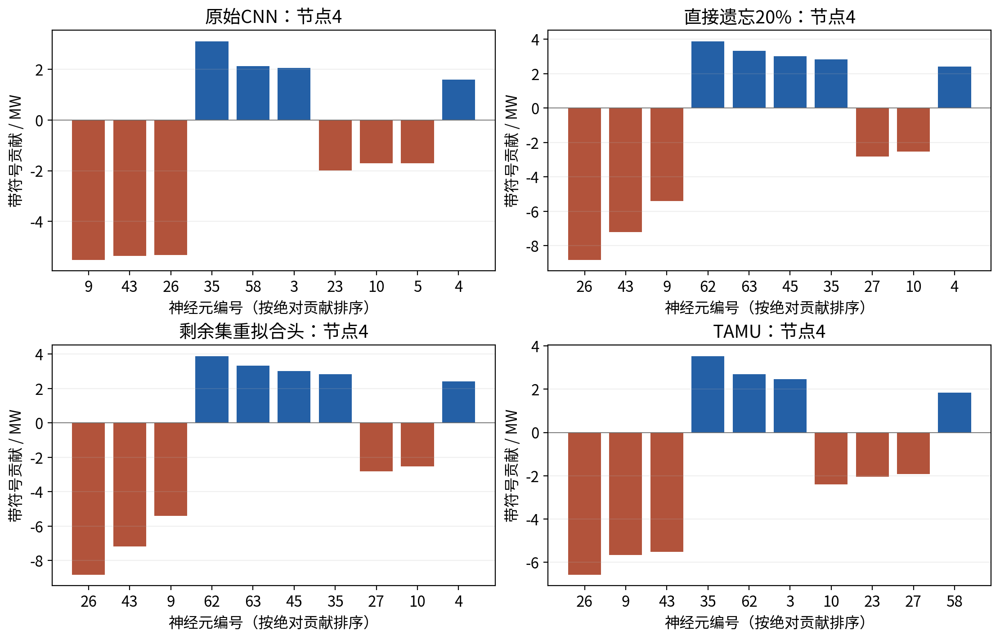
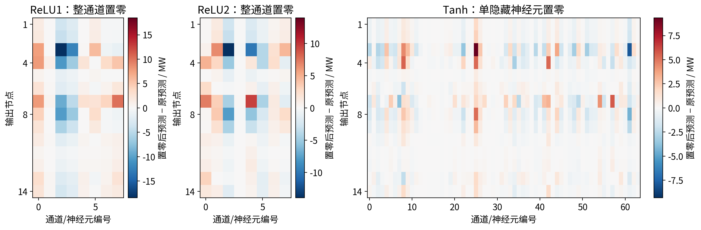

# CNN 模型内部层作用路径分析

[下载Word](CNN_模型内部层作用路径.docx?raw=true) · [阅读PDF](CNN_模型内部层作用路径.pdf) · [下载完整包](../../exports/cnn_layer_paths.zip?raw=true) · [复算说明](REPRODUCE.md)

## CNN 各层怎样形成最终预测

分析对象：原 Task-Aware 项目的已有 CNN 与四种敏感集预测头。分析重点是模型内部各层的表示、梯度贡献和内部消融，不是再次改变温度等原始输入。日期：2026-10-21。

Captum 是归因分析工具库，本身没有唯一神经网络结构。用户上传的 captum-master.zip 超过当前工具32 MiB读取上限，未能读取；本轮使用官方 Captum v0.7.0源码，与既有 PyTorch 2.0.1兼容，不声称等同上传包版本。

| 分析项 | 实际执行 |
| --- | --- |
| 固定样本 | 既有 test index 0，原始未扰动输入 |
| 模型 | 原始、20%直接遗忘、剩余集重拟合头、TAMU |
| 层记录 | 8个实际运算阶段；两次ReLU分别记录 |
| 层归因 | Captum LayerActivation、LayerGradientXActivation |
| 内部干预 | ReLU1的8通道、ReLU2的8通道、Tanh的64神经元逐个置零 |
| 规模 | 4模型×80次=320次内部消融，记录4480个输出变化 |
| 验收 | 90项内部一致性检查通过，0失败 |

核心发现：四模型的核心激活逐位相同，贡献会因预测头参数改变而不同；原始模型节点4的最大绝对隐藏贡献来自神经元9，直接遗忘/重拟合/TAMU则来自神经元26。该观察仅适用于当前固定样本。

## 1  模型内部的实际调用链

原代码同一个relu模块调用两次；分析包装器将两次调用分成唯一命名relu1/relu2，保持计算与预测逐位一致，避免层hook混淆。

## 2  每层做什么、形状怎样变化

| 阶段 | 实际输出形状 | 参数数 |
| --- | --- | --- |
| conv1 | 1x8x14x10 | 80 |
| relu1 | 1x8x14x10 | 0 |
| conv2 | 1x8x7x5 | 1032 |
| relu2 | 1x8x7x5 | 0 |
| flatten | 1x280 | 0 |
| lin1 | 1x64 | 17984 |
| tanh | 1x64 | 0 |
| head | 1x14 | 910 |

Conv1在编码张量的局部3×3邻域提取8种响应；Conv2组合已有通道并以步长2缩小空间尺寸，局部感受野约6×6编码位置。这里的相邻位置由bus/特征排列决定，不能直接称为电网物理相邻。

ReLU只保留正响应。Flatten仅将8×7×5重排为280维；lin1把所有位置融合到64维；Tanh将表示限制到(-1,1)，可能因饱和而减弱梯度；当前样本没有绝对值大于0.95的Tanh单元。

最终预测头以Wx+b将64维隐藏表示读为14个负荷输出，再反标准化为p.u.并换算MW。实际有效网络共20006参数，其中预测头910参数。本轮没有重新训练这些参数。

## 3  看见各卷积通道的激活

当前样本ReLU1零激活比例48.6607%，ReLU2为33.9286%。这描述哪些内部响应被门控，不表示通道已经学到某个已知物理含义。四模型核心相同，所以这些激活也相同。

## 4  哪些隐藏神经元在支持各输出

Captum的LayerGradientXActivation计算“该层激活×目标输出对该层激活的梯度”。这里目标是每个节点的原始负荷预测（MW），不是Cost。不同层的分数是同一预测的不同切面，不能相加或据其总量给层做全局重要性排名。

对最后仿射头，隐藏贡献具有精确表达：贡献[j,k]=W[j,k]×h[k]×std[j]×100。所有隐藏贡献加上(b[j]×std[j]+mean[j])×100，恢复节点预测。当前最大重构误差为1.43e−14 MW。

这是对隐藏状态置零参考下的仿射读出分解；常数偏置单列。前面非线性层的Gradient×Activation一般只是局部归因，不自动具备同样的精确可加性。

## 5  节点4：遗忘前后读出了什么

| 模型 | 节点4预测/MW | 最大绝对贡献神经元 | 带符号贡献/MW |
| --- | --- | --- | --- |
| 原始CNN | 51.640998 | 9 | -5.526458 |
| 直接遗忘20% | 52.816433 | 26 | -8.827747 |
| 剩余集重拟合头 | 52.816477 | 26 | -8.827731 |
| TAMU | 51.204608 | 26 | -6.576171 |

原始模型神经元9贡献−5.526458 MW；直接遗忘与重拟合的最大贡献转为神经元26，约−8.8277 MW；TAMU同为神经元26，约−6.576171 MW。前层激活没变，改变的是预测头对同一隐藏表示的读出。不能据此称核心学会了新的特征，也不能把神经元9直接命名为温度神经元。

## 6  内部消融验证与结论范围

保持原始输入不变，将某个ReLU后的整通道或某个Tanh神经元激活置0，再计算后续层。整通道包含许多空间位置，与单个隐藏神经元不是同样大小的干预，不能直接将两类峰值当作公平层排名。

原始模型将神经元9置零，节点4预测从51.640998增加到57.167456 MW，增加5.526458 MW，与其负贡献被移除一致。全部隐藏神经元置零检查的最大误差约3.27e−14 MW。前层通道消融可能改变后续ReLU门控，未必等于局部Gradient×Activation。

Captum激活与手动记录完全一致；Captum梯度×激活与直接自动微分完全一致；四模型预测与既有零扰动记录一致；模型参数与源快照均未变化。90项检查为本轮内部一致性验收，不与此前实验测试数累加。

局限：仅一条固定样本；置零后的隐藏状态未必来自真实输入；归因依赖目标和方法；没有枚举完整的最重要神经元连通路径，没有宣称物理因果或全局层重要性。本轮不重新计算Cost，也没有把数据输入扰动冒充模型层分析。

复现：使用Captum v0.7.0，运行 experiments/analyze_cnn_layers.py；源码来源 https://github.com/pytorch/captum/tree/v0.7.0 。逐层数组、归因表、消融表及校验记录保存在本目录。
