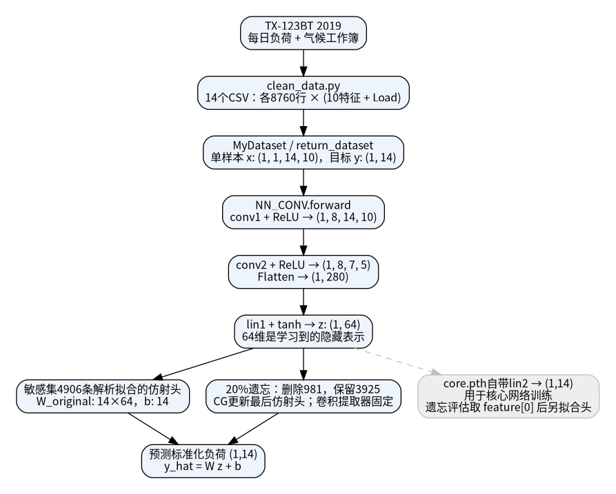
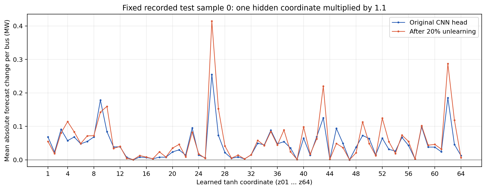
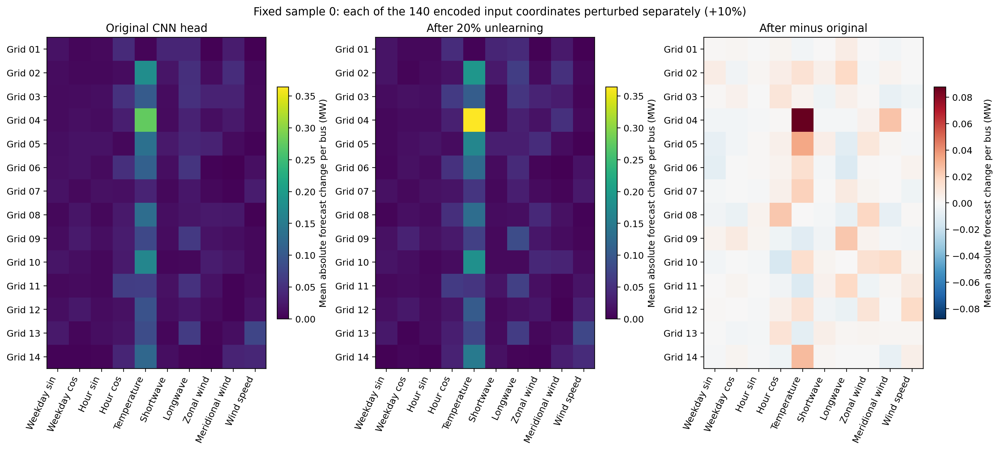
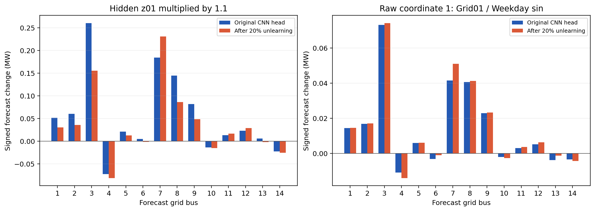
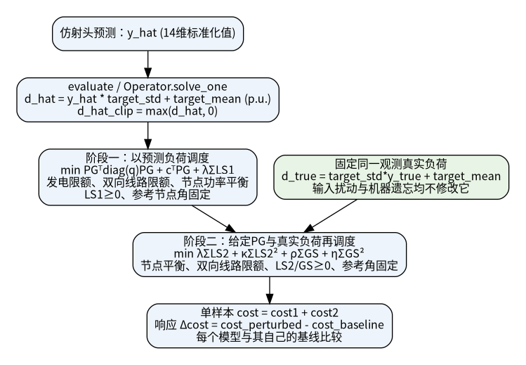
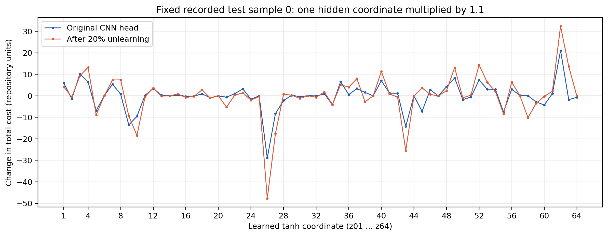
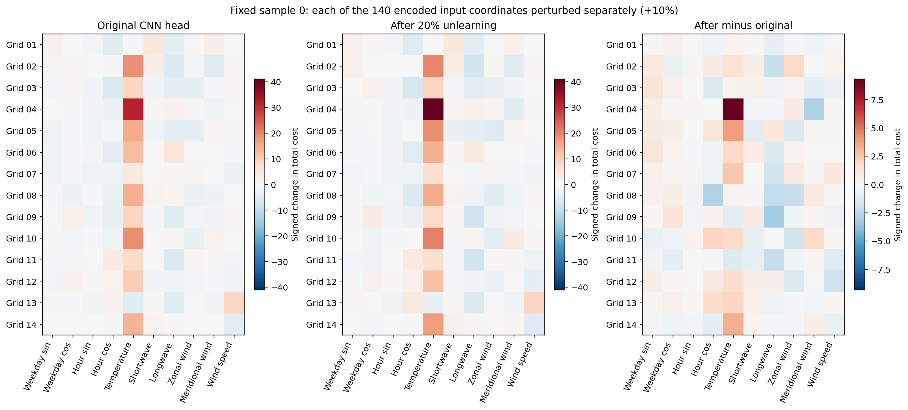
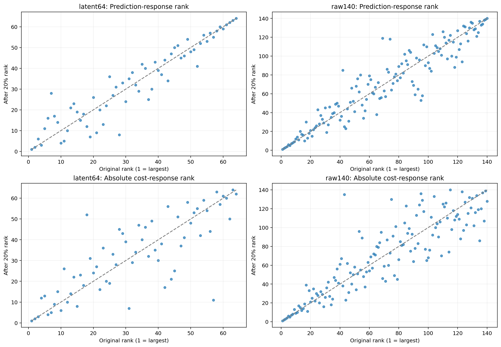
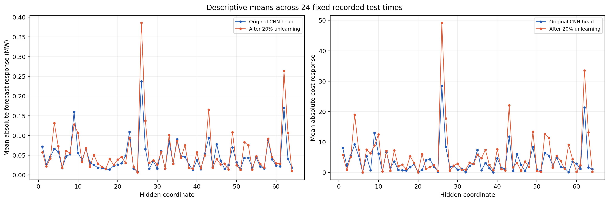
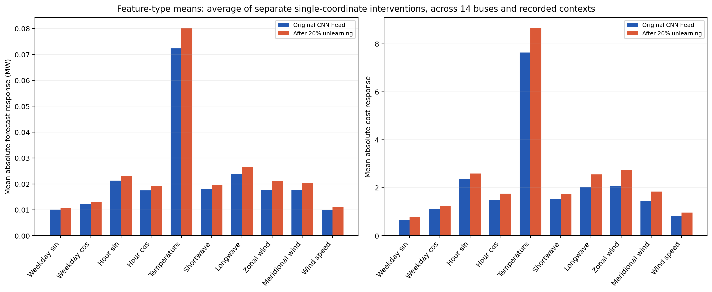

# CNN 输入—预测—Cost 与 20% 遗忘敏感性研究

五项任务已经完成；本页和关联 CSV/PNG/PDF 均来自现有真实检查点与官方 TX-123BT 数据。TX-123BT 是公开的合成系统数据，本次使用其已存在的测试样本。分析使用固定卷积提取器，重新按原算法构建敏感集仿射头及 20% CG 遗忘头，没有重新训练 CNN 核心网络，也没有更改 cost、目标函数或数学约束。

- [x] 输入含义：140维原始特征表与64维隐藏表示表。
- [x] CNN路径：源码定位、实测张量形状和调用流程图。
- [x] 单变量扰动：每次一个坐标乘1.1，记录完整14维预测与敏感性图。
- [x] Cost路径：逐次求解原两阶段问题，记录费用分量和约束残差。
- [x] 遗忘前后：固定提取器和真实负荷，对比20%遗忘后的响应幅度及排名。

固定样本的实测结果：原始与遗忘模型最敏感的隐藏坐标分别为 z26 / z26，对应预测响应 0.254909 / 0.414450 MW；64维预测响应的Top10重合5项。原始编码输入中，原模型响应最大的坐标为节点4 / Temperature (k)，同一坐标前后干预Δcost为+31.686280 / +41.007442。排名与幅度应结合完整表评价，单个最大响应坐标相同不代表整体敏感性不变。

## 一、确认输入维度与实际意义

**原始 CNN 输入不是64维，而是14个节点 × 10类特征 = 140维。64维是 `lin1 → tanh` 输出的学习表示。** 各隐藏维混合了原始特征，没有可直接命名为“温度”“风速”的逐维物理对应。其编号只能写为 z01…z64。

| 类别 | 10类原始特征（每个节点均有） | CSV实际存储值 |
| --- | --- | --- |
| 时间 | Weekday_sin、Weekday_cos、Hour_sin、Hour_cos | sin/cos编码，无量纲；weekday从0开始，hour标签1…24 |
| 气象 | Temperature (k)、Shortwave Radiation (w/m2)、Longwave Radiation (w/m2)、Zonal Wind Speed (m/s)、Meridional Wind Speed (m/s)、Wind Speed (m/s) | 每个原始TX节点按全年均值和样本标准差(ddof=1)进行z-score，单位已经消除 |

气象原单位分别是 K、W/m²、W/m²、m/s、m/s、m/s。CSV保留原列名，但数值已标准化。`Load` 是目标列，不进入10个输入特征。实际模型没有64个滞后负荷输入。隐藏特征经过 tanh，原始范围为[-1,1]；最后仿射层使用64个特征，另有偏置，共14×(64+1)=910个可遗忘参数。

- [140维输入说明表](raw_input_features_140.csv)：每个坐标的节点号、字段、原单位、存储编码、原始TX索引及当前样本取值。
- [64维隐藏表示说明与实测敏感性表](latent_features_64.csv)：逐维激活、干预步长、线性头单位增益及前后排名；不赋予未经证实的物理语义。
- 原始TX的CSV文件 `bus_k.csv` 使用0基列索引，源气候 Bus 标签为k+1。加载器按文件名数字排序后映射至14节点模型，完整对应已写入输入表。
- 源码：[clean_data.py:28](../../clean_data.py#L28)、[utils/dataset.py:52](../../utils/dataset.py#L52)、[utils/dataset.py:13](../../utils/dataset.py#L13)。

## 二、CNN 前向与输出调用链



[矢量PDF](figures/cnn_call_path.pdf) · [SVG](figures/cnn_call_path.svg) · [真实前向张量形状](forward_trace.json)。卷积参数为1→8通道、3×3/stride1；第二层8→8通道、4×4/stride2；Flatten为280维；lin1为280→64；tanh输出64维。

`train_nn.py` 的核心网络预测取 `net(x)[1]`，对应 checkpoint 内的 lin2。遗忘实验的 [func_operation.py:404](../../func_operation.py#L404) 取 `net(x)[0]`，再在敏感集上解析拟合最后仿射头。因此本报告的“原始CNN”指现有遗忘流程中的**固定CNN提取器 + 未遗忘的敏感集仿射头**。20%遗忘更新这个头，提取器不变；没有把 core.pth 自带 lin2 与另一个头混作前后对照。[utils/net.py:31](../../utils/net.py#L31)、[eval_unlearn.py:31](../../eval_unlearn.py#L31)。

数据为8760小时；训练7008，测试1752。测试集实际是全年最前1752小时，训练集是之后7008小时；核心集2102，敏感集4906，20%删除981、保留3925。候选样本按原默认 cost influence 从最有帮助的31%中按seed42选取，详见 [func_operation.py:326](../../func_operation.py#L326)。两个模型重建后的全测试集MSE/MAPE与此前保存结果相符：原模型MSE=0.004187925789、MAPE=9.237294605%；遗忘模型MSE=0.005208476725、MAPE=9.855998086%。

## 三、单变量 +10% 扰动

固定展示样本为 test index 0（原始年度行0：Day1、Hour1标签，没有额外推断时区）。逐次令 x_j'=1.1x_j，其余输入坐标、模型参数及同一真实负荷全部固定。分别执行64维隐藏坐标干预和140维原始编码坐标干预；敏感性主要度量为14个节点预测变化绝对值的均值，换算MW使用case14的baseMVA=100。

**乘1.1对负数表示绝对值增加10%，对零不产生变化。天气z-score乘1.1表示离全年均值的距离增加10%，不等于温度/风速物理值增加10%。独立修改时间sin/cos会破坏共同时间及单位圆关系；隐藏值也可能越过tanh范围。** 这些是冻结模型的数值敏感性探针，不作为可实现天气或时间反事实。本次有706条模型干预记录超出其编码单位界，已逐条标记，未裁剪或隐瞒。





第一个隐藏坐标 z01 的实际值与步长分别为 -0.354067594、-0.035406759。其原模型/遗忘模型平均预测响应分别为 0.068451074 / 0.055082411 MW，对应Δcost为 +6.030577922 / +4.289029066。原始第1坐标是节点1的 Weekday_sin，响应分别为 0.017650709 / 0.018643485 MW。完整14维预测向量在 [所有预测NPZ](all_predictions.npz) 和 [首坐标示例表](first_coordinate_examples.csv) 中。



## 四、预测到 Cost 的完整路径



[矢量PDF](figures/forecast_to_cost.pdf) · [逐项费用、状态、约束残差与决策变量](fixed_sample_cost_trace.json)。预测先按目标的全年mean/std还原为p.u.，负预测按原代码截断为0；原始负荷先按每节点全年最大值映射到case14标准负荷，再除baseMVA。标准化顺序、截断和两阶段均保持原实现。目标标准差使用NumPy总体标准差(ddof=0)，区别于天气输入的Pandas样本标准差(ddof=1)。

第一阶段最小化 `PGᵀdiag(q)PG + cᵀPG + λΣLS1`；保留发电上下限、线路双向限额、`Bbusθ=CgPG−Cl(d_hat−LS1)`、LS1≥0和参考角。

第二阶段固定第一阶段PG，最小化 `λΣLS2 + κΣLS2² + ρΣGS + ηΣGS²`；保留 `Bbusθ=Cg(PG−GS)−Cl(d_true−LS2)`、双向线路限额、LS2≥0、GS≥0和参考角。case14 λ=3500、κ=1250、ρ=700、η=250；不添加原项目没有的GS上界或LS上界。

单样本cost等于cost1+cost2，本报告沿用仓库目标函数数值。每次干预使用固定真实负荷，且每个模型的Δcost都相对于该模型自身的基线，不把遗忘本身的基线差混入扰动响应。源码：[utils/funcs.py:135](../../utils/funcs.py#L135)、[utils/optimization.py:233](../../utils/optimization.py#L233)、[utils/optimization.py:260](../../utils/optimization.py#L260)。

| 固定样本 | 阶段一 | 阶段二 | 总cost |
| --- | ---: | ---: | ---: |
| 原模型 | 204.044292207 | 384.429256735 | 588.473548943 |
| 遗忘20% | 210.704196866 | 469.477155569 | 680.181352435 |

从已完成的原始输入干预中，选取本样本预测响应最大的坐标（节点4 / Temperature (k)）展示费用路径。其编码值从-1.923651457变为-2.116016626；这是编码数值乘1.1，符号方向已保留。以下各列均为同一次干预相对本模型基线的变化，完整七项费用见 [费用示例CSV](cost_path_largest_raw_example.csv)。

| 模型 | 预测总负荷ΔMW | Δcost1 | Δcost2 | 净Δcost | 储存/过量发电处理ΔMW |
| --- | ---: | ---: | ---: | ---: | ---: |
| original | +3.870870 | +2.277620 | +29.408659 | +31.686280 | +3.870870 |
| unlearned20 | +5.098785 | +3.113590 | +37.893852 | +41.007442 | +5.098785 |

该固定示例中，温度编码坐标扰动使预测总负荷上升，阶段一费用与阶段二的过量发电处理费用均增加；真实负荷保持相同。这个例子的主要cost增加来自再调度项，不能只根据预测误差大小或阶段一发电成本推断总cost。





## 五、遗忘前后敏感性变化

| 空间/指标 | 前后Spearman排名相关 | Top10重合 | 原模型最大响应坐标 | 遗忘后最大响应坐标 |
| --- | ---: | ---: | --- | --- |
| latent64 预测响应 | 0.938278 | 5/10 | z26 | z26 |
| latent64 Cost响应 | 0.804487 | 7/10 | z26 | z26 |
| raw140 预测响应 | 0.941239 | 9/10 | 节点4 / Temperature (k) | 节点4 / Temperature (k) |
| raw140 Cost响应 | 0.887402 | 9/10 | 节点4 / Temperature (k) | 节点4 / Temperature (k) |

Spearman越接近1表示排序越相似，不能据此断言响应幅度相同。预测响应与cost响应分别排名，cost按绝对变化排名，同时保留正负方向。

| 空间 | 模型 | 预测响应最大的坐标 | 平均绝对预测变化MW | 同次Δcost |
| --- | --- | --- | ---: | ---: |
| latent64 | original | z26 | 0.254908769 | -28.908915052 |
| latent64 | unlearned20 | z26 | 0.414450179 | -47.748332210 |
| raw140 | original | 节点4 / Temperature (k) | 0.276490701 | +31.686279809 |
| raw140 | unlearned20 | 节点4 / Temperature (k) | 0.364198930 | +41.007441775 |



在同一个隐藏坐标值及步长下，`Δprediction = diag(std) W Δz`。本次逐项验证误差最大为 2.37e-16 p.u.；原始输入的特征提取变化Δz对两个头相同，前后预测响应之差等于 `diag(std)(W_after−W_before)Δz`。因此本实验中敏感性变化可定位到最后仿射头变化；cost的后续变化还受预测基线和约束作用区域影响。该结论不涉及已冻结卷积层发生参数变化。

24个时点按当前测试集均匀选取，索引为 [0, 76, 152, 228, 304, 380, 456, 532, 609, 685, 761, 837, 913, 989, 1065, 1141, 1218, 1294, 1370, 1446, 1522, 1598, 1674, 1751]。它们只覆盖当前测试集的最前73天，不代表全年或总体。分别计算所有坐标干预后取描述性均值，没有按最大效应挑选样本或坐标。





特征类型柱状图是对14个节点上的**独立单坐标干预**再跨时点取均值，并非同时改变14个输入。可用 [排名统计JSON](summary.json)、[固定样本带排名CSV](fixed_sample_ranked.csv)、[跨时点均值CSV](context_aggregated.csv) 核验。单样本和跨时点结果不可替换为因果物理重要性或全数据集统计结论。

## 数据、验证及复现

已通过36项自动化测试，0失败、0跳过；快照完整重放的137760个预测值逐位一致，全部干预CSV逐字节一致。完整验证记录见 [validation.json](validation.json)，测试输出见 [test-results.txt](test-results.txt)。

- [完整干预CSV](all_interventions.csv)：9840行，含48条基线和9792条干预；两阶段费用分量、求解状态/残差、预测变化和固定真实负荷路径均有记录。
- [便携冻结模型](frozen_models.npz)、[真实输入及目标快照](reference_inputs.npz)：支持不读取原始数据、不重新训练CNN的重放。核心checkpoint、影响分数、14个CSV及源文件校验值见 [manifest](manifest.json)。
- 实际共执行19680次QP，全部optimal，求解器GUROBI，最大原约束残差2.43e-07，费用分解误差2.27e-13。
- 原模型与遗忘模型及提取器的state哈希在研究前后完全一致，所有干预保持真实负荷不变。CG收敛info=0，遗忘与重训练头最大参数差为 0.000367963，保留原容差1e-5。

从仓库根目录执行：

```bash
export OMP_NUM_THREADS=1 OPENBLAS_NUM_THREADS=1 MKL_NUM_THREADS=1
export XDG_CACHE_HOME=/workspace/.cache
export MPLCONFIGDIR=/workspace/.cloud-setup/task-aware/matplotlib
.venv/bin/python scripts/analyze_cnn_sensitivity.py
.venv/bin/python scripts/report_cnn_sensitivity.py
.venv/bin/python -m pytest tests -q

# 使用导出真实快照完整重放；输出目录必须为空
.venv/bin/python scripts/analyze_cnn_sensitivity.py --replay-from research/cnn_sensitivity --output-dir /tmp/tamu-cnn-sensitivity-replay
.venv/bin/python scripts/validate_cnn_sensitivity.py --with-original-data --replay-dir /tmp/tamu-cnn-sensitivity-replay
```

局限：这是编码输入和隐藏表示的有限扰动研究，部分探针不在实际数据流形内；不等同于物理温度增加10%的研究。当前预处理在划分前使用全年统计量和最大值，保留了原方案，但限制其作为严格盲测评估的解释。尚未接入ERCOT，也没有作跨数据集、跨季节或全网络重新训练后敏感性稳定性的结论。既有cost定义和数学约束均保持不变。
