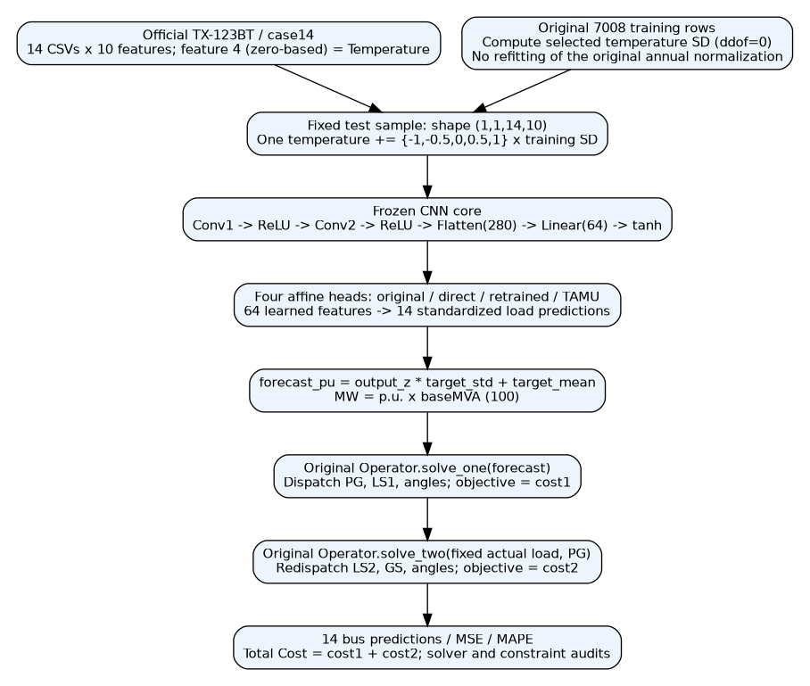
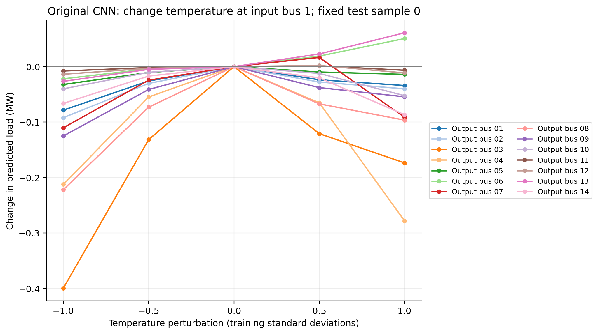
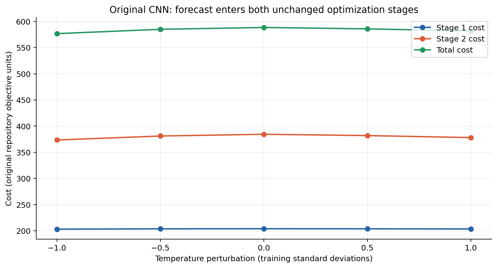
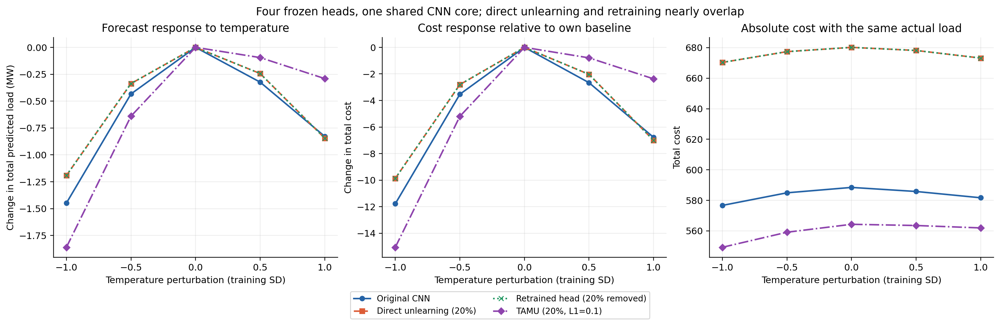

# CNN 单节点温度扰动：导师汇报

已完成截图中的 5 项任务。本轮只做固定样本、固定节点的五档扰动和四种模型比较；下列数值均来自实际推理和原两阶段优化求解。

## 1. 固定设置和输入核验

| 项目 | 实际设置 |
| --- | --- |
| 代码 | 基于 `fix/cost-evaluation` 的修复代码，独立分支 `analysis/cnn-temperature-response` |
| 数据与电网 | 官方 TX-123BT 2019，case14；14 个预处理文件，每个 8760 小时 |
| 种子、删除规则 | 42；helpful；删除敏感样本 981/4906（20% 向下取整），剩余 3925 |
| 测试样本 | test index 0，全年行 0；Day=1, Hour=1，未推断数据时区 |
| 扰动节点 | 电网节点 1；原始 TX 零基索引 2，TX 标签 3 |
| 温度位置 | `input[0,0,0,4]`；节点内零基特征 4；140 维展开零基索引 4 |
| σ 来源 | 原始训练池 7008 行（全年零基行 1752..8759）的温度总体标准差，ddof=0；未使用测试行计算 σ |
| σ 数值 | 编码坐标 0.935414141938，对应物理温差 7.936348491 K（温差数值也等于 °C） |
| 原始全年标准化 | 年均值 291.742801955 K，全年样本标准差 8.484315268 K（ddof=1） |
| 参考温度 | 277.344451904 K；模型实际 float32 编码 -1.697055101395 |
| TAMU | Cost 分数；平均 L1 ≤0.1，L∞≤1；与原 `eval_unchange.py` 相同 LP 和加权 CG |

输入为 `(batch, channel=1, bus=14, feature=10)`；文件按 bus 编号数值升序排列。每个节点的特征依次为：星期 sin、星期 cos、小时 sin、小时 cos、温度、短波辐射、长波辐射、纬向风速、经向风速、风速。**64 维是 CNN 学到的 tanh 隐特征，原始输入有 140 个编码值。** 完整结构及训练集统计见 [140 行输入结构表](input_structure_140.csv)，输出反标准化参数见 [14 节点缩放表](output_scaling_14.csv)。

本次从全部 365 个官方气候工作簿读取选中 TX 节点的 8760 个真实温度，逐小时验证其全年标准化值与预处理 CSV 一致；保存原温度向量及各文件 SHA256。σ 在实际训练 float32 输入上计算，Kelvin 温差与原温度训练段核对一致。五档输入只改变一个坐标，float32 舍入后的实际步长在结果表中记录。

## 2. 输入如何到达预测和 Cost



调用位置：

- [clean_data.py](../../clean_data.py)：气候取行、全年天气 z-score、特征列顺序。
- [utils/dataset.py](../../utils/dataset.py)：文件排序、`(N,1,14,10)` 排列、前 1752 行为测试、后 7008 行为训练；目标先按节点峰值映射 case14，再除 baseMVA=100，再做全年均值/标准差缩放。
- [utils/net.py: NN_CONV.forward](../../utils/net.py#L32)：卷积→ReLU→卷积→ReLU→280 维→64 维 tanh。预测头输出 14 维标准化负荷。
- [func_operation.py](../../func_operation.py)：固定 core 提取敏感特征、生成删除集合、拟合预测头、CG 遗忘模块。
- [eval_unlearn.py](../../eval_unlearn.py)、[eval_unchange.py](../../eval_unchange.py)：原始/直接/重训与 TAMU 的恢复协议。
- [utils/funcs.py: evaluate](../../utils/funcs.py)：`forecast_pu = prediction_z * target_std + target_mean`；MSE 使用 p.u.²，MAPE 使用百分比。
- [utils/optimization.py](../../utils/optimization.py)：负预测按原逻辑截为 0；第一阶段使用预测负荷得到 PG 和 cost1；第二阶段使用同一真实负荷及 PG 得到 cost2。总成本 `cost1+cost2`。

第一阶段为二次/一次发电费用及 LS1 费用；第二阶段为 LS2 和 GS 的一次/二次费用。λ=3500、κ=1250、ρ=700、η=250；发电上限、线路限制、功率平衡、非负与参考角约束均沿用原程序。七项费用和 PG/LS1/LS2/GS/角度全部保存在 [逐场景求解轨迹](cost_traces.json)。Cost 采用仓库目标函数单位，不额外声称为现实市场电价。

## 3. 三张扰动图和实际结果

### 图 1：原始 CNN 的 14 节点负荷响应



预测变化以各模型自己的零扰动预测为基准。14 节点逐值数据见 [predictions_14_buses.csv](predictions_14_buses.csv)。

### 图 2：原始 CNN 的温度—Cost 路径



| 扰动 / σ | 总预测负荷变化 / MW | MSE / p.u.² | MAPE / % | cost1 | cost2 | 总 Cost |
| --- | --- | --- | --- | --- | --- | --- |
| -1.0 | -1.448131 | 0.006174719 | 9.388702 | 203.198978 | 373.495723 | 576.694702 |
| -0.5 | -0.433243 | 0.006306180 | 9.345251 | 203.791202 | 381.151346 | 584.942548 |
| +0.0 | +0.000000 | 0.006372556 | 9.347309 | 204.044292 | 384.429257 | 588.473549 |
| +0.5 | -0.323389 | 0.006311210 | 9.304290 | 203.856545 | 381.956236 | 585.812781 |
| +1.0 | -0.827542 | 0.006291866 | 9.384601 | 203.562631 | 378.132555 | 581.695186 |

原始模型 +1σ 的 cost1 变化为 -0.481661，cost2 变化为 -6.296702；此次 Cost 变化主要来自第二阶段。七项费用分解显示主要为 GS 过量发电处理费用变化，LS1/LS2 的变化接近求解数值误差。此现象只对应当前固定样本。

### 图 3：四种模型的响应对比



| 模型 | 零扰动总 Cost | +1σ 总预测变化 / MW | +1σ ΔCost | −1σ ΔCost |
| --- | --- | --- | --- | --- |
| Original CNN | 588.473549 | -0.827542 | -6.778363 | -11.778847 |
| Direct unlearning (20%) | 680.181358 | -0.844525 | -7.007316 | -9.869084 |
| Retrained head (20% removed) | 680.180885 | -0.844474 | -7.006892 | -9.868670 |
| TAMU (20%, L1=0.1) | 564.325866 | -0.290330 | -2.371888 | -15.057260 |

原始模型 +1σ 时，变化最大的输出是节点 4，变化 -0.278248 MW。所有发生超过 1e−6 MW 变化的输出节点与中心差分结果见 [summary.json](summary.json)。

直接遗忘与重新拟合的五档总 Cost 最大差异为 0.000472933，因此曲线近乎重叠。TAMU 在本样本 +1σ 下的 ΔCost 相比直接遗忘相差 +4.635428。这是一条实际局部响应曲线，是否更稳健应结合全部五档的幅度和绝对成本看，不能仅凭单个端点推出普遍结论。

**模型恢复核验：** 前三种头及 core 与上一轮已保存参数逐位相同；原始、直接遗忘和重训的全测试集 MSE/MAPE 与历史结果一致。TAMU 重建后全测试 MSE=0.004006459731、MAPE=9.124598238%、平均 Cost=470.887519328，与历史 L1=0.1 结果一致；加权 CG 与独立加权最小二乘参数最大差异 0.000158457161。

沿用原项目的实验协议：卷积核心固定，仅拟合/遗忘最后 910 个仿射参数。这里“重新训练 CNN”指在剩余敏感样本上重新拟合预测头，没有从头重训全部卷积层。

## 4. 验证、改动和复现

新增独立 [experiments/input_sensitivity.py](../../experiments/input_sensitivity.py)、[绘图与报告脚本](../../experiments/report_temperature_response.py)、[结果验证脚本](../../experiments/validate_temperature_response.py) 和相应测试。`train_nn.py`、`eval_unlearn.py`、`eval_unchange.py`、清洗/网络/优化等原有数学源码均未修改，其 SHA256 在 manifest 中记录。

最小测试先运行原始模型五档；通过后运行四种模型。零扰动预测逐位恢复；零扰动 Cost 误差 ≤1e−6；全部输出有限且维度为 14；真实负荷和模型状态保持不变。四模型主实验 20 组，共 48 次 QP（含每模型一次独立零扰动基准）；所有求解状态 optimal，最大约束残差 1.69e-08，最大目标分解误差 1.14e-13。详细验证及自动化测试记录见 [validation.json](validation.json)、[test-results.txt](test-results.txt)。

TAMU 的 3925 变量重加权 LP 超过现有 GUROBI 许可证规模限制，自动改由 ECOS 解同一个 CVXPY LP（未改变目标或约束）；两阶段小型 QP 的实际求解器在 CSV 中逐行记录。CG 返回 info=0。

使用现有 `.venv`，从仓库根目录运行：

```bash
export OMP_NUM_THREADS=1 OPENBLAS_NUM_THREADS=1 MKL_NUM_THREADS=1
# 已有完整数据、core 权重、COST influence 和 TAMU 分数时重建
.venv/bin/python experiments/input_sensitivity.py --only-original --output-dir /tmp/temperature-minimal-new
.venv/bin/python experiments/input_sensitivity.py --output-dir /tmp/temperature-full-new
# 下载包中保存了实际输入/训练σ/四种权重，无需重新训练即可复算
.venv/bin/python experiments/input_sensitivity.py --replay-from research/cnn_temperature_response --output-dir /tmp/temperature-replay-new
.venv/bin/python experiments/report_temperature_response.py
.venv/bin/python experiments/validate_temperature_response.py --replay-dir /tmp/temperature-replay-new
.venv/bin/python -m pytest -q
```

所有输出目录须为空，避免覆盖历史结果。完整环境安装与依赖版本沿用 [成本复现报告](../../COST_REPRODUCTION_REPORT.md) 和 [requirements.txt](../../requirements.txt)。

## 5. 可汇报的结论与边界

1. 温度位于原始输入的第 5 个节点内特征，通过固定 CNN 的 64 个隐特征和 14 输出仿射头改变预测，再经两阶段调度改变 Cost；各阶段实际数据均已保存。
2. 原始、直接遗忘、重训和 TAMU 对同一输入变化的响应可以实测比较。TAMU 的权重由原测试集平均 Cost 的一阶分数优化，未对本次温度场景专门调参，也不保证每个场景的 Cost 或敏感性都降低。
3. 本轮为单节点、单样本、单种子、有限幅度的数值干预；真实负荷固定。它不代表实际发生的天气变化，不建立温度对真实负荷的因果关系，不支持跨时刻、季节、电网或 ERCOT 的总体结论。
4. 原项目先做全年天气/目标标准化再划分训练测试，存在预处理使用测试期统计的限制；本轮未重新拟合归一化以免改变模型语义，但新增扰动 σ 严格仅取训练段。helpful 删除及 TAMU 也使用测试性能信息，应视为原论文实验协议的局限。

所有三张响应图及流程图同时提供 PNG/PDF；底层数据见 [results.csv](results.csv)，冻结权重、真实输入、训练统计、源文件校验及命令均在本目录。[从 GitHub 下载完整 ZIP](https://github.com/syh-Mason/task_aware_machine_unlearning/blob/analysis/cnn-temperature-response/exports/cnn_temperature_response.zip?raw=true)。
